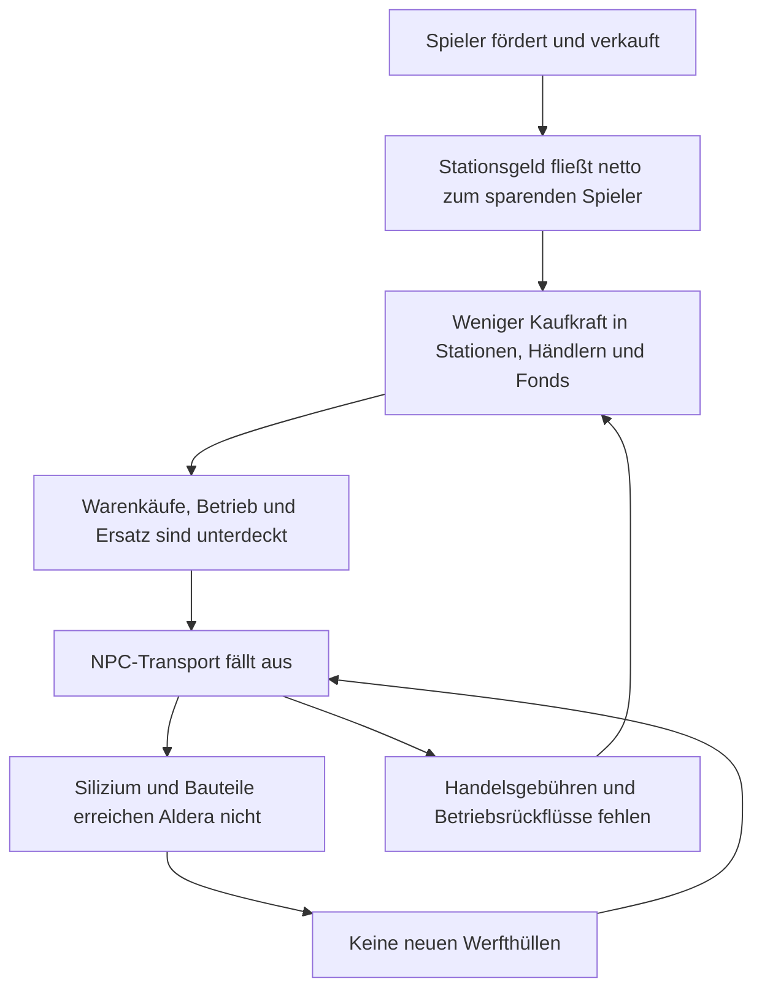
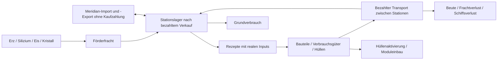

# Aphros Void – Architekturprüfung einer wiederaufbaufähigen Wirtschaft

**30. Oktober 2026 · [ANALYSE/OPTION] · docs-only-Draft auf `main`.** Verbindliche Planung: [ROADMAP.md](ROADMAP.md). Auftrag: unbegrenztes Sparen des Spielers, mögliche NPC-Insolvenz und Übernahme wirtschaftlicher Aufgaben; reale Ressourcen und Zahlungen, keine kostenlosen Rettungsschiffe, unbegrenzten Subventionen oder versteckten Geldquellen. Ein deterministischer Core, keine neue Laufzeitabhängigkeit; normale Flüge bleiben treibstofffrei. Diese Ziele sind **[BESCHLOSSEN]**, die folgenden Mechaniken sind **nicht freigegebene Optionen**. Dieser Bericht implementiert keine Regeln.

## 1. Empfehlung und Entscheidungsgrenze

**[OPTION] C als Bilanzrahmen, B als Akteursmodell, gezielte Teile von A als vorhandene Ausführung weiterverwenden.** Zuerst muss die Projektleitung die monetäre Grenze entscheiden: Eine endliche feste Geldmenge kann beliebig wachsende, dauerhaft gehaltene Spieler-Nettoersparnisse und eine positive NPC-Mindestliquidität nicht gleichzeitig garantieren. Neue Konzernnamen, Kredite aus endlichen Kassen oder Fonds-Pools ändern diese Identität nicht. Der aktuelle Core hat bereits Geldquellen und Senken; er ist kein streng geschlossenes Festgeldmodell.

Die Empfehlung bedeutet: reale Konten und Leistungen vollständig erklären; bei Scheitern vorhandene Vermögenswerte und Aufgaben gegen Zahlung übertragen; einen Markteintritt nur mit belegtem Kapital, realem Schiff, erstem Warenkauf und zahlungsfähigem Absatz zulassen. Fonds-/Routenverbesserungen können diese Abläufe bedienen, ersetzen aber weder Finanzierung noch Material. **Keine der vier Einzelvarianten aus #34 und keine pauschale Spielerabgabe aus #33 als fertige Lösung übernehmen.**

Eine zusätzliche explizite Geldquelle wäre eine Produktentscheidung, keine durch diesen Bericht erteilte Erlaubnis. Falls jegliche weitere Nettoemission ausgeschlossen wird, bleibt nur ein bedingtes Robustheitsziel innerhalb der verbleibenden NPC-Liquidität; uneingeschränkter Wiederaufbau bei jeder Spielerakkumulation wäre dann nicht erfüllbar. Auch mit Geldquelle ist Wiederaufbau nach vollständiger Vernichtung aller erreichbaren Transport-/Produktionsmittel nicht automatisch möglich.

## 2. Verifizierte Basis, PR-Stack und CI

Gelesen: `AGENTS.md`, Roadmap, Projektstatus, v12-Versorgungsbericht, Berichte und relevante Werkzeuge/Messdaten aus #32–#34, Daten-/Core-Module, Save/Load, Audits und Workflows. `main` wurde am 30.10.2026 über Git und GitHub geprüft: [`ed94b8914e4ad2ad0c7980e9f3d84f6d549ef22f`](https://github.com/tobiasfranziskus/Check/commit/ed94b8914e4ad2ad0c7980e9f3d84f6d549ef22f), letzter Produktmerge [#30](https://github.com/tobiasfranziskus/Check/pull/30), v0.12.3, Regeln 12, Schema 8. Keine vorhandenen Nutzeränderungen beim Arbeitsbeginn. Der Architekturbranch beginnt direkt dort, übernimmt keine Analysewerkzeuge oder Workflows aus dem Stack.

| Nachweis | Geprüfte Basis → Head, Status | Aussage der bestehenden Untersuchungen |
| --- | --- | --- |
| [#32](https://github.com/tobiasfranziskus/Check/pull/32) | `ed94b891` → `8cd87134c3c5869319455b3670e92f3e42133027`, offen/Draft, nicht gemergt | 13 inaktive Jahreswelten technisch stabil; drei aktive Jahresfälle kollabieren. Seed 42 mit nur Start-Miner genügt als Gegenbeispiel. |
| [#33](https://github.com/tobiasfranziskus/Check/pull/33) | #32 → `4c55d4b8ebf5e14f818597815d1a9f3e004ed5d8`, offen/Draft, nicht gemergt | Aufnahme von `player` in den vorhandenen Überschussfilter verhindert vier Startkollapse; einzelne Miner-Kasse maximal 7.056 ISK, gleicher Stationskauf scheitert. Spätes Einschalten heilt den Kollaps nicht dauerhaft. |
| [#34](https://github.com/tobiasfranziskus/Check/pull/34) | #33 → `6855d76bb374dd777a1b7e30ea52c9a6eca36399`, offen/Draft, nicht gemergt | Vier Kollapsfundamente, je Kontrolle + vier isolierte Varianten: technisch korrekt, wirtschaftlich 0/16 Wiederanläufe. Kein Spielerfilter übernommen, keine Kombination getestet. |

Die CI-Läufe wurden **jetzt aus GitHub gelesen**, die Langzeitversuche **hier nicht erneut ausgeführt**: #32 [Regression](https://github.com/tobiasfranziskus/Check/actions/runs/41067401530) / [Langzeit](https://github.com/tobiasfranziskus/Check/actions/runs/41067401643), #33 [Regression](https://github.com/tobiasfranziskus/Check/actions/runs/41076425570) / [Rückfluss](https://github.com/tobiasfranziskus/Check/actions/runs/41076425687), #34 [Regression](https://github.com/tobiasfranziskus/Check/actions/runs/41083152545) / [Wiederanlauf](https://github.com/tobiasfranziskus/Check/actions/runs/41083152586): jeweils abgeschlossen/erfolgreich. Im Wiederanlauf wurden zusätzlich alle sechs erfolgreichen Jobs einschließlich Diagnose und Vollständigkeit geprüft. Technischer CI-Erfolg hebt den negativen Wirtschaftsentscheid nicht auf.

Der [Integrationslauf von #30](https://github.com/tobiasfranziskus/Check/actions/runs/41036228202) hat fünf erfolgreiche Jobs und einen bedingt übersprungenen historischen Geografie-Job. **Unter Regel 12 führt der v10-Job nur seine Überspringen-Verzweigung aus; er ist kein neuer v10-Nachweis.** Aktueller `main` filtert CI auf `index.html`, `tests/**` und die Workflowdatei. Der zusätzliche `tools/**`-Filter aus #32 ist nur Draft. Ein Markdown-PR startet diese CI daher nicht.

Pinned Diagnoseberichte: [Jahreswirtschaft an `8cd8713`](https://github.com/tobiasfranziskus/Check/blob/8cd87134c3c5869319455b3670e92f3e42133027/docs/TEST_WIRTSCHAFT_LANGZEIT_V12.md), [Spieler-Rückfluss an `4c55d4b`](https://github.com/tobiasfranziskus/Check/blob/4c55d4b8ebf5e14f818597815d1a9f3e004ed5d8/docs/TEST_SPIELER_RUECKFLUSS_V12.md), [Wiederanlauf an `6855d76`](https://github.com/tobiasfranziskus/Check/blob/6855d76bb374dd777a1b7e30ea52c9a6eca36399/docs/TEST_NPC_WIEDERANLAUF_V12.md). Die Links zeigen bewusst außerhalb dieses docs-only-Branches liegende Belege.

## 3. Ursachenmodell: drei gekoppelte Blockaden

**Belegte Ursachen:** Förderung erzeugt Erz, dessen Verkauf vorhandenes Stationsgeld zum Spieler überträgt. Gebühren und ziviler Betrieb geben einen Teil zurück. `npcAusgaben()` erfasst `trader`/`miner` oberhalb 6.000 ISK, aber keinen `player`. In #32 fällt mit einem gültigen `shipMine`-Befehl die NPC-Handelsflotte aus; in #33 verhindert genau dieser zusätzliche Filtereintrag den Startkollaps in vier Fällen. Das stützt den Liquiditätspfad. Ein Stationskauf oder Jagdbetrieb ist dafür nicht notwendig. Dies beweist weder Häufigkeiten über alle Seeds noch die Eignung einer Spielerabgabe.

**Belegte Wiederanlaufblockaden:** `zuschuss()` nutzt ausschließlich den Werftsystem-Fonds und nur vollständige Deckung. `fonds()` überweist an Stationskassen, nicht bedarfsgerecht zwischen Zuschussfonds; die ärmste Station muss nicht Aldera sein. Beim vollständig leeren Konzern finanziert `ersatzkauf()` nur Hülle + Gebühr, ohne nachträgliches Waren-/Betriebskapital. #34 bezahlt mit dem Fonds-Pool zweimal je einen Frachter für 750 + 30 ISK; Cash danach null, nie Warenhandel, Verlust nach 81 bzw. sieben Stunden. Alle vier Varianten lassen beide Flotten bis Tag 365 ausfallen.

**Belegter Materialzustand:** Aldera hat an Tag 90 je Fall 193/194 Material, null Bauteile, null Silizium. Meridian hält 91 Bauteile und 100 Silizium, Dravos/Nadir je 65 Silizium. Die Frachterlinie benötigt acht Bauteile; eine Bauteileinheit benötigt zwei Material und ein Silizium. Globaler Warenbestand ist also kein lokaler Produktionsinput. Nach dem ersten Pool-Ersatz entstehen während 275 Folgetagen weder neue Aldera-Bauteile noch Frachter.

**Symptome:** leere NPC-Flotten, volle/festgefahrene Miner, ausbleibender Handel, stillstehende Linien und steigende Mangelstunden. Die Zunahme 90→365 beträgt in jedem Kontrollfall 118.800 = 275 × 24 × 18 fehlende Stations-/Warenstunden. Korrekte Audits und begrenzte Preise können gleichzeitig mit vollständigem Leistungsausfall bestehen.

**Nicht belegt:** dass Materialknappheit allein einen sonst ausreichend finanzierten Händler scheitern lässt; dass Fonds-Pool plus 250 ISK Reserve genügt; dass ein neuer Akteur allein stabilisiert; dass eine bestimmte Emissionsregel tragfähig ist. #34 kombiniert die Einzelvarianten nicht. Piraterie verursacht reale Verluste und verstärkt den Ersatzbedarf; sie ist durch diese Analysen nicht als alleinige Kollapsursache isoliert.

Weitere bestätigte Modellgrenzen: #32 weist 77,64 % unbezahlte Sicherheits-Sollkosten bei weiterarbeitenden Jägern nach. Meridian gleicht Warenbestände ohne Kaufzahlung aus; Piratenersatz kostet ISK, verbraucht aber keine gebaute Hülle. Bestandene Audits beweisen deshalb weder bezahlte Gesamtleistung noch eine vollständig ressourcengedeckte Wirtschaft.

## 4. Bestehende Geld- und Warenflüsse

Codeanker beziehen sich auf [`index.html` an der geprüften Basis](https://github.com/tobiasfranziskus/Check/blob/ed94b8914e4ad2ad0c7980e9f3d84f6d549ef22f/index.html). Die Funktionen bleiben unverändert.

| Vorgang / Core-Anker | Geldseite | Waren-/Leistungsseite und Grenze |
| --- | --- | --- |
| `m_core_state.createState()` | Startausstattung insgesamt 55.000 ISK je Welt | Initiallager und Anfangsflotten sind Anfangsbedingungen, keine laufend bezahlten Ersatzkäufe. |
| `m_core_foerderung.foerderung()`, `m_core_handel.handel()` | Station bezahlt Miner/Spieler aus ihrer Kasse | Förderung → Fracht → Stationslager; `ledger.mined`, kein gleichzeitiges Geld-Minting. |
| `handel()`, `gebuehr()` | Warenpreis Käufer → Verkäufer; Gebühr Schiffseigner → Systemfonds, bei besessener Station → Stationskasse | Reale Bestände/Fracht, Reserven, Platz und Kassen begrenzen Menge. Verkaufsstation muss Bruttowarenwert zahlen können. |
| `m_core_produktion.produktion()` | Kein eigener Lohn-/Maschinenkostenpfad | Rezeptinputs werden beim Start als `consumed`, Outputs nach Produktionsdauer als `produced` gebucht. Keine angeblich bereits bezahlten Fabriklöhne ergänzen. |
| `verbrauch()` | Kein Endkundenkauf oder Konsumbudget | Nahrung/Medikamente/Bauteile werden aus Stationen konsumiert; Mangel zählt fehlenden Verbrauch. |
| `betriebskosten()` | Zivile Zahlungen → Tätigkeits-/Zielsystemfonds; Sicherheitszahlung → `burned` | Nur `min(cash, Soll)` bezahlt; Unterdeckung ist bisher keine gespeicherte Schuld. Kein Treibstoffverbrauch. |
| `npcAusgaben()`, `fonds()` | NPC-Überschüsse → Fonds der ärmsten Station; lokal Fonds → Station bis 2.500; Fondsüberschuss über 1.500 → ärmste Station | Reine Transfers. Lokale Auffüllung überspringt besessene Stationen; globale Verteilung hat diesen Eigentümerfilter nicht. |
| `dividende()` | Eigene Station → Spieler oberhalb 3.000 ISK | Stationskonto und Konzernkonto sind getrennt; Ausschüttung nach Fondsverteilung kann Geld erneut binden. |
| `zuschuss()`, `ersatzkauf()` | Werftfonds → leerer Owner; Owner → Werft und Gebührenempfänger | Vorhandene Hülle wird gekauft und bei Aktivierung im Warenledger verbraucht. Sollflotte ist feste Ersatzliste, kein Markt-/Insolvenzmodell. |
| `stationBuy` | Spielerpreis `2 × Stationscash + 3000` → `burned` | Eigentumstitel wechselt; Stationscash bleibt bestehen. Kein Verkäufer erhält den Kaufpreis. 8.000 ISK ist ein gemessener Preis, kein allgemeiner Festpreis. |
| `patrouille()`, `ueberfall()` | Kopfgeld → Empfängerkasse und `minted`, ohne belasteten Zahler | Belegter Abschuss als Auslöser; Quelle hängt von Kampf ab und speist nicht gezielt zivile Wiederaufnahme. |
| `zerstoeren()`, `entfernen()` | Beuteverkauf Meridian → Piraten, sonst kein automatischer ISK-Verlust | Fracht teilweise direkt ins Meridian-Lager, ohne simulierten Beutetransport; Rest als Verbrauch/Verlust, aktives Schiff entfernt. Kein Wrack-/Bergungsbestand. |
| `piratenErsatz()` | Piraten → Meridian | Neues Piratenschiff ohne Rezept-/Hüllenabgang: bezahlt, aber nicht materialgedeckt. |
| `aussenhandel()` | Keine Außenkasse und keine Zahlung | Meridian: stündlich `floor((Ziel − Bestand)/10)`, im Import-/Exportledger erfasst. Offene Warenquelle/-senke, kein finanzierter Außenhandel. |

Bestehende monetäre Identität: **Σ Owner-Cash = `initialSupply + minted − burned`**. Interne Transfers verändern diese Summe nicht. Warenidentität je Ware: Lager + Fracht = initial + mined + produced + imported − consumed − exported. Aktive Hüllen und eingebaute Module sind bereits als verbrauchte Waren behandelt; ein späterer Besitzerwechsel darf sie nicht nochmals konsumieren oder neu erzeugen. Marktwertänderung ist weder Geldschöpfung noch Warenproduktion.

**Codeprüfung zusätzlich zu den Diagnoseberichten:** `bestesPaar()` verlangt positive Marge nach Handelsgebühren, berücksichtigt aber keine Betriebskosten, Hüllenabschreibung oder Verlustwahrscheinlichkeit. `betriebskosten()` überspringt Auftrag `halten`; `shipMove` ändert den Auftrag nicht. Ein manuell bewegtes gehaltenes Schiff ist deshalb kein belastbarer Nachweis bezahlter Logistik. Diese vorhandenen Grenzen müssen in späteren Versuchen gemessen und gegebenenfalls ausdrücklich geändert werden; hier wurde kein kostenloser Transportweg als Wiederaufbau unterstellt.

## 5. Geldmenge und Mindestliquidität

### 5.1 Feste Geldmenge bei unbegrenztem Sparen

Für eine hypothetisch feste Gesamtgeldmenge M sei P das dauerhaft gehaltene Spieler-Cash, N das übrige Cash und L der positive, tatsächlich verfügbare Mindestbedarf eines NPC-Zyklus. Dann gilt P + N = M und für dessen Finanzierung N ≥ L, also **P ≤ M − L**. Wenn die tatsächliche Nettoakkumulation diese Grenze überschreitet, fehlt die Deckung; räumliche Bindung kann einen Zyklus schon früher blockieren. Geldumlauf erhöht mögliche Umsätze, schafft aber keinen fehlenden Kassenbestand. Geringere Preise helfen nur begrenzt, solange ganzzahlige positive Preise/Kosten und reale Kapazitäten bestehen.

Eine unbegrenzte Wallet ohne fortgesetzte Nettozuflüsse erzwingt nicht von selbst einen Kollaps. Der Widerspruch entsteht aus **beliebig großer tatsächlicher Nettoakkumulation** bei endlicher M und gleichzeitig garantiert positivem N. Freiwilliger Spielerkonsum kann Umlauf zurückbringen, darf aber keine Voraussetzung für die Funktionsfähigkeit der NPC-Welt sein. Depot-/Investmentkonten lösen dies nur, wenn das Spielervermögen dann eine riskante Forderung statt jederzeit zusätzlich auszahlbarem Cash ist; das wäre eine eigene Produktentscheidung.

Im echten v12-Modell ist M variabel: Kopfgeldschöpfung minus Sicherheits- und Stationskaufsenken. #32 misst in der inaktiven Welt nach einem Jahr meist 50.000–50.240 statt initial 55.000 ISK je Welt. Die vorhandenen Quellen sind also **kein nachgewiesener Ausgleich beliebiger Spielerersparnis**. Für den NPC-Sektor muss getrennt gelten:

`ΔN = Quellen_N − Senken_N + Nettozahlung_Spieler→NPC − Nettozahlung_NPC→Spieler`.

Ein dauerhafter positiver Nettoabfluss braucht einen entsprechend dauerhaften Gegenfluss oder eine explizite Nettoquelle. Die Ausgabe vorhandener Fonds-/Investorenreserven verschiebt den Erschöpfungszeitpunkt. Ein reiner Geldmengen-Summen-Audit genügt nicht: die verfügbaren Mittel müssen die konkreten Zahler erreichen.

### 5.2 Vollständiger Handelszyklus statt Hüllenkauf

Für ein festgelegtes Befehls-/Zahlungsband ist das exakte Anfangs-Cashminimum der **größte kumulierte Zahlungsfehlbetrag** bis einschließlich Rückkehr und Vorbereitung des Folgezyklus:

`K_min = max_t(Σ Auszahlungen[0..t] − Σ sichere Einzahlungen[0..t], 0)`.

Auszahlungen umfassen reale Hülle/gebrauchten Schiffskauf bzw. Leasingzahlung, beide Handelsgebühren, Warenkauf, Betrieb während Leeranreise/Warten/Transport sowie vereinbarte Schulddienste. Einzahlungen zählen erst beim tatsächlichen Verkauf, nicht bei einem Preisangebot oder nominalem Lagerwert. Wenn Betrieb noch nach dem Verkauf abgerechnet wird, muss dieser offene Betrag im nächsten Kassenfenster verfügbar bleiben. Ein Sicherheits-/Verlustersatzpuffer kommt für Dauerbetrieb zusätzlich hinzu; seine Höhe ist nicht untersucht. Bei fortbestehendem Schiff wird sein Anschaffungspreis im Folgezyklus nicht erneut ausgezahlt, muss langfristig aber durch Überschüsse/Finanzierung ersetzbar sein.

Für den ersten Kauf gilt mindestens **Hülle + Kaufgebühr + erste Ware + deren Kaufgebühr + Betrieb bis zum ersten Erlös**. Zusätzlich müssen Verkäuferbestand oberhalb Reserve, Transportkapazität, Route und Käufer-Bruttoliquidität/Platz gleichzeitig passen. Mittel anderer Owner dürfen nicht doppelt als dieselbe Reserve verplant werden. `ersatzRuecklage = 250` ist weder eine aus diesen Bedingungen abgeleitete Handelsfinanzierung noch ein Beweis ihrer Deckung.

**Neue statische Angebotsrechnung, kein neuer Simulations- oder Erfolgstest:** Auf dem gespeicherten Miner/42-Tag-90-Bestand aus [#34-Messdaten](https://github.com/tobiasfranziskus/Check/blob/6855d76bb374dd777a1b7e30ea52c9a6eca36399/docs/data/npc-wiederanlauf-v12.json) ergeben die unveränderten Core-Preis-/Gebühren-/Routenfunktionen für acht Meridian-Bauteile: 104 ISK je Stück, 832 ISK Warenkauf, dort null Gebühr; Aldera-Angebot 135 je Stück, Bruttoerlös 1.080, Verkaufsgebühr 43, Netto 1.037. Die unveränderte Kasse 1.524 könnte zu diesem Zeitpunkt elf Stück aufnehmen. Hin- und Rückweg Aldera–Cyris–Meridian: je 55 Minuten-Ticks. Module bleiben leer, wie im ausschließlich fördernden Befehlsband.

Damit sind **780 + 832 = 1.612 ISK bereits vor Betrieb** nötig, sofern eine neue Hülle gekauft und diese Ladung aus eigener Kasse vorfinanziert werden soll. Die 205 ISK reine Handelsmarge sind kein Nettogewinn: 110 angesetzte Arbeitsminuten eines Frachters entsprechen bei 250 ISK/Stunde ungefähr 458 ISK Betrieb, mit tatsächlicher Abrechnung nach Arbeitsminuten und Stundenfenstern. Diese kleine Versorgungsladung trägt eine solche Rundreise folglich bei eingefrorenen Angeboten nicht selbst. Größere Ladung, anderer Startort, andere Route oder ein **zahlender** Transportauftrag wären getrennt zu prüfen. Preise, Käufercash und Waren können sich während der Reise ändern; die Rechnung reserviert nichts, führt keine Transaktion aus und beweist keinen Wiederanlauf. Sie zeigt, warum selbst ein bezahlter Frachter mit 250 Rest-ISK kein vollständiger Geschäftsplan ist.

## 6. Architekturvergleich

### A – Vorhandene Fonds, Reserven und Ersatzwege stabilisieren

**[OPTION]** `fonds()`, `zuschuss()`, `ersatzkauf()` und Routenbewertung gezielt nutzen: vollständiges Zyklusbudget statt nur Hülle prüfen; Werftmaterial und zahlungsfähigen Zielmarkt berücksichtigen; mehrere Investitionen gegen denselben Fonds atomar disponieren. Eigentümerfilter und Ausschüttungsreihenfolge gemeinsam prüfen. Keine bloße Erhöhung der 6.000-ISK-NPC-Grenze als Mittel gegen Spielerakkumulation.

Vorteil: kleinster Eingriff in den heutigen Core; Preis-, Handels-, Produktions-, Routen- und Auditfunktionen bleiben zentral. Nachteil: feste Sollflotten restaurieren bestimmte Owner, erlauben noch keine Insolvenz oder Aufgabenübernahme. #34 belegt das Scheitern vier einzelner Reparaturen, nicht aller denkbaren A-Kombinationen. Selbst eine erfolgreiche Kombination erschließt nur endliches vorhandenes Geld und Material. **A allein kann die monetäre Langfristbedingung bei fortgesetztem Sparen nicht garantieren.**

### B – Agenten mit Insolvenz und Markteintritt

**[OPTION]** Die existierenden `owners`, `ships.owner`, `stations.eigentum`, Aufträge und Konten um einen kleinen Lebenszyklus ergänzen; keine zweite KI-/Wirtschaftswelt. Wirtschaftliche Aufgabe und Gesellschafts-ID trennen: bestehende solvente Händler dürfen Lücken bedienen, neue Gesellschaften benötigen einen tatsächlich zahlenden Investor und reale Assets. Eine positive Spread-Meldung reicht nicht, weil Betrieb, Risiko, Endabnehmer und Vorfinanzierung dazugehören.

Startkapitalquellen ohne neue ISK: Beteiligung aus frei verfügbarem Cash solventer NPCs, ausdrücklich zulässige Investition eines Fonds oder freiwillige Spielerbeteiligung; alternativ ein gedeckter Kredit aus tatsächlich belasteter Geberkasse. Die Gesellschaft beginnt mit null und erhält exakt den abgebuchten Betrag. Investor hält dafür einen Beteiligungstitel oder eine Forderung, **kein zweites identisches Cashguthaben**. Verlust muss Investor/Gläubiger treffen können. Stationen dürfen nicht ungeprüft ihr eigenes Einkaufsbudget investieren. Keiner dieser Investitions-/Kreditpfade besteht heute bereits als allgemeine Mechanik.

Schiffe: vorhandenes aktives Schiff aus Insolvenzmasse gegen Zahlung übernehmen; vorhandene Werfthülle kaufen/aktivieren; erst danach bezahlter Neubau mit Rezeptinputs. Leasing ist nur bei realem Eigentümer, Schiff und Einnahmen ein Transfermodell, kein Ersatzspawn. Ein neues Namensschild ohne Käuferliquidität und Schiff erzeugt kein Angebot. Endliche Kapitalgeber erschöpfen sich bei dauerhaftem Nettoabfluss ebenfalls. **B ermöglicht Erneuerung einzelner Akteure, löst allein aber nicht das Geldmengenproblem.**

### C – Bilanzrahmen mit ausdrücklich definierten Quellen und Senken

**[OPTION]** Vorhandene Identität und Konten weiterverwenden, jeden Vorgang als Transfer, Warenumwandlung, Geldquelle oder Geldsenke ausweisen. Sollkosten, Istzahlung, Rückstand und Leistungsfolge separat behandeln. C ist zunächst Mess-/Abrechnungsdisziplin, keine automatische Erlaubnis zur Geldschöpfung und kein zusätzlicher Simulationskern.

| Möglicher Pfad | Was bilanziert werden müsste | Grenze / offene Entscheidung |
| --- | --- | --- |
| Bestehende Kopfgelder / Sicherheitskosten | Emission je belegtem Abschuss, Sicherheits-Istzahlung und Leistung; keine Sollkosten als fiktiver Abfluss | Bereits reale Quelle/Senke im Code, aber konfliktabhängig und kein ziviler Erholungsnachweis. Erhöhte Kopfgelder können Abschuss-/Piratenfarming belohnen. |
| Bestehende Fonds, Investoren, Konsumbudgets aus endlichem Cash | Geberabbuchung, Empfängerzugang, Ware/Leistung; Rückfluss an tatsächlichen Investor | Transfers, keine neue Geldquelle; können unbeschränktes Netto-Sparen nicht unbegrenzt finanzieren. Ein neu benanntes Außenkonto mit endlicher Kasse ändert das nicht. |
| Ausdrücklich beschlossene, regelgebundene Emission gegen reale Endleistung | Benannter Emittent, sichtbare Emissionsbuchung/Verbindlichkeit, dokumentierter Auslöser, Menge/Preis/Berechtigung, tatsächliche Lieferung und Verbrauch; separates Gesamt- und Sektoraudit | Denkbar an vorhandenem Grundverbrauch oder Außenabsatz anzuknüpfen. Kein Verlustausgleich eines ausgewählten Konzerns; Volumen je Zeitraum und Leistung begrenzen, keine Reset-Kasse. Höhe, Missbrauchsschutz, Nachfrage und Rücknahme **unentschieden und ungetestet**. |
| Kredit | Bei Cashkredit Gebercash minus/Schuldnercash plus sowie Forderung/Verbindlichkeit; Tilgung umgekehrt, Ausfallverlust beim Geber | Cashkredit verteilt M nur um. Kreditgeldschöpfung würde das Geldmodell erweitern und braucht zusätzliche Bilanzregeln; bloßes negatives Cash oder ewige Prolongation wäre versteckte Finanzierung. Zunächst nicht empfohlen. |
| Bezahlter Außenhandel statt heutiger Meridian-Anpassung | Realer Außenkäufer/-verkäufer, Geldquelle oder endliches Budget, reale Export-/Importmengen, Transit und Leistung | Ein unendliches Außenbudget ist eine explizite Quelle, keine geschlossene Geldwirtschaft. Außenmaterial zum kostenlosen Erhalt des letzten Schiffs widerspräche dem Ressourcenauftrag. |

Für dauerhafte unbegrenzte Nettoakkumulation müsste eine zulässige Quelle über die Lebenszeit ebenfalls ohne feste Gesamtsumme funktionieren können. **Begrenzung pro Tick/Leistung ist keine endliche Lebenszeitgeldmenge.** Dies darf nicht als „nur Fonds“ oder versteckte Subvention verpackt werden. Eine mögliche Emission gegen realen Endverbrauch ist ein monetärer Modellwechsel; Produktion, Absatz oder die Rettung eines bestimmten Unternehmens werden dadurch nicht garantiert. Kein Betrag und kein neues Konto wird hier beschlossen. Gebühren für reale Leistungen bleiben möglich; eine erzwungene Vermögensabschöpfung widerspräche dem Sparziel.

### Bewertung der drei Ansätze

Qualitative Architekturabwägung, **keine gemessenen Vorher-/Nachher-Werte**:

| Kriterium | A | B | C |
| --- | --- | --- | --- |
| Robustheit / Wiederanlauf | Lokale Engpässe behandelbar; finite Ressourcen und starre Owner | Ausfall/Übernahme darstellbar; benötigt Kapital und Assets | Geldentzug erklärbar; dauerhaft nur mit geeignetem beschlossenen Quellenmodell, keine Logistiklösung allein |
| Spielerfreiheit / langfristige Investition | Ohne Spielerabgabe sparfreundlich, aber Umlaufproblem bleibt | Freiwillige Investition möglich, Sparen darf weitergehen | Sparfreiheit mit expliziter Sektorfinanzierung vereinbar; keine Walletobergrenze erforderlich |
| Geld-/Warenerhaltung | Bestehende Audits gut nutzbar; Materialausnahmen bleiben | Eigentumswechsel und Forderungen zusätzlich auditieren | Vollständige Flussklassifikation; deklarierte Quellen/Senken statt behaupteter fixer Menge |
| Aufwand / Wartung | Klein bis mittel | Mittel bis hoch: Lebenszyklus, Assets, Finanzierung, IDs | Messrahmen klein; neue Quelle/Endnachfrage mittel, Bankmodell hoch und vermeidbar |
| Determinismus / Saves | Geringerer Strukturbedarf, geänderte Regeln dennoch versionieren | Neue gespeicherte Zustände, stabile Auswahl, Migration nötig | Quellenreihenfolge/Zähler speichern; Kredit erhöht Komplexität; gleicher Core bleibt möglich |
| Fehlanreize / Subventionen | Wiederholte Zuschüsse an selben Owner, Reserveaushöhlung | Insolvenz-/Neugründungsfarming, Assetverschiebung, unverzinste Scheinfinanzierung | Überproduktion gegen Emission, Kopfgeldfarming, Auslagerung unendlicher Budgets |
| Piraten / Bergung / Gehälter / Stationen | Sonderfälle wachsen schnell | Reale Eigentümer, Kauf/Verkauf und Gläubiger als brauchbare Grundlage | Gemeinsame Bilanzregeln für Beute, Löhne, Reparaturen und externe Leistung nötig |

## 7. Möglicher Insolvenz- und Wiederaufbaukreislauf

**[OPTION, vollständig unimplementiert]** Zahlungsunfähigkeit, fehlendes Schiff und Überschuldung unterscheiden. Heute werden Sollkosten teilweise nicht gezahlt, aber weder als Forderung noch Insolvenz gespeichert. Aus historischen Diagnose-Sollkosten darf nicht rückwirkend eine neue Schuld entstehen. Ein späteres Modell müsste Pflichtzahlungen, Frist, Stop-/Stundungsfolge und Haftung ausdrücklich beschließen; kein beliebiger Null-Cash-Tick als sofortige Liquidation.

1. **Unterdeckung feststellen:** Nach deterministisch definierter Abrechnung kann ein Konzern keine fälligen Zahlungen oder keinen tragfähigen nächsten Zyklus decken. Neue Verpflichtungen stoppen, Anlegerausschüttung sperren; freiwilliger Verkauf oder frisches, real gezahltes Kapital kann vor Liquidation möglich sein. Kein automatischer Kassenreset.
2. **Masse feststellen:** Cash, aktive Schiffe einschließlich Position/Fracht, Lagerrechte, Stationstitel und vertragliche Verpflichtungen erfassen. Aktive Hüllen nicht nochmals aus dem Warenledger verbrauchen. Ein insolventer Owner verschwindet nicht samt Geld aus der Summenbilanz.
3. **Aufträge und Gegenparteien abwickeln:** `queue` enthält Befehle, Schiffe tragen `auftrag`, Linien `rest`/bereits verbrauchte Inputs; es gibt heute kein allgemeines Handelsorderbuch. Alte Owner-Befehle nach Übertragung neu validieren/ablehnen, statt sie unter neuer Identität auszuführen. Bezahlte/unbezahlte neue Verträge gegebenenfalls erfüllen, übertragen oder stornieren und Escrow exakt rückzahlen. Kein Erlös für unerbrachte Leistung. Begonnene Produktion bleibt am Standort; Abbruch würde einen ausdrücklich bilanzierten Materialverlust/Rückbau benötigen.
4. **Reale Assets verkaufen:** Stabile Reihenfolge nach Masse/Asset-ID, zahlungsfähige Gebote und eindeutige Gleichstandsregel. Käufercash → Masse; Eigentumstitel → Käufer. Fracht und Schiffe behalten Ort/Zustand, keine Teleportation. Sicherer Übergabezeitpunkt für reisende Schiffe festlegen. Ohne Käufer bleiben Assets zunächst in der Masse und erneut anbietbar; sie werden weder verschenkt noch als Gratiswrack neu erzeugt.
5. **Cash verteilen und schließen:** Gesetzte Gläubigerrangfolge und belegte Forderungen bedienen, Restverlust beim Kapitalgeber, verbleibendes Cash nach beschlossener Restberechtigung auszahlen. Ohne eingeführte Schuldmechanik existieren heute keine solchen Ansprüche. Stationen behalten ihre eigenen Konten; deren Cash nicht zugleich als Konzernmasse und Stationsbudget zählen. `stationBuy` ist wegen seiner Geldvernichtung **kein** fertiger Insolvenzverkaufspfad. Erst bei vollständig abgewickelten Referenzen schließen; alte ID nicht als frisch finanzierte Gesellschaft recyceln.
6. **Aufgabe neu besetzen:** Bestehender solventer Akteur oder neue Gesellschaft kauft reale Assets und hält danach den aus Abschnitt 5 abgeleiteten Zyklusbedarf. Investorcash wird abgebucht; Forderungs-/Beteiligungstitel gespeichert. Kein Antritt ohne verfügbaren Lieferbestand, fahrfähiges Schiff und zahlungsfähigen Absatz. Wettbewerb kann den neuen Betreiber scheitern lassen; dieselbe Firma oder Sollflotte muss nicht zurückkehren.
7. **Leistung und Rückfluss prüfen:** Erster Warenkauf → echte Lieferung → bezahlter Verkauf → Betrieb → nächster selbst finanzierter Zyklus → Materialnachschub/Neubau. Fonds-/Investitionsrückfluss und Verluste getrennt zählen. Eine spätere Quelle aus C dürfte nur ihren beschlossenen Leistungs-/Emissionsregeln folgen, niemals „Konzern braucht Geld“ als unbeschränkten Auslöser nutzen.

### Werftnachschub nach Transportstillstand

Zuerst vorhandene Hülle bzw. solvent finanziertes vorhandenes Transportschiff identifizieren, **dann** Lieferung und Käuferbudget gemeinsam finanzieren. In den vier #34-Zuständen bestehen noch ein bis zwei Werftfrachter und neun NPC-Miner; der überlieferte Stillstand ist kein Zustand ohne jedes mögliche Transportasset. `shipTrade`/`shipMove` sind nicht auf Frachter beschränkt, autonomes `shipHandeln` dagegen schon. Die vorhandenen Miner sind fremdes Eigentum und möglicherweise beladen; ihre Verwendung verlangt Verkauf/Vertrag, freie Kapazität, reale Betriebskosten und einen neuen Aufgabenentscheid, den die aktuelle Miner-KI nicht trifft. Daraus folgt noch kein getesteter Rettungspfad.

Kurzfristig können vorhandene Meridian-Bauteile gekauft und nach Aldera geliefert werden; danach Silizium aus vorhandenen Lagern/Förderung zusammen mit realem Material für die Bauteillinie. **Nicht auf magische Priorität vertrauen:** Bauteile werden auch grundverbraucht, andere Linien konkurrieren um sie, Silizium erhält keinen Bonus allein wegen Produktionsbedarf. Eine mögliche reservierte Werftcharge oder ein zahlender Beschaffungsauftrag muss Eigentümer, Finanzierung, Auslösezeit und Opportunitätskosten haben. Eine bloße globale Verfügbarkeit oder höhere Knappheitspreise erzeugen keinen Transport.

Bei bezahlt gelieferten acht Bauteilen, freiem Ausgabelager und tatsächlicher Zuteilung an die Frachterlinie kann diese nach ihrem Start 36 Ticks produzieren. Acht einzeln lokal gefertigte Bauteile brauchen zusätzlich 16 Material und acht Silizium, je acht Produktionsticks pro Bauteil; konkurrierender Grundverbrauch kann mehr Liefermenge erfordern. Der Bericht garantiert weder diese Zuteilung noch eine Finanzierung. Die letzte Transportmöglichkeit darf für eine starke Erholungsgarantie nicht zugleich unwiederbringlich vernichtet oder vollständig unzugänglich sein. Wenn alle Hüllen, alle nutzbaren Transporter und erreichbaren Neubauinputs fehlen, ist **ohne eine ausdrücklich zugelassene reale Ersatzroute** kein Wiederaufbau möglich. Eine Geldüberweisung behebt diese physische Unmöglichkeit nicht.

### Regeln gegen Blockaden, ohne Erfolg einzelner Konzerne zu garantieren

**[OPTION]** Finanzierungszusagen für Hülle, Fracht und Betrieb zusammen auf Deckung prüfen; Geber-/Käuferreserven nicht doppelt verwenden; Auszahlungen erst gegen belegte Rechte/Leistung. Produktionsinput und Transportkapazität dürfen mit bezahlten Reservierungen gesichert werden. Ausschüttungen berücksichtigen bereits eingegangene Verpflichtungen. Insolvente Akteure geben Aufgaben/Assets frei; keine Pflicht zur dauerhaften Subvention derselben ID. Deterministische erneute Angebots-/Eintrittsprüfung verhindert, dass eine einmalige Fehlersituation dauerhaft unerreichbar bleibt.

Das ist eine **bedingte Erreichbarkeitsaussage**: Ein Zyklus braucht verfügbares Geld am richtigen Zahler, reale Inputs, Transport und eine wirtschaftlich zulässige Nachfrage. Diese Voraussetzungen müssen durch ausdrücklich beschlossene Regeln gesichert sein, wenn die Projektleitung eine starke Gesamtgarantie verlangt. Wiederholte garantierte Schiffsverluste, ausschließlicher Besitz aller kritischen Assets ohne Zugangsrecht oder endliche ausgeschöpfte Geldgeber lassen sich nicht durch Marktlogik wegdefinieren. Verlustbringende Routen werden nicht zu Gewinnen umetikettiert; ein realer Auftraggeber darf Transport bezahlen, muss die Leistung und deren Kosten selbst tragen.

## 8. Externe Vergleichsgrundlagen und Übertragungsgrenzen

**Externe Quellen, am 30.10.2026 über die Original-Repositories gelesen; keine Abhängigkeiten übernehmen.** Die allgemeine Websuche lieferte in dieser Sitzung Fehler, der direkte EVE-Seitenzugriff wurde vom Netzwerkproxy abgewiesen. Deshalb werden keine aktuellen EVE-/X4-Zahlen oder ungelesenen Spielregeln als Beleg verwendet. Die folgenden Primärquellen dokumentieren die tatsächlich verglichenen Implementierungen; die Übertragung auf Aphros Void ist jeweils eigene Architekturabwägung.

| Quelle | Etabliertes Konzept / geprüfte Dokumentation | Übertragung und Grenze |
| --- | --- | --- |
| Godley & Lavoie, *Monetary Economics* (2007), als SFC-Grundlage; überprüfbare Umsetzung: Brian Romanchuk, [SFC_models README](https://github.com/brianr747/SFC_models/blob/32f8869efccb5dbd3e18de3f33340ef436095372/README.rst), [`RegisterCashFlow` und Gegenbuchungen](https://github.com/brianr747/SFC_models/blob/32f8869efccb5dbd3e18de3f33340ef436095372/sfc_models/models.py) | Bestände und periodische Flüsse verbinden; die Umsetzung erzeugt zum Abfluss eines Sektors den Zufluss beim anderen und unterscheidet Einkommen von Finanzierung. README verweist ausdrücklich auf nachgebildete Godley-/Lavoie-Modelle. | Gegenparteien, Eigenkapital/Forderungen und Stock-Flow-Identitäten für vorhandene Owner übernehmen. Buchungskonsistenz beweist keine wirtschaftliche Stabilität; Gleichungslöser, Python und makroökonomische Marktgleichgewichte werden nicht übernommen. Das Buch wurde nicht neu vollständig gelesen. |
| Dawid, Gemkow, Harting, van der Hoog, Neugart, [Eurace@Unibi: Modell und Literatur](https://github.com/ETACE/eurace_unibi/blob/5a45850f86bc48693742e02011eff26dff7ea5cd/README.md), [Finanz-/Insolvenzfunktionen](https://github.com/ETACE/eurace_unibi/blob/5a45850f86bc48693742e02011eff26dff7ea5cd/Financial_Management/Firm_Financial_Management_Functions.c) | Agentenbasierte Firmen mit Zahlungsunfähigkeit/Überschuldung, Inaktivität, Gläubigerverlusten und gesonderter Reaktivierung; dokumentierte Funktionen `Firm_set_bankruptcy_illiquidity`, `Firm_set_bankruptcy_insolvency`, `Firm_bankruptcy_rescale_loans`, `Firm_reset_bankruptcy_flags`. | Illiquidität, Vermögen und Ausfallfolgen trennen; Finanzierung nachweisen. Dessen automatische Reaktivierung/Modellannahmen sind kein Nachweis real bezahlten Aphros-Markteintritts. Kein kompletter Banken-, Arbeitsmarkt- oder FLAME-Unterbau. |
| OpenTTD, [offizieller Wirtschafts-/Insolvenzcode](https://github.com/OpenTTD/OpenTTD/blob/d4702b4d1eb1e379fe9f4f261737b02b7fe0bd1a/src/economy.cpp), `CompanyCheckBankrupt`, `ChangeOwnershipOfCompanyItems` | Zeitlich gestufte Krise, Verkaufsangebot und schließlich Entfernung; Eigentumswechsel hat konkrete Assetfolgen. Der lokale Einzelspieler hat im betrachteten Pfad eine Ausnahme. | Vorwarnung, nachvollziehbare Assets und explizite Ausfallzustände sind übertragbar. Verkaufsfristen, Löschpfad und Spielerausnahme sind keine beschlossenen Aphros-Regeln; OpenTTD belegt hier keine geschlossene Geld-/Werftmaterialwirtschaft. |
| Endless Sky, [offizielle Kontenabrechnung](https://github.com/endless-sky/endless-sky/blob/abb41b23eb4accf207714003dc41ff640a2ce61a/source/Account.cpp), `Account::Step`, `PaySalaries` | Löhne/Wartung, tatsächliche Teilzahlung, fortgeführte Rückstände sowie Kreditfolgen werden getrennt erfasst. | Vorbild für Soll/Ist/Rückstand statt kostenlos weiterlaufender Leistung. Der gezeigte Spielerkontenpfad ist kein Beleg für mitgebuchte Empfängerkassen oder eine geschlossene NPC-Wirtschaft; genau diese Ergänzung müsste Aphros selbst leisten. |

Diese Quellen liefern Methoden und dokumentierte Gegenbeispiele, keine extern validierten Balancingwerte für Aphros. Annahmen dieses Vorschlags: rentable und erreichbare Aufgaben können existieren; solvente Investoren **können** verfügbares Cash anbieten; ein noch zu beschließender monetärer Pfad **könnte** dauerhaften Nettoentzug ausgleichen. Keine dieser Annahmen wurde hier als Langzeiterfolg simuliert.

## 9. Wiederverwendung, Determinismus und Speichergrenzen

| Vorhanden und wiederverwendbar | Erforderliche Änderung nur nach gesonderter Freigabe |
| --- | --- |
| `m_core_handel`: Preise, Gebühren, Reserven, Annahmekapazität, reale Käufe/Verkäufe | Firmen-/Assetkäufe brauchen echte Verkäufertransfers; `stationBuy` nicht dafür missbrauchen. Bezahlte Reservierung/Vertragsabwicklung existiert noch nicht. |
| `m_core_route`, `m_core_entscheidung`, Produktions-/Förderpfade | Betrieb und Wiederbeschaffung in Investitionsentscheidung einbeziehen; industrielle Versorgung/Aufgabenwechsel zusätzlich prüfen. |
| `owners`, Schiff-Owner/IDs, Stationseigentum, `sollflotte`, Konto-/Abgabestatistik | Lebenszyklus und reale Investoren; Sollflotten dürfen geschlossene Firmen nicht automatisch wiederbeleben. Allgemeine Konzern-/Stationsübertragung fehlt. |
| `ledger`, `initialSupply/minted/burned`, Core-Audit und Diagnosebeobachter aus den Drafts | Transaktionsgründe, Ist-/Sollkosten und gegebenenfalls Forderungsbilanz; aktive Assetbestände gesondert auditieren. Kein ungeprüftes Aufaddieren der drei Drafts. |
| `m_core_step`, gespeicherter RNG, sortierte IDs, kanonischer Save/Hash, Queue | Präzise Einfügestelle für Insolvenz/Eintritt und Quellen beschließen; alle Gleichstände/Abwicklungsschritte versionieren und speichern. |

Heutige Reihenfolge: Queue → Ankunft/Förderung/Handelsentscheidung/Reisearbeit/Produktion/Eskorte; stündlich Verbrauch/Betrieb/Außenhandel → Kampf/Piratenersatz/Schutzgeld → **Ersatzkauf → NPC-Abgabe → Fonds → Dividende**. Eine Schlussüberweisung finanziert erst einen späteren Ersatzversuch. Keine zukünftige Implementierung darf diese Ordnung beiläufig verändern, auf UI-Zeit warten oder Zufall außerhalb des gespeicherten RNG nutzen. Neue Firmen brauchen monotone, gespeicherte IDs und feste Gleichstandsregeln; Objekt-/Auktionsreihenfolge darf nicht von Browser oder asynchronen Aufrufen abhängen.

Dieser docs-only-Auftrag verändert weder Schema 8 noch Regeln 12. Spätere Regeländerungen benötigen eigene Regelversion; neue Zustandsstrukturen gegebenenfalls eine Schemaänderung mit Migration. Alte Saves zunächst mit leeren neuen Listen/Status „bestehend aktiv“ übernehmen, ohne zusätzliche Kassen, Hüllen oder rückwirkend konstruierte Schulden. Migration muss sämtliche bisherigen Bestände/RNG/Queue erhalten; zukünftige Verläufe dürfen sich nur gemäß offen benannter neuer Regeln ändern. Insolvenzmassen, Eigentumsrechte, Kapitalgeber, offene Verträge, gegebenenfalls Emissionszähler und nächste IDs müssen savebar sein. Die historische Ablehnung von Regeln 8–10 erlaubt keinen neuen allgemeinen Save-Reset. JSON-Zahlen-/Safe-Integer-Grenzen sind bei sehr großem Vermögen/Zählern separat zu behandeln; „unbegrenzt sparen“ ist kein Auftrag zu einem beiläufigen Zahlenformatwechsel.

## 10. Entscheidungen für die Projektleitung

Alle folgenden Punkte sind **offen**, keine neuen Produktbeschlüsse:

| Entscheidung | Empfehlung zur späteren Prüfung / bewusst akzeptierter Kompromiss |
| --- | --- |
| Geldregime | Explizit entscheiden, ob regelgebundene Nettoemission gegen reale Endleistung zulässig ist. Ohne sie und ohne erzwungenen Rückfluss nur bedingte Funktionsgarantie bei endlichem Umlauf versprechen. Keine pauschale Spielerabgabe. |
| Umfang der Gesamtgarantie | Wiederaufbau bei verfügbaren echten Assets und finanzierbarem Zyklus als Mindestziel; Umgang mit dem letzten Transport-/Werftzugang und vollständiger Vernichtung ausdrücklich bestimmen. Kein unsichtbarer Rettungsasset. |
| Firmenausfall und Eigentum | Zunächst Cashfinanzierung, aktive Assets und freiwilligen Verkauf/Liquidation; Ausfallfrist, Gläubigerrangfolge, unverkaufte Assets und reisende Schiffe festlegen. Keine sofortige Vollbank-/Schuldenökonomie. |
| Kapitalgeber / Reserven | Wer darf aus welchem frei verfügbaren Budget investieren? Fonds-/Stationskassen und zyklische Verpflichtungen schützen, Risiko beim Investor belassen; Spielerbeteiligung freiwillig. |
| Kosten / reale Gegenleistung | Was geschieht bei unbezahltem Betrieb? Fonds als Empfänger belegt noch keine reale Serviceproduktion. Sicherheitsfinanzierung, Endverbrauch, Meridian und materialfreier Piratenersatz separat an das Ressourcen-/Zahlungsziel angleichen. |
| Versorgung und Fortschritt | Bezahlte Beschaffung/Reservierung für kritische Produktionsinputs prüfen, keine Gewinnpflicht. Spieler darf Vermögen halten und planbare Investitionen ausführen; keine engen Sparfenster als Ersatz für Freiheit. |

## 11. Höchstens drei kleine, unabhängig prüfbare Folgepakete

**[OPTION]** Diese Pakete sind Vorschläge für eigene Aufträge, keine hier freigegebenen Implementierungen. Jedes bekommt eigenen Basiscommit, Umfang und Bericht; keine Zusammenlegung zu einem großen Wirtschaftspatch.

1. **Zyklus- und Sektorbilanz als Messauftrag.** Bestehende #32–#34-Beobachter gegen unveränderten Produktionskern verwenden, für die vier Kollapszustände konkreten maximalen Zahlungsfehlbetrag, Käuferbudget, Arbeitskosten und Materialerreichbarkeit ausweisen. Kapitalgeber nur benennen, nicht auffüllen. Ausgabe: reproduzierbare Engpassliste und ein vollständiges Kassen-/Warenflussprotokoll; keine Regeländerung, kein neuer Goldenwert. Unabhängig von einer gewählten Insolvenz- oder Emissionsregel prüfbar.
2. **Ein bezahlter Assetübergang als begrenzter Laborversuch.** Nach Auswahl von Ausfall-/Eigentumsregeln einen vorhandenen NPC-Transporter samt Fracht an einen aus realem Cash finanzierten Nachfolger übertragen. Ein Verkäufer, ein Käufer, ein Übergabezeitpunkt; zunächst keine neue Geldquelle und keine allgemeine Auktion. Ausgangsposition/Kapital/Schuldrechte vollständig angeben. Abnahme: exakte Geld-/Asseterhaltung und deterministischer Save/Load auch bei abgelehntem Kauf; langfristiger Wiederanlauf wird damit noch nicht behauptet. Bei fehlendem Budget muss der Versuch scheitern.
3. **Ein monetärer Pfad als isolierter Gegenversuch.** Erst nach Geldregimeentscheidung genau eine bestehende oder neu ausdrücklich zugelassene Quelle/Senke gegen unveränderte Kontrolle prüfen. Emission an reale belegte Leistung binden; Soll/Ist, Gesamtgeld, Sektorliquidität und Spielerersparnis ausweisen. Keine gleichzeitige Einführung von Insolvenz, Gehältern oder neuen Rezepten. Ausgabe: Wirkung und Fehlanreize, einschließlich ausgeschöpfter Nachfrage/Emissionsgrenzen und fehlender Assets; kein automatischer Kassenreset.

## 12. Reproduzierbare Abnahme späterer Experimente

Die folgenden Kriterien sind **vorgeschlagene Prüfanforderungen, nicht neue Testergebnisse**. Ein wirtschaftlicher Schwellenwert oder eine Maximalfrist muss vor dem Lauf festgelegt werden; erfolglose Fälle bleiben sichtbar. Keine Referenz allein durch Ausgabe des veränderten Cores ersetzen.

| Prüfachse | Reproduzierbarer Aufbau und Erfolg-/Fehlerkriterium |
| --- | --- |
| Kontrolle und Isolation | Produktbasis und Werkzeug-/Regelhash pinnen. Dieselben Seeds **7, 11, 1, 2, 65535, 42, 1234, 98765, 3, 99, 2024, 2025, 314159** für 90/180/365 Tage; vorhandene 13×90-v12-Goldenprofile zuerst unverändert reproduzieren. Nur deklarierte Eingriffe, keine geänderten Befehle zur Ergebnisrettung. |
| Spielerfreiheit | Unveränderte Bänder Miner/42, Handelsflotte/42, Station/1234, Jagd/98765 aus #32/#33; Sparguthaben nach jedem Tick, gleiche Submission-/Ausführungsresultate ausweisen. Keine Vermögensobergrenze, kein Zwangskauf, keine periodische Cashlöschung. Für neue Sparziele passende längere Bänder definieren; ein endlicher Jahreslauf beweist kein unendliches Sparen. |
| Wiederanlauf | Dieselben hashgeprüften Tag-90-Saves aus #34, Kontrolle und Eingriff; Messpunkte 91/100/120/180/270/365. Ersten realen Warenkauf, Lieferung, Verkauf, Betrieb, Folgezyklus und Werftmaterial samt Belegen verlangen. „Ein Ersatzschiff gekauft“ ist kein Erfolg. |
| Leistungsnachweis | Anzahl zusammenhängender Stunden mit aktiven Handelsaufgaben, tatsächlich bezahlte Kosten, echte Produktion und Versorgung gemeinsam ausweisen. Nachfolger zählen nach Aufgabe, unabhängig von alter ID; historische 3/2-Sollflotten zusätzlich als Vergleich berichten. Kein Wirtschaftserfolg, solange alle Transporte wieder enden oder alle 18 Verbrauchspaare dauerhaft fehlen. Dauer-/Erholungsgrenze vorab festlegen. |
| Kassen und Kapital | Stündlich Core-Audit und unabhängige Einzelkassen-Gegenbuchungen; kein negatives/unsicher ganzzahliges Cash, keine doppelt verfügbaren Investorreserven. `K_min` sowie Zielkäuferbudget am tatsächlichen Zahlungstermin prüfen. Eine absichtlich zu geringe Finanzierung muss reproduzierbar abgelehnt werden. |
| Ressourcen und Assets | Lager + Fracht + Warenledger prüfen; aktive Hüllen/Module, Standort und Eigentumswechsel zusätzlich zählen. Produktionsinput/-zeit, Frachtverlust und Bergung getrennt; keine neue Hülle ohne vorhandene Ware oder vollständig gebuchten Bau. Meridian-Import und Piratenersatz als bestehende Ausnahmen ausdrücklich weiter ausweisen. |
| Ausfall / Randfälle | Fehlendes Käufercash, fehlendes Schiff, kein Silizium, gleichzeitige Fondsansprüche, insolventer Investor, keine Auktionsgebote, letzte Hülle verloren, alle kritischen Assets beim Spieler. Entweder realer erlaubter Wiederaufbaupfad oder offen dokumentierte Nichterfüllbarkeit; niemals stilles Minting. |
| Emission / Fehlanreize | Jede Quelle und Senke mit Grund, Empfänger, Menge, Leistungsbeleg und gegebenenfalls Gegenbilanz. Emissionslimit pro Zeitraum und über die Laufzeit unterscheiden. Überproduktion ohne Nachfrage, Kreislaufverkauf derselben Ware, Insolvenz-/Kopfgeldfarming und Fonds→eigene Station→Dividende prüfen. |
| Determinismus / Save | Eigener unveränderter Replay jeder Variante, tägliche Hashes, kanonischer Vergleich an Messpunkten; Save/Load-Fortsetzung vor/nach Ausfall, Eigentumswechsel, Eintritt und Zahlung sowie mit wartender Queue. Jede relevante Version mit definierter Migration; Altzustände ohne neues Vermögen übernehmen, zukünftige/beschädigte Formate ablehnen. |
| Spätere Produktintegration | 48 bestehende Standardtests und erforderliche Referenz-/Langläufe wirklich ausführen; Fehler/Skip/Nichtausführung getrennt. Echte iPad-Safari-/Touch-/Speicher-/NAS-Abnahme bleibt eigenes Gate. Kein Produktmerge allein aufgrund grüner technischer Diagnose. |

**Tatsächlich in diesem Dokumentationsauftrag geprüft:** Node.js **22.23.4**, `node --test tests/*.test.mjs` erfolgreich (Sandboxausgabe: sechs bestandene Dateisuiten). Zusätzlich derselbe vorhandene Bestand mit `--experimental-test-isolation=none`: **48 Tests bestanden, 0 fehlgeschlagen, 0 übersprungen, 0 abgebrochen**. Die zusätzliche Ausgabe macht die Einzeltestzahl sichtbar; es sind keine 48 neu geschriebenen Tests. Statische Core-Lektüre und die ausdrücklich bezeichnete Angebotsrechnung wurden neu durchgeführt. Keine neue Jahres-/Wiederanlaufsimulation, keine neuen Wirtschaftsgoldenwerte, keine echte Safari-/NAS-Prüfung. CI der Analyse-PRs wurde gelesen, nicht hier neu erzeugt. `index.html` bleibt SHA-256 `5e842417c5b05e057ad26499659089060ac96ddda913e38922886b1c54ff3653`; Tests, Goldenwerte und Workflows bleiben unverändert. Kein Merge oder Deployment.
