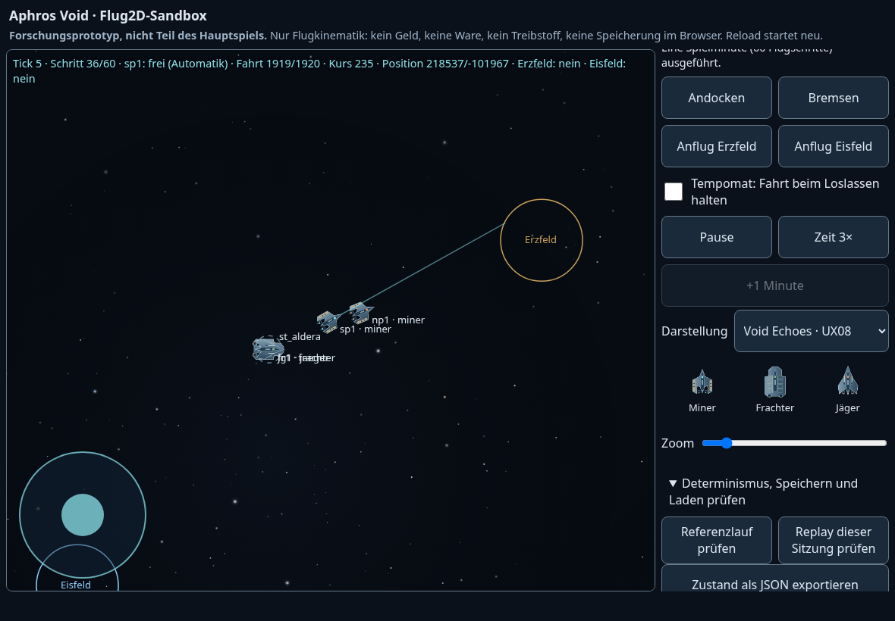

# G1 – Void-Echoes-Grafik auf F0

**[DRAFT · 10.11.2026 · [PR #292](https://github.com/tobiasfranziskus/Check/pull/292)]** Isolierte Grafik für `prototypes/flug2d/index.html`, nicht im Hauptspiel. Lokal statisch ausliefern (z. B. `python3 -m http.server 8000`) und `/prototypes/flug2d/` öffnen. „Darstellung“ schaltet zwischen UX08 und der bisherigen F0-Dreiecksgrafik. Fehlt das Grafikmodul, startet die Basisansicht weiterhin. Die Modelllegende zeigt alle drei Klassen auch am gemeinsamen Dockpunkt.

## Basis und Abhängigkeit

- Gestapelt auf [Draft #290](https://github.com/tobiasfranziskus/Check/pull/290), geprüfter Head `a12a3d00f216f066cd97178926ac3ad52119ecce`.
- Vor Beginn frisch abgerufen: `main 04124f2bca27dc33b54be30c07b6a7bbb7387e81`. `git rev-list --left-right --count origin/main...a12a3d00` ergibt **1 / 5**. Main enthält inzwischen den Spielstandschutz #289, der F0-Basis fehlt. Kein Überschreiben oder Rebase des fremden Branches. Vor späterer Main-Integration müssen F0 und Spielstandschutz zusammengeführt und erneut geprüft werden; Dokumentationskonflikte sind möglich.
- [Analyse #291](https://github.com/tobiasfranziskus/Check/pull/291), Head `3fca34e53a39ea8637cef698b1f6d00712e81cc8`, inklusive `VOID_HTML_REUSE_AUDIT.md` direkt gelesen. Dieser Dokumentationsbranch wird nicht zusätzlich in den F0-Stack gemergt.

## Direkt gelesene GitHub-Quellen

Quelle ist das private Repository **void-echoes**, Commit **`a8e2e36faf8257ac2cc47780d12ea9e8e1f58b9f`**. Keine hochgeladene HTML, keine Änderungen an void-echoes.

| Übernahme | Unveränderlicher Quellverweis | Anpassung |
| --- | --- | --- |
| Build-Reihenfolge | [manifest.json](https://github.com/tobiasfranziskus/void-echoes/blob/a8e2e36faf8257ac2cc47780d12ea9e8e1f58b9f/build/manifest.json) | 080 → 085 → 360 → 390; UX08 überschreibt ursprüngliche Sprites/Sky. |
| `GX_MODELS` | [390, Zeilen 3–15](https://github.com/tobiasfranziskus/void-echoes/blob/a8e2e36faf8257ac2cc47780d12ea9e8e1f58b9f/src/script/390-ux08-vektorgrafik.js#L3-L15) | Nur `miner`, `hauler`, `hunter`, `rookie` als Fallback; Körper, Rollen, Triebwerkspositionen und Modellskalierung übernommen. |
| `gxParts`, `gxCanvas`, `sgSprite` | [390, Zeilen 20–22](https://github.com/tobiasfranziskus/void-echoes/blob/a8e2e36faf8257ac2cc47780d12ea9e8e1f58b9f/src/script/390-ux08-vektorgrafik.js#L20-L22) | Expliziter Canvas-Kontext und lokale Maps statt globalem GX/SG; keine Schadens-/Weiß-Sprites oder SVG-Menüs. |
| `sgShip` | [390, Zeile 26](https://github.com/tobiasfranziskus/void-echoes/blob/a8e2e36faf8257ac2cc47780d12ea9e8e1f58b9f/src/script/390-ux08-vektorgrafik.js#L26) | Statische blaue Flammen an Modell-Triebwerken; F0-Geschwindigkeit entscheidet über Sichtbarkeit. Kurs direkt aus F0, keine `sgAngle`-Glättung, Warp, Treffer oder Legacy-Pilotenlogik. Darstellungsgröße 0,8 × Modellskalierung, unabhängig von Klassenphysik. |
| `sgStars`, `sgSkyInit`, Parallaxe | [390, Zeilen 28–30](https://github.com/tobiasfranziskus/void-echoes/blob/a8e2e36faf8257ac2cc47780d12ea9e8e1f58b9f/src/script/390-ux08-vektorgrafik.js#L28-L30) | Drei statische Kacheln, gleiche Sternverteilung/Farben/Nebel, Parallaxe 0,025/0,065/0,14. Keine Warpstreifen, Uhr oder Heading-Historie. |
| `sgRandom`, `sgPolygon`, Sky-Grundlage | [080](https://github.com/tobiasfranziskus/void-echoes/blob/a8e2e36faf8257ac2cc47780d12ea9e8e1f58b9f/src/script/080-ve08g-02-sprites.js) | Lokaler Xorshift mit rein dekorativem Seed `0x8e02cafe`; kein Import des Simulations-RNG. |
| HUD-/Cockpit-Sichtung | [085 draw/ui](https://github.com/tobiasfranziskus/void-echoes/blob/a8e2e36faf8257ac2cc47780d12ea9e8e1f58b9f/src/script/085-kern-zeichnen-hud.js), [360 cpRender](https://github.com/tobiasfranziskus/void-echoes/blob/a8e2e36faf8257ac2cc47780d12ea9e8e1f58b9f/src/script/360-ux05-cockpit.js) | Gelesen, nicht übernommen: zu stark an Legacy-Zustand bzw. nicht für diesen Auftrag nötig. F0-HUD bleibt. |

## Architektur und Ressourcen

`grafik.js` ist ein unabhängiges Vanilla-JS-Modul (Browser/Node). `adapter()` kopiert nur ID, Modell, interpolierte Position, Kurswinkel, vx/vy und Bewegungssichtbarkeit aus F0; keine geteilten Flugobjekte, Befehle oder Zustandsfelder. `projektion()` nutzt unverändert die F0-Kameraabbildung in CSS-Pixel. Die bestehende Sandbox bestimmt weiterhin alle Flugschritte und den Interpolationsanteil. Der Renderer besitzt keine eigene Uhr und keinen Core-Import.

`erstellen(context)` kapselt sämtliche Canvas-Caches. Modell und Farbton werden auf vier Modelle × drei feste Farben normalisiert: höchstens zwölf 128²-Sprites und zwölf Teilesätze. Drei 1536²-Sternkacheln entstehen einmalig; Resize/DPR-Wechsel erzeugt sie nicht erneut. Maximal 7.274.496 Cache-Pixel (ca. 27,75 MiB RGBA ohne Browser-/Pattern-Kopien); die statische Legende hat zusätzlich drei kleine Sprites ohne Sternkacheln. Das Hauptcanvas übernimmt den vorhandenen DPR-Deckel 2. `leeren()` gibt die Cache-Referenzen frei. Keine Partikel, Frame-Historien oder anwachsenden Schiffs-ID-Maps.

## Qualitätsnachweise

- Node22 v22.23.4: vier neue Grafiktests **4/4**, 0 Fehler/Skips. Klassen/Fallback, Koordinaten/Interpolation/Resize, tief eingefrorener Zustand, Cache-Freigabe und identische Kettenhashes mit Rendering zwischen jedem der 3.600 Flugschritte.
- Chromium-Touch **4/4**: 1180×820, 1024×768, 820×1180, 390×844; bestehende Mehrfinger-/Dock-/Replay-/JSON-Prüfungen plus UX08/Basis-Pixelvergleich, Rotation, 360 Renderframes pro Größe, unveränderter kanonischer Zustand. Cache konstant vier Sprites/Teilesätze plus drei Sternkacheln. Batchmittel ca. **0,54–2,49 ms/Frame** auf diesem Linux-Executor; keine iPad-Leistungszusage.
- Zusätzlicher Chromium-Speichertest (`node tests/flug2d-grafik-speicher.cjs`): **2.000 Frames**, **3,283 ms/Frame**; nach erzwungener GC JS-Heap 1.780.408 → 1.889.476 Bytes (ca. +107 KiB), Backing Storage 236.609 Bytes konstant, Cache und Core unverändert. Kurzer Einzelansicht-Test, keine allgemeine Leckfreiheit bewiesen. Zusätzlich bestanden: absichtlich blockiertes Grafikmodul → Basisansicht startet und kann weiterhin abdocken (`G1_MISSING_MODULE_FALLBACK_OK`).
- `node scripts/build-w5-singlefile.mjs --check`: **W5_SINGLEFILE_OK**, 312.912 Zeichen, 7 CSS/14 JS; `git diff` bestätigt unveränderten F0-Kern und Referenzlauf.
- WebKit lokal **nicht ausgeführt**: Browser fehlt (`webkit-2227/pw_run.sh`), Installationsversuch von Playwright-CDN durch Netzwerkregel mit **403 Domain forbidden** abgewiesen. Erweiterter bestehender WebKit-CI-Test ist vorbereitet; kein grüner Lauf ohne Abschluss behauptet.
- Vollständiger Lauf mit Node22 v22.23.4: `node --test tests/*.test.mjs` **221/221 bestanden**, 0 Fehler, 0 Skips, 0 abgebrochen; ca. 375 s. Darin alle elf unveränderten F0-Kerntests und vier neue Grafiktests. Die beiden vorhandenen F0-Workflows prüfen auch die neuen `tests/flug2d-*`-Dateien. Browserprüfungen vergleichen reale Canvas-Ausgaben zwischen UX08/Basis, schalten zurück, rendern 360-mal je Größe und drehen denselben Viewport bei pausiertem Core. Caches und kanonischer Zustand müssen gleich bleiben.

## Korrektur des CI-Fallback-Tests (10.11.2026)

**[DRAFT / PR #292]** Der F0-CI-Lauf [42886286196](https://github.com/tobiasfranziskus/Check/actions/runs/42886286196) auf `322c0c7` scheiterte nach vier erfolgreichen Touchgrößen und dem 2.000-Frame-Teil beim abschließenden Fallback-Abdocken. Der bisherige Test wartete auf Echtzeit-Flugschritte der zweiten Browserseite; eine RAF-/Hintergrundseitenabhängigkeit ist plausibel, ein Defekt der Dock-FSM damit nicht belegt.

`tests/flug2d-grafik-speicher.cjs` pausiert jetzt vor dem Abdocken, prüft `abdocken`, löst über `#minute` genau eine Spielminute aus und prüft unmittelbar `frei`. Keine Timeout-Erhöhung. Bei Fehlern werden Meldung, HUD, kanonischer Zustand und seit Seitenstart gesammelte PageErrors protokolliert; PageErrors führen auch bei erfolgreichem Abdocken zum Fehler. Lokal mit Node22/Chromium bestanden: `G1_MISSING_MODULE_FALLBACK_OK`, 2.000 Frames mit identischen Caches/Core, JS-Heap nach GC 1.806.856 → 1.924.292 Bytes. Diese lokale Prüfung ersetzt nicht die erneute vollständige CI-Abnahme auf dem Korrektur-Head. Flugkern, Grafikmodul, Referenzhashes und Produktdateien bleiben unverändert.

## Grenzen

Echte iPad-Safari-/NAS-Abnahme ausdrücklich **offen**. Linux-WebKit ersetzt diese nicht. Cache-Grenzen und kurze Renderläufe beweisen keinen stundenlangen Safari-Speicherbetrieb. Gleichzeitige angedockte Schiffe überlagern sich weiterhin an der autoritativen F0-Position; die Modelllegende macht die Klassen trotzdem unterscheidbar. Keine künstlichen Positionsversätze. Spätere Integration mit aktuellem Main/F1 und große Flotten brauchen eine erneute Abnahme.

Keine Zielauswahl, Kampf-, Bergbau-, Wirtschafts-, Befehls-, Physik- oder Regeländerung. `flug-kern.js`, `referenz.js`, Hauptspiel, produktive Spielstände und Hashreferenzen unverändert gegenüber #290. Kein Merge, Deployment oder Pages-Release.
