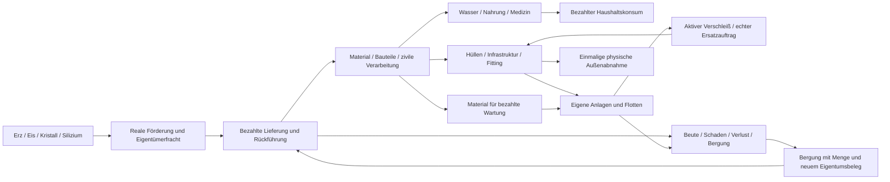
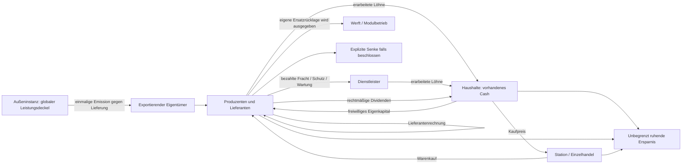

# Aphros Void – Gesamtwirtschaft als berechnetes Referenzmodell

**Stand: 07.11.2026 · Konzept zur Entscheidung, keine Implementierungsfreigabe.**

Basis: aktueller `main` [`fd3e915448a2f35fa803db709aff9ce223dddc6f`](https://github.com/tobiasfranziskus/Check/commit/fd3e915448a2f35fa803db709aff9ce223dddc6f), Forschungsstand W5s-ao [`e921fd29`](https://github.com/tobiasfranziskus/Check/tree/e921fd29cf4af33b0b325b4d656183638d12abd4), [Draft #243](https://github.com/tobiasfranziskus/Check/pull/243). Ausschließlich dieses Konzeptpapier wird vorgeschlagen. Produktcode, Tests, Speicherformate, Preise, Roadmap, Pages und Deployment werden nicht geändert.

**Leseschlüssel:** **[MAIN]** produktiv vorhandener Regelpfad; **[DRAFT]** technisch vorhandene, nicht integrierte Forschung; **[BESCHLOSSEN]** Ziel der [einzigen verbindlichen Roadmap](ROADMAP.md); **[ANNAHME]** frei gewählte Zahlen oder Verhalten dieser Rechnung; **[VORSCHLAG]** neue, separat zu entscheidende Ausgestaltung. „Berechnet“ bezeichnet ausschließlich nachgerechnete Gleichungen und Tabellen. Zitierte Messwerte stammen aus früheren Berichten; hier wurden **keine neuen Wirtschaftszeitreihen simuliert**. Unmarkierte Modelltabellen und Formeln in Abschnitten 3–13 gehören zu **[ANNAHME/VORSCHLAG]**, niemals automatisch zu MAIN.

## 1. Management-Zusammenfassung und Entscheidungsempfehlung

**[VORSCHLAG] Zielmodell C: eine privatwirtschaftliche Binnenwirtschaft mit regelmäßig angebotenen, global begrenzten externen Industrieaufträgen.** Haushalte bezahlen aus tatsächlich überwiesenen Löhnen und rechtmäßigen Ausschüttungen. Ein Außenauftrag vergütet ausschließlich gelieferte, eindeutig ausgebuchte Waren oder belegte Dienste. Die Außeninstanz erzeugt dabei die ausdrücklich begrenzten neuen ISK. Sie finanziert weder einen bestimmten Konzern noch einen Verbraucher wegen dessen Geldmangel.

Der entscheidende Zusammenhang lautet für einen stationären Binnenbetrieb:

> **Externer Nettozufluss muss den tatsächlichen Nettoabfluss in dauerhaft ruhende Kassen und Geldsenken decken. Ersatz muss zusätzlich physisch produziert und aus dem Geld des jeweiligen Betreibers bezahlt werden.**

Geldschöpfung allein garantiert weder Kaufkraft beim richtigen Eigentümer noch Schiffe am richtigen Ort. Geld ohne Lieferfähigkeit kann keine reale Leistung vergüten. Positive Branchenmargen allein schließen den Kreislauf ebenfalls nicht.

Das hier vollständig spezifizierte Rechenbeispiel ergibt pro Spieltag:

| Berechnete Größe im stationären Referenzfall | ISK/Tag |
| --- | ---: |
| Privater Endverbrauch: 10 Wasser, 2 Nahrung, 0,2 Medizin | 286,40 |
| Außenabnahme industrieller Endprodukte | 240,00 |
| Bezahlte Löhne aller Vorstufen einschließlich Logistik, Schutz und Wartung | 299,029311 |
| Unternehmensgewinn nach Abschreibung, vor Ausschüttung | 227,370689 |
| Davon kalkulatorischer Kapitalanspruch, bereits im Gewinn enthalten | 15,898573 |
| Wirtschaftlicher Gewinn nach diesem Kapitalanspruch | 211,472116 |
| Finanzierung und Produktion des Ersatzes | 91,603008 |
| Gesamter Waren-/Dienstleistungsumsatz über alle Stufen | 1.872,741846 |
| Nettoemission, ausschließlich gegen Export; Referenzsenken 0 | 240,00 |

**Berechnet:** `299,029311 + 227,370689 = 286,40 + 240 = 526,40`. Ersatz wird aus Abschreibung finanziert und ist kein zusätzlich ausschüttbarer Gewinn. Bei vollständiger Gewinneinbehaltung sparen Firmen 227,370689 und Haushalte 12,629311 ISK/Tag. Zusammen sind dies genau die 240 exportbedingt neu zugeflossenen ISK. Haushalte benötigen in diesem speziellen Fall keine fiktiven Gewinnansprüche, um ihren Warenkorb zu bezahlen. Andere Eigentums- und Lohnverteilungen können das ändern.

**[VORSCHLAG]** Zunächst 19 lagerfähige Grundwaren (vorhandene 18 plus Wasser), zwei MK1-Ausrüstungswaren und zwei gemeinsame MK2/MK3-Kerne als spätere Erweiterung. Keine zusätzlichen Sternensysteme, Rohstoffe, Energiezellen oder seltenen Funde für den Grundbetrieb voraussetzen. Industrie bleibt über Ersatz und Industrieexporte vorwiegend auf Schiffe und Infrastrukturmodule ausgerichtet: `331,603008 / (331,603008 + 286,40) = 53,66 %` der letzten Verwendung vor Abschreibungsabzug entfallen auf diese Investitionsgüter.

**Wesentliche Grenze:** Bei einem vorgeschlagenen Gesamtdeckel von 400 ISK/Tag kann die Beispielwelt nicht beliebig viele neue Sparabflüsse verkraften. Bei 90 % dauerhafter Stilllegung der Nettoeinkommen wären für denselben Binnenkonsum bereits 2.577,60 ISK/Tag nötig. Es gibt weder eine Garantie für alle Betriebe noch eine Garantie unveränderten Weltumsatzes bei beliebiger Geldhortung. Der Zielmarkt darf schrumpfen und Unternehmen dürfen scheitern.

## 2. Geprüfte Grundlagen und klare Trennung der Welten

### 2.1 Primärquellen

| Status | Geprüfte Quelle | Bedeutung |
| --- | --- | --- |
| [MAIN/BESCHLOSSEN] | [AGENTS.md](../AGENTS.md), [ROADMAP.md](ROADMAP.md), [PROJEKTSTATUS.md](PROJEKTSTATUS.md) an `fd3e915` | Vanilla JS, ein deterministischer Core, W0–W6, Sparfreiheit, keine Individualrettung, keine neue Produktregel durch Forschung |
| [MAIN] | [index.html an fd3e915](https://github.com/tobiasfranziskus/Check/blob/fd3e915448a2f35fa803db709aff9ce223dddc6f/index.html), `m_data_systeme`, `m_data_economy`, `m_data_world`, Preis-, Produktions-, Stunden-, Kampf- und Auditmodule | Regel14/Schema8; 18 Grundwaren; sieben Systeme; tatsächliche alte Rezepte, Kassen, Preisbildung und Eigentumsprüfungen |
| [DRAFT] | [W5s-ao-Gesamtbericht an e921fd29](https://github.com/tobiasfranziskus/Check/blob/e921fd29cf4af33b0b325b4d656183638d12abd4/docs/W5S_AO_INTEGRIERTE_WIRTSCHAFTSANALYSE.md), darunter [W5s-an](https://github.com/tobiasfranziskus/Check/blob/e921fd29cf4af33b0b325b4d656183638d12abd4/docs/W5S_AN_EXPORTMARGE_EIGENTUM.md) | Zusammenhängender R32-Befund, Kosten- und Eigentümerproblem, keine Nachhaltigkeitsfreigabe |
| [DRAFT] | [W5f Piloten/Laser](https://github.com/tobiasfranziskus/Check/blob/e921fd29cf4af33b0b325b4d656183638d12abd4/docs/W5F_PILOTEN_KOPFGELD_LASER.md), [W5m Bohrkopf](https://github.com/tobiasfranziskus/Check/blob/e921fd29cf4af33b0b325b4d656183638d12abd4/docs/W5M_BERGBAURENDITE_MK1.md) | Echte Piloteneinkommen, einmalige Prämie, getrennte Modul-/Hülleneigentümer, produktivitätssteigernde bezahlte Umrüstung |
| [DRAFT] | [W5n Wasser](https://github.com/tobiasfranziskus/Check/blob/e921fd29cf4af33b0b325b4d656183638d12abd4/docs/W5N_EIS_WASSER_VERSORGUNG.md), [W5o Haushalte](https://github.com/tobiasfranziskus/Check/blob/e921fd29cf4af33b0b325b4d656183638d12abd4/docs/W5O_HAUSHALTSKREISLAUF.md), [W5r Ersatz](https://github.com/tobiasfranziskus/Check/blob/e921fd29cf4af33b0b325b4d656183638d12abd4/docs/W5R_ERSATZFLOTTE_ANLAGENSERVICE.md) und R32-Daten in `index.html` an e921fd29 | Endliche Kundenkasse, Einkommensrückflüsse und hypothetische 15-/30-Tage-Lebensdauern |
| [historische Analyse] | [Architektur V12](ARCHITEKTUR_WIRTSCHAFT_V12.md), [Analysearchiv](ANALYSEARCHIV_HANDELSZYKLUS_2026-10-31.md) | Vorbefunde, keine zweite Produktplanung; alte Funktionsbefunde durch aktuellen Code abgleichen |

**[MAIN] ist ein Laufzeitstatus:** Forschungsfunktionen stehen teilweise bereits im Quelltext der Main-Datei hinter separaten Profilen. Ihre bloße Existenz macht R32 nicht zur produktiven Regel14-Wirtschaft. Die Konsolidierung #244 änderte Dokumentation, nicht den Produktkern. Die gleichfalls R32 genannte alternative Verschleißvariante #199 darf nicht mit W5r #200/#243 gleichgesetzt werden.

### 2.2 Originalpreise und Kostenlücke

**[MAIN] Basispreise**, keine garantierten Transaktionspreise: Erz 10, Eis 12, Kristall 24, Silizium 24, Material 30, Bauteil 75, Nahrung 30, Medikamente 105; Lager 180, Bergbau 225, Fabrik 300, Dock 360, Werft 450, Verteidigung 252; Miner 600, Frachter 750, Jäger 900, Bauschiff 1.200 ISK. Region, Knappheitsformel und Preisgrenzen 0,55–2,5 verändern diese Preise. Handelsgebühren betragen an den meisten Stationen 4 %, Meridian 0 %. Ein Basispreis ist kein beobachteter Durchschnitt und kein Vollkostennachweis.

**[MAIN]** Erzrezept 10→4 Material; Bauteil aus 2 Material + 1 Silizium; Nahrung aus 2 Eis; Medizin aus 1 Kristall + 2 Material. Alle übrigen ursprünglichen Rezepte stehen mit ihren Eingaben in Abschnitt 4; nur das leichte Jägerrezept wird neu vorgeschlagen. Die normale Produktion bezahlt im Regel14-Pfad keine gesonderten Fabriklöhne; ziviler Stationsverbrauch ist dort kein Haushaltskauf. Miner-/Frachter-/Jägerbetrieb wird über Fonds/Senken mit 150/250/50 ISK je Arbeitsstunde abgerechnet, nicht über die hier vorgeschlagenen Arbeitsverträge. Bestehende Fondsüberweisungen dürfen nicht zusätzlich als neue Löhne verbucht werden.

**Berechneter Gegencheck mit alten Inputpreisen, aber neuen vollständig angesetzten Aufwandssätzen aus Abschnitt 3:**

| Kette | Alter Verkaufspreis | Kosten bei alten Inputpreisen | Differenz |
| --- | ---: | ---: | ---: |
| Material, je Einheit | 30 | 43,125 | −13,125 |
| Bauteil | 75 | 115,00 | −40,00 |
| Nahrung (Eis 12) | 30 | 45,90 | −15,90 |
| Medizin | 105 | 113,15 | −8,15 |
| Frachter | 750 | 709,80 | +40,20 |

Der scheinbar profitable Frachter verwendet dabei Bauteile zu Preisen, zu denen deren Hersteller Verlust machen. Deshalb werden **alle** Vorstufen neu kalkuliert. Diese Vergleichskosten sind keine nachträglich behaupteten Kosten des alten Core. Knappheitspreise könnten einzelne Verluste überdecken, begründen aber keinen gemeinsamen rentablen Referenzzustand.

### 2.3 R32 und 55.000-ISK-Grundwelt bleiben getrennte Vergleichspunkte

| Merkmal | [MAIN] Grundwelt Regel14 | [DRAFT] W5s-ao R32 |
| --- | --- | --- |
| Startgeld | 55.000 = globale Owner 18.000 + Stationen 30.000 + Fonds 7.000 | 33.000; andere Startverteilung, endlicher Export-/Investorkunde |
| Geografie | sieben produktive Systeme | isolierte Aldera/Nadir-Forschungsgeografie, keine vollständige Sieben-System-Wirtschaft |
| Material | 10 Erz→4, Basis 30 | W4: 10 Erz→5, 20 Minuten Arbeit; weitere spezielle Kauf-/Verrechnungspreise |
| Frachterbau | 8 Bauteile, Basis 750 | W5: 5 Material mit besonderem Materialankauf, 30 Arbeitsminuten; nicht das Main-Rezept |
| Wasser | keine Grundware im produktiven Profil | 50 Wasser direkt 250 Eis + 240 Fracht + 100 Arbeit = 590 ISK |
| Geldquellen | Kopfgeld bereits emittiert; Sicherheits-/Stationskauf-Senken | Default kein Mint; in Exportfällen zusätzliche 7.000 auf 500/1.000 echte Wasser |
| Früheres Ergebnis | Kein aktueller Nachhaltigkeitsnachweis | Alle sechs 730d-Fälle still; letzter Wasserabsatz Tag209/303/393 |

**[DRAFT, zitierter Messbefund]** Bei Export 7 hält die R32-Welt am Ende 40.000 ISK, davon 32.659 bei drei anderen Eigentümern; Kunde 11 bei Wasserpreis 14, Altspedition 600 bei Ersatzbedarf 930, keine freie Frachterhülle. Im Profilvergleich sind 4.316 / 1.421 / 510 / 834 bezahlte Wasser an Tag90 belegt. Die 13 Seeds je Profil sind wirtschaftlich identisch. Das beweist keine Vielfalt von Wirtschaftskrisen.

Die neue Referenz unten verwendet **weder** die R32-Bauformel **noch** deren Eigentums-/Startverteilung. Ihre 55.000 ISK sind ein bewusst gewählter Vergleichsmaßstab, keine Fortsetzung eines Main-Saves. Eine kleinere Referenz mit 33.000 wird lediglich als eigene Kapitalrechnung gegenübergestellt, nicht als neu gemessene R32-Welt.

## 3. Vorgeschlagene Akteure, Waren und Kalkulationsregeln

### 3.1 Rollen, Eigentum und sieben Systeme

**[BESCHLOSSEN]** NPC-Piloten besitzen keine persönlichen Hüllen. Ein selbstständiger NPC-Spediteur ist deshalb eine eigene Firma mit Firmenhülle und angestelltem oder pachtendem Piloten. Pilotenkonto, Konzernkonto, Fracht und persönliche Module bleiben getrennt. Der Mensch darf persönlich ein Schiff besitzen. Gleiche Befehle/Kosten für Spieler und NPC bedeuten keine Umgehung dieser ausdrücklich unterschiedlichen persönlichen Eigentumsregel.

**[VORSCHLAG]** Mindestens drei voneinander unabhängige NPC-Unternehmen, zusätzlich Spezialanbieter oder Unternehmenssparten für Förderung, Logistik, Verarbeitung, Module, Werft und Reparatur. Die Referenz separiert diese Kassen, damit keine Verlustsparte hinter einer Konzernsumme verschwindet. Haushalte bestehen aus Arbeitern, Piloten und privaten Anteilseignern. Stationen betreiben Lager, Märkte und Einzelhandel; sie erzeugen keine automatische Kaufkraft. Anleger können freiwillig Eigenkapital einzahlen oder Bestandsanteile kaufen. Der erste Fall finanziert die Firma, der zweite nur den bisherigen Anteilseigner.

| System und [MAIN] Sicherheit | Vorhandene Spezialisierung | [VORSCHLAG] Funktion im Zielmodell |
| --- | --- | --- |
| Aldera, sicher | Erz, breite Industrie/Werft | Kapitalgüter, Bauteile, Hauptwerft; eigener kaufmännischer Betrieb |
| Cyris, sicher | Kristall/Eis, Nahrung/Medizin/Bauteile | Zivile Verarbeitung, Kristallgewinnung |
| Veldra, sicher | Erz, Material/Nahrung | Zweiter Anbieter als Konkurrenz/physische Ausweichkapazität |
| Orion, umkämpft | Erz/Eis, Material | Risikobepreiste Rohstoff-/Raffineriekette |
| Nadir, umkämpft | Eis/Silizium, Nahrung | Wasserwerk, Silizium, Grenzversorgung |
| Dravos, gesetzlos | Erz/Silizium, Material | Alternative Siliziumquelle und kostenpflichtige Schutz-/Konvoirouten |
| Meridian, gesetzlos | Außenhandel, keine Produktionslinien | Physischer Exportumschlag, keine gratis importierten Rohwaren |

Weitere Standorte dürfen konkurrieren; keine Branche bekommt ein unentziehbares Monopol. Sichere Kernsysteme können den Grundbetrieb tragen, benötigen für Silizium aber bereits eine geschützte Grenzlieferung oder vorhandene Puffer. Die Rechnung unterstellt erfolgreiche Lieferungen, **keinen empirisch nachgewiesenen Schutzgrad**. Eine unterbrochene Siliziumroute stoppt irgendwann den Neubau; andere Systeme werden nicht als automatische Rettung eingeführt.

### 3.2 Warenstruktur und Spieltiefe

**[VORSCHLAG] 19 Grundwaren** reichen für den ersten vollständigen Kreislauf: vier Rohstoffe, zwei Zwischenprodukte, drei Verbrauchsgüter einschließlich Wasser, sechs Infrastrukturmodule und vier Hüllen. Dienstleistung, Reservierung und Anteil sind keine zusätzlichen Lagerwaren. Wartung verwendet vorhandenes Material statt einer zweiten Ersatzteilware; Bauteile tragen die komplexe Industriekette.

Zwei MK1-Waren (Bohrkopf, Laser) ergänzen persönliches Fitting. MK2/MK3 erhalten je einen gemeinsamen komplexen Kern; ein Slot-/Typattribut hält Schild, Radar, Antrieb, Fracht und Laser unterscheidbar, ohne für jede Größe und Stufe einen eigenen Rohstoffmarkt zu erzwingen. Verbrauch einer Kernware beim Bau einer fertigen Variante muss eindeutig bleiben. Die Kerne unten sind eine Preis-/Komplexitätsoption, noch kein vollständiges Rezept jedes späteren Fittings.

**Kritische Bewertung:** Nur Erz→Material und Eis→Wasser wären zu wenig: ein einzelner Haushaltsmarkt und eine einzelne Spedition dominieren. Die 19 Waren plus Standort-/Risikounterschiede, konkurrierende Lieferverträge und langlebige Güter erlauben hingegen schon erhebliche wirtschaftliche Entscheidungen. Die geringe Tiefe von Material→Bauteil ist technisch gut beherrschbar, aber Silizium wird zum Flaschenhals. Zunächst Lager-/Routen-/Ersatzstrategien spielbar machen, erst danach bei nachgewiesener Nachfrage etwa eine Elektronikvorstufe ergänzen. Mehr Waren beheben keinen Kaufkraftmangel.

Wasser und Nahrung erfüllen getrennte Haushaltsbedarfe. Medizin wird im Mittel seltener gebraucht. Kein automatischer Materialverbrauch ohne Käufer oder echten Wartungsvorgang. Seltene Funde bleiben optionaler physischer Exportbonus und teilen das globale Emissionsbudget; die Grundrechnung setzt Fundhäufigkeit und Eventeinnahmen auf **null**.

### 3.3 Einheit, Lohn, Wartung, Kapital und Transport

**[ANNAHME]** Ein Spieltag enthält 1.440 Core-Minuten. Eine Arbeitsminute wird mit **1 ISK tatsächlich an den Arbeiter/Piloten bezahlt**. Die Modellzeiten sind abrechenbare Arbeit und aktive Maschinenzeit eines normierten Einpersonenarbeitsplatzes. Förderzeiten je Einheit: Erz 4, Eis 2, Kristall/Silizium je 10 Minuten. Das ist eine bewusst andere Produktivität als W5m/R32, nicht deren gemessene Rate. Mit den vorhandenen Rohstoffpreisen vermeidet sie extreme Bergbaurenten. Eine spätere schnellere Förderung erfordert neue Lohn-/Preis-/Nachfragekalkulation, keine garantierte Verdopplung des Umsatzes.

Für aktive Produktion/Förderung/Flug/Schutz je Minute:

- Lohn `L = 1,00` als Transfer.
- Wartung `W = 0,50` als Anspruch auf realen Reparaturdienst; gesammelt bis zum ausführbaren Wartungslos.
- Abschreibung `D = 0,30` als Wertverzehr, zugleich Rücklage für realen Ersatz. Reservierung eigener ISK ist **kein** Transfer und keine Senke.
- Kalkulatorischer Kapitalanspruch `K = 0,05`, als Renditehürde auf gebundenes Kapital. Keine automatische Auszahlung und keine zusätzlichen ISK.

**Wartungsdienst, 100 ISK:** 1 Material zu 48 + dessen Transport 5,40 + 30 echte Arbeitsminuten + 10 eigene Anlagenabschreibung + 2 Kapitalanspruch = **95,40 Vollkosten**, 4,60 wirtschaftlicher Gewinn. Die direkte Werkbankpflege steckt hier in den 30 Minuten; keine weitere externe Selbstwartungsrechnung. Eine Diensteinheit deckt 200 aktive Minuten. Material wird dabei physisch verbraucht, ohne aktive Minute kein Verschleiß. Bruchteile sind nur Rechenmittel; der Core bündelt sie in Lose, mit gespeicherten Restansprüchen und Vorfinanzierung der nächsten echten Wartung.

**Frachtnormlos, 50 Frachteinheiten, vollständige Runde:** 120 bezahlte Arbeitsminuten einschließlich Rückführung, 60 Wartung, 36 Abschreibung, 6 Kapitalanspruch, 12 Minuten Schutz zu 24 ISK = **246 Vollkosten**, Preis **270**, wirtschaftlicher Gewinn **24**. Daraus folgen **5,40 ISK je bewegter Inputeinheit**. Die Hülle transportiert maximal 50 Normeinheiten je kalkulierter Ladung; nicht jede Hülle oder jedes Modul ist als Einheitsstück einfach im Frachtraum zu stapeln. Industrielle Lieferlose werden als passende Frachtvolumina spezifiziert.

Das ist ein **angenommener mittlerer Routen-/Umschlagaufwand**, keine aus der Karte gemessene Fahrzeit. Beispiel Main: Aldera–Cyris–Meridian 55 Minuten einfach, mit 10 Minuten tatsächlich geleisteter Lade-/Entladearbeit ergibt sich eine 120-Minuten-Runde. Für die gesamte Sieben-System-Verteilung muss später die mengengewichtete Routenplanung diesen Mittelwert belegen. Längere Fahrten/Leerpositionierungen bekommen eine höhere Offerte; kein unbezahlter Rückweg. Schutz ist belegte Co-Lokation/Dienstzeit, kein erkaufter Garantieschutz.

**Transportkonvention:** Jede physische Inputeinheit der Fertigungsrezepte und der Reparatur kommt in dieser konservativen Referenz über einen solchen Lieferdienst; der Käufer trägt die Fracht zusätzlich zum Ab-Werk-Inputpreis. Schutz ist Dienstleistung, keine erneut zu transportierende Ware. Endkunden kaufen am selben Stationslager; dessen lokaler Umschlag steckt im Einzelhandelslohn. Kapitalgüterpreise gelten betriebsbereit am vereinbarten Werft-/Produktionsstandort. Externe Übergabe erfolgt am Exportlager Meridian, nach der in Abschnitt 9 zusätzlich gerechneten bezahlten Endauslieferung; notwendiger zusätzlicher Außenhüllenflug, Montage oder Außenpostenbau wird **separat** angeboten. Zusätzlicher Außenpostenbau ist im stationären Bestand null; Endauslieferung der Ersatz- und Exportgüter wird in Abschnitt 9 ausdrücklich hinzugerechnet.

**Einzelhandel je verkauftem Stück:** Einkauf zum Herstellerpreis, 0,50 Lohn, 0,10 Wartung, 0,20 Abschreibung, 0,05 Kapitalanspruch; Verkauf mit 2 ISK Aufschlag. Eigene bezahlte Leistung und keine doppelte Fernfracht. Alte Main-Gebühren werden im Zielmodell **nicht zusätzlich pauschal aufgeschlagen**: Leistungen sind im Dienstpreis enthalten. Wer die 4-%-Gebühr behalten will, muss alle Tabellen erneut einschließlich Empfänger und dessen Verwendung rechnen.

Kein laufender Treibstoff, keine künstliche Grundenergie. Gebäude-/Schiffs-Leerstand zahlt keinen Aktivitätsverschleiß. Es gibt in dieser ersten Kalkulation keine unbezahlten Mieten/Zinsen: Eigentümer nutzen eigene bilanziell erfasste Anlagen, finanzieren aus Eigenkapital und tragen Abschreibung/Kapitalanspruch selbst. Miete/Pacht ersetzt später den entsprechenden Eigentümerkostenanteil, sie kommt nicht doppelt hinzu.

## 4. Vollständige Rezepte, Preise und Betriebskapital

**[ANNAHME/VORSCHLAG]** Alle Preise in ISK. `M` sind gekaufte Inputs, `T` Inputtransport, `L` tatsächlich gezahlte Arbeit, `W` gekaufte Wartung, `D` eigene Abschreibung, `K` kalkulatorischer Kapitalanspruch. Keine alten R32-Verrechnungspreise werden hineingemischt.

`Vollkosten = M + T + L + W + D + K`

`Deckungsbeitrag DB = Preis − M − T − L − W`

`Buchgewinn = DB − D`; `wirtschaftlicher Gewinn G = DB − D − K`.

`BK = M + T + L + W` ist das **vor einem unangezahlten Auftrag mindestens benötigte Geld für dessen Ausführung**, ohne bereits vorhandenes Anlagevermögen. Zuverlässige Unternehmer binden zusätzlich D bis zum Ersatz sowie Risiko-/Leerlaufpuffer. Bereits eingekaufte Inputs gehören zum gebundenen Betriebskapital, werden bei der Auftragsprüfung aber nicht noch einmal mit Cash bezahlt. Kundenanzahlung senkt den eigenen Cashbedarf, nicht den realen Gesamtfinanzierungsbedarf.

### 4.1 Rezepte und Folgeauftrag

Die Zeiten sind pro vollständigem Rezeptlos, die nachfolgende Kostentabelle rechnet pro Outputeinheit. `m` = Material, `b` = Bauteil. Die sechs Infrastrukturrezepte und Miner-/Frachter-/Bauschiffrezepte entsprechen mengenmäßig MAIN; ihre Preise und bezahlten Kosten nicht. Leichter Jäger wird bewusst kleiner als der Main-Jäger.

| Ware/Stufe | Inputs → Output je Los | Arbeitsminuten / ausgezahlter Loslohn | Für gleichen Folgeauftrag nötiger zahlender Abnehmer |
| --- | --- | ---: | --- |
| Erz / Rohstoff | Feldentnahme → 1 Erz | 4 / 4 | 1 Erz × 10; bei 50er-Los 500 |
| Eis / Rohstoff | Feldentnahme → 1 Eis | 2 / 2 | 1 Eis × 5; bei 50er-Los 250 |
| Kristall / Rohstoff | Feldentnahme → 1 Kristall | 10 / 10 | 1 × 24 |
| Silizium / Rohstoff | Feldentnahme → 1 Silizium | 10 / 10 | 1 × 24 |
| Material / Zwischenprodukt | 10 Erz → 4 m | 10 / 10 | 4 × 48 = 192 |
| Bauteil / Zwischenprodukt | 2 m + 1 Silizium → 1 b | 8 / 8 | 1 × 170 |
| Wasser / Verbrauch | 50 Eis → 50 Wasser | 100 / 100 | 50 × 16 = 800 Großhandel; Einzelkunden zusammen 900 |
| Nahrung / Verbrauch | 2 Eis → 1 Nahrung | 6 / 6 | 34 Großhandel / 36 Endkunde |
| Medizin / Verbrauch | 1 Kristall + 2 m → 1 Medizin | 7 / 7 | 170 Großhandel / 172 Endkunde |
| Lager / Infrastruktur | 2 b → 1 | 12 / 12 | 430 und konkreter Lager-/Ersatzbedarf |
| Bergbau / Infrastruktur | 2 b + 1 m → 1 | 15 / 15 | 500 und konkreter Anlagenbedarf |
| Fabrik / Infrastruktur | 2 b + 3 m → 1 | 18 / 18 | 630 und konkrete Kapazitäts-/Ersatzentscheidung |
| Dock / Infrastruktur | 4 b → 1 | 20 / 20 | 850 |
| Werft / Infrastruktur | 4 b + 2 m → 1 | 24 / 24 | 980 |
| Verteidigung / Infrastruktur | 2 b + 2 m → 1 | 14 / 14 | 560 |
| Miner / Hülle | 6 b + 1 m → 1 | 30 / 30 | 1.340 plus Einsatzkapital |
| Frachter / Hülle | 8 b → 1 | 36 / 36 | 1.690 plus Einsatzkapital |
| Leichter Jäger / Hülle | **4 b + 2 m → 1** | **24 / 24** | 980 plus bezahlter Schutzauftrag |
| Bauschiff / Hülle | 12 b + 2 m → 1 | 48 / 48 | 2.640 plus Bauvertrag |
| Bohrkopf MK1 / Fittingoption | 1 m → 1 | 15 / 15 | 94; begründete produktive Umrüstung |
| Laser MK1 / Fittingoption | 1 b + 1 Kristall → 1 | 15 / 15 | 270; eigener finanzierter Ausrüstungswunsch |
| Gemeinsamer Kern MK2 / spätere Option | 2 b + Kristall + Silizium → 1 | 30 / 30 | 540; keine automatische Subvention des Aufrüstens |
| Gemeinsamer Kern MK3 / spätere Option | 4 b + 2 Kristall + 2 Silizium → 1 | 60 / 60 | 1.080 |

Die letzte Spalte bedeutet zahlungsfähige Gesamtbestellung, nicht bloß einen rechnerischen Bedarf. Ein Händler muss außerdem sein eigenes Lagerkapital und den Endkundenabsatz decken. Eigenproduktion ohne Bestellung bleibt erlaubt, vollständig auf Eigentümerrisiko. Teilverkauf finanziert nur den entsprechenden Anteil; eine Inventuraufwertung bezahlt keine zweite Charge.

### 4.2 Berechnete Vollkosten pro Einheit

| Ware | M | T | L | W | D | K | Vollkosten | Preis | DB | G | BK |
| --- | ---: | ---: | ---: | ---: | ---: | ---: | ---: | ---: | ---: | ---: | ---: |
| Erz | 0,000 | 0,000 | 4,000 | 2,000 | 1,200 | 0,200 | 7,400 | 10,000 | 4,000 | 2,600 | 6,000 |
| Eis | 0,000 | 0,000 | 2,000 | 1,000 | 0,600 | 0,100 | 3,700 | 5,000 | 2,000 | 1,300 | 3,000 |
| Kristall | 0,000 | 0,000 | 10,000 | 5,000 | 3,000 | 0,500 | 18,500 | 24,000 | 9,000 | 5,500 | 15,000 |
| Silizium | 0,000 | 0,000 | 10,000 | 5,000 | 3,000 | 0,500 | 18,500 | 24,000 | 9,000 | 5,500 | 15,000 |
| Material | 25,000 | 13,500 | 2,500 | 1,250 | 0,750 | 0,125 | 43,125 | 48,000 | 5,750 | 4,875 | 42,250 |
| Bauteil | 120,000 | 16,200 | 8,000 | 4,000 | 2,400 | 0,400 | 151,000 | 170,000 | 21,800 | 19,000 | 148,200 |
| Wasser | 5,000 | 5,400 | 2,000 | 1,000 | 0,600 | 0,100 | 14,100 | 16,000 | 2,600 | 1,900 | 13,400 |
| Nahrung | 10,000 | 10,800 | 6,000 | 3,000 | 1,800 | 0,300 | 31,900 | 34,000 | 4,200 | 2,100 | 29,800 |
| Medizin | 120,000 | 16,200 | 7,000 | 3,500 | 2,100 | 0,350 | 149,150 | 170,000 | 23,300 | 20,850 | 146,700 |
| Lager | 340,000 | 10,800 | 12,000 | 6,000 | 3,600 | 0,600 | 373,000 | 430,000 | 61,200 | 57,000 | 368,800 |
| Bergbau | 388,000 | 16,200 | 15,000 | 7,500 | 4,500 | 0,750 | 431,950 | 500,000 | 73,300 | 68,050 | 426,700 |
| Fabrik | 484,000 | 27,000 | 18,000 | 9,000 | 5,400 | 0,900 | 544,300 | 630,000 | 92,000 | 85,700 | 538,000 |
| Dock | 680,000 | 21,600 | 20,000 | 10,000 | 6,000 | 1,000 | 738,600 | 850,000 | 118,400 | 111,400 | 731,600 |
| Werft | 776,000 | 32,400 | 24,000 | 12,000 | 7,200 | 1,200 | 852,800 | 980,000 | 135,600 | 127,200 | 844,400 |
| Verteidigung | 436,000 | 21,600 | 14,000 | 7,000 | 4,200 | 0,700 | 483,500 | 560,000 | 81,400 | 76,500 | 478,600 |
| Miner | 1068,000 | 37,800 | 30,000 | 15,000 | 9,000 | 1,500 | 1161,300 | 1340,000 | 189,200 | 178,700 | 1150,800 |
| Frachter | 1360,000 | 43,200 | 36,000 | 18,000 | 10,800 | 1,800 | 1469,800 | 1690,000 | 232,800 | 220,200 | 1457,200 |
| Jaeger | 776,000 | 32,400 | 24,000 | 12,000 | 7,200 | 1,200 | 852,800 | 980,000 | 135,600 | 127,200 | 844,400 |
| Bauschiff | 2136,000 | 75,600 | 48,000 | 24,000 | 14,400 | 2,400 | 2300,400 | 2640,000 | 356,400 | 339,600 | 2283,600 |
| BohrerMK1 | 48,000 | 5,400 | 15,000 | 7,500 | 4,500 | 0,750 | 81,150 | 94,000 | 18,100 | 12,850 | 75,900 |
| LaserMK1 | 194,000 | 10,800 | 15,000 | 7,500 | 4,500 | 0,750 | 232,550 | 270,000 | 42,700 | 37,450 | 227,300 |
| KernMK2 | 388,000 | 21,600 | 30,000 | 15,000 | 9,000 | 1,500 | 465,100 | 540,000 | 85,400 | 74,900 | 454,600 |
| KernMK3 | 776,000 | 43,200 | 60,000 | 30,000 | 18,000 | 3,000 | 930,200 | 1080,000 | 170,800 | 149,800 | 909,200 |
| Service | 48,000 | 5,400 | 30,000 | 0,000 | 10,000 | 2,000 | 95,400 | 100,000 | 16,600 | 4,600 | 83,400 |
| Schutz | 0,000 | 0,000 | 60,000 | 30,000 | 18,000 | 3,000 | 111,000 | 120,000 | 30,000 | 9,000 | 90,000 |
| Fracht | 24,000 | 0,000 | 120,000 | 60,000 | 36,000 | 6,000 | 246,000 | 270,000 | 66,000 | 24,000 | 204,000 |
| RetailWasser | 16,000 | 0,000 | 0,500 | 0,100 | 0,200 | 0,050 | 16,850 | 18,000 | 1,400 | 1,150 | 16,600 |
| RetailNahrung | 34,000 | 0,000 | 0,500 | 0,100 | 0,200 | 0,050 | 34,850 | 36,000 | 1,400 | 1,150 | 34,600 |
| RetailMedizin | 170,000 | 0,000 | 0,500 | 0,100 | 0,200 | 0,050 | 170,850 | 172,000 | 1,400 | 1,150 | 170,600 |

Rundungen dienen der Anzeige; gerechnet wurde mit ungerundeten Koeffizienten. Service = Wartungslos, Schutz = 60 bezahlte Dienstminuten, Fracht = vollständiges 50er-Rundlos, Retail = eine tatsächlich verkaufte Endkundeneinheit. Dienstleistung wird nicht als physische Ware exportiert oder gelagert.

**Berechnet:** Eine Materialcharge bindet `4 × 42,25 = 169` ISK und benötigt 192 ISK sicheren Absatz. Die 50er-Wassercharge bindet `50 × 13,40 = 670` Cash, reserviert zusätzlich 30 Ersatz und verlangt 5 Kapitalvergütung. Der Hersteller verkauft für 800, der Händler braucht bis zum Weiterverkauf weitere 830 Cash inklusive Einzelhandelsarbeit/Wartung. Diese **sukzessiven** Kapitalbedarfe sind keine doppelte Geldschöpfung.

### 4.3 Sechs tragfähige Unternehmen – jeweils nur bei bezahltem Absatz

| Betrieb / konkretes Los | Umsatz | Cashausgaben BK | Ersatz D | Kapitalhürde K | Wirtschaftlicher Gewinn | G/Umsatz |
| --- | ---: | ---: | ---: | ---: | ---: | ---: |
| Bergbau: 50 Eis | 250 | 150 | 30 | 5 | 65 | 26,00 % |
| Spedition: 50er-Rundtransport | 270 | 204 | 36 | 6 | 24 | 8,89 % |
| Raffinerie: 4 Material | 192 | 169 | 3 | 0,50 | 19,50 | 10,16 % |
| Modulhersteller: 1 Fabrik | 630 | 538 | 5,40 | 0,90 | 85,70 | 13,60 % |
| Werft: 1 Frachter | 1.690 | 1.457,20 | 10,80 | 1,80 | 220,20 | 13,03 % |
| Sicherheit: 60 Minuten | 120 | 90 | 18 | 3 | 9 | 7,50 % |
| Reparatur: 1 Wartungslos | 100 | 83,40 | 10 | 2 | 4,60 | 4,60 % |

Es gibt keine Branche, die für diese Margen eine Verlustvorstufe voraussetzt. Der Bergbau hat nach vollständigem Kostenansatz weiterhin Rohstoffrente; bei mehr Wettbewerb können Erz-/Eispreise fallen. Ein kostenloser eigener Pilot wird nicht angenommen: persönliches Selberfliegen bedeutet, dass der Mensch seinen eigenen verdienten Arbeitsanspruch erhält oder bewusst darauf verzichtet. Der Vergleich mit NPC rechnet diesen Anspruch stets ein.

### 4.4 Persönliches Fitting: Produktivität ist noch kein Absatz

**Zusätzliche Modellrechnung, nicht Teil des stationären Sockels:** Ein Bohrkopf MK1 kostet 94 ab Werk + 5,40 Lieferung. Fünf echte Einbauminuten mit 1,85 Vollkosten/Minute ergeben **108,65** installierten Kapitalbedarf. Angenommen, er halbiert die Erz-Förderzeit von 4 auf 2 Minuten, hält 1.000 aktive Minuten und benötigt zusätzlich 0,02 Wartungs-ISK je aktiver Minute. Seine eigene Abschreibung beträgt 0,10865/Minute, Kapitalhürde ein Sechstel davon. Die neuen vollständigen Förderkosten sind dann `3,70 + 2×(0,10865 + 0,018108333 + 0,02) = 3,993516667` je Erz statt 7,40. Der wirtschaftliche Vorteil **3,406483333 je tatsächlich benötigtem Erz** ist nach Modulverschleiß positiv.

Die reine Ausführungs-Cashersparnis ist `6,00 − (3,00 + 0,04) = 2,96` pro verkaufter Einheit. Die Erstinvestition ist dadurch rechnerisch nach **36,71 tatsächlich verkauften Erz** als Cash zurückverdient; das ist keine garantierte Kalenderamortisation. Bei identischem Absatz halbiert sich aktive Förderarbeit; es entsteht kein doppelter Warenumsatz. Bei fehlendem Käufer können weder der teurere MK2-Kern noch ein schnellerer Miner Absatz erzwingen. Waffen-/Schildfitting benötigt analog einen gemessenen vermiedenen Schaden oder einen freiwilligen Spielerausrüstungswunsch; ein Kampfstärkebonus allein ist kein wirtschaftlicher Gewinnnachweis.

### 4.5 Wasser: die bekannte Fehlinterpretation ausschließen

**[DRAFT, vorhandener Kostenmaßstab]** `590 / 50 = 11,80` direkte ISK pro Wasser. Damit ergeben sich für 1.000 Exportwasser zu 7 ISK **−4.800**; für 500 zu 14 ISK **+1.100** vor Wartung/Verschleiß. Kein Nettoertrag und kein automatisch freies Dividendengeld.

**[ANNAHME, Zusatzprüfung bei unverändertem alten Transportpreis 240]:** 590 direkte Kosten + 50 reale Wartung + 30 Abschreibung + 5 Kapitalhürde = **675 / 50 = 13,50** Vollkosten beim Hersteller. Zu 14 bleiben dann 0,50 je Wasser; zusätzlicher Exportumschlag von 0,60 macht bereits Verlust. Die angesetzten Zusatzkosten sind Modellwerte, keine nachgemessenen W5s-Kosten.

**[VORSCHLAG, gemeinsame neue Kalkulation]:** Die geschützte Fracht kostet 270. Herstellerkosten sind jetzt `250 + 270 + 100 + 50 + 30 + 5 = 705`, also **14,10** pro Wasser. Export 14 erzeugt **−0,10** nach Vollkosten. Herstellerpreis 16 lässt **1,90**, Endkundenpreis 18 trägt zusätzlich den Handel. Ein Außenauftrag 16 ist nur bei Übergabe ohne weitere Transportkosten profitabel; 7 wird von der NPC-Automatik abgewiesen. Bewusst finanzierter Spieler-Verlustexport bleibt möglich und vernichtet **keine ISK**: Er verschiebt sie zu seinen Lieferanten, während sein Eigenkapital sinkt.

Die bevorzugte Referenz bezahlt überhaupt **keinen Wasserexport**. Der reguläre Außennachfragesockel betrifft industrielle Endprodukte und ist unabhängig vom Haushalts-Wasserlager. Ein solcher zweiter Absatzkanal kann Löhne verdienen lassen, auch wenn ein privater Konsumauftrag gerade fehlt.

## 5. Waren- und Geldkreislauf als zusammenhängendes System

### 5.1 Physischer Warenfluss



Eine exportierte oder konsumierte Einheit ist nicht mehr verkaufbar. Ein eingebautes Modul bleibt als Asset erfasst; sein Ausbau reklassifiziert denselben Gegenstand und produziert keine neue Ware. Eine zerstörte Hülle wird nicht gratis ersetzt. Bergung erhält nur die tatsächlich überlebende Menge, Verlust und Bergung dürfen nicht beide dieselbe volle Fracht liefern.

### 5.2 Geldfluss mit offenen Abzweigungen



Die Rückpfeile stellen **mögliche bezahlte Verträge** dar. Sie bedeuten keine automatische Vollauszahlung, keinen Zugriff auf Fremdkassen und keine Konsumgarantie. Unterlassene Dividenden, Vorratskäufe, Verluste und Spieler-Sparen ändern die Verteilung. Ein Betriebsverlust ist der Gegenposten zu Einkommen anderer Eigentümer, kein Bilanzloch und keine automatische Geldvernichtung.

### 5.3 Stock-Flow-Definitionen

| Begriff | Eindeutige Definition / Buchungswirkung |
| --- | --- |
| Bestandsvermögen | Cash + reale Vorräte zu nachvollziehbaren Kosten + Anlagebuchwerte + Forderungen − Verbindlichkeiten. Marktwert separat anzeigen; keine Cash-Aufwertung |
| Verfügbares Bargeld | Vorhandenes Owner-Cash abzüglich gesperrter Teilbeträge desselben Cashbestands |
| Gebundenes Betriebskapital | Bestandskosten von Vorräten/WIP + Forderungen + nicht frei verfügbare Ausführungsbeträge; kein zusätzliches Weltgeld |
| Einkommen | Tatsächlich gezahlter Lohn, Dividende oder sonstiger berechtigter Ertrag des Empfängers; Transfer, keine Emission |
| Umsatz | Bezahlt realisierte Lieferung; Anzahlungen bleiben zunächst Erfüllungsverbindlichkeiten |
| Gewinn | Umsatz − verbrauchte Bestandskosten − tatsächliche Dienste/Löhne − Abschreibung; nicht Umsatz minus beliebig wenig gerade gezahltes Cash |
| Investition | Austausch von Cash gegen neue reale Anlage oder Firmenkapital. Gebrauchtkauf/Anteilsweiterverkauf verschiebt vorhandenes Vermögen, ist keine neue Güterproduktion |
| Dividende | Transfer aus nach Verlusten verbleibendem realisiertem Gewinn und überschüssiger Liquidität an eingetragene Anteilseigner |
| Emission | Genau eine explizite Erhöhung von Empfängercash und kumuliertem `minted` nach belegter Außenleistung |
| Geldvernichtung | Expliziter Cashabgang ohne inländischen Empfänger und identischer Zuwachs `burned`; Waren-/Schiffsverlust ist keine Geldsenke |

Für jeden Buchungsschritt gilt:

`M(t) = Σ_e Cash_e(t) = M(0) + Σ Emission − Σ Geldvernichtung`.

Reservierungen sind hier Subsalden des Owner-Cash. Werden stattdessen echte Treuhandkonten verwendet, muss der Betrag vom Owner abgehen und genau einmal beim Treuhänder stehen. Beide Darstellungen gleichzeitig zu addieren wäre doppelte Geldmenge. Für die Realwirtschaft gilt je Ware zusätzlich:

`Lager + Fracht + WIP_Inputbestand = Anfang + Förderung + fertige Produktion + bezahlter Import − Rezeptverbrauch − Endkonsum − Export − endgültiger Verlust`.

Aktive Hüllen/Module laufen in einem separaten Assetbuch mit Herkunftsverweis auf die bei Aktivierung aus dem Warenbestand abgegangene Einheit. WIP-Eingaben werden entweder bis Fertigstellung gehalten oder beim Start verbraucht, niemals beides. Auftragsabbruch erstattet nur nachweislich verbleibende Ware und unverdientes Cash.

## 6. Eine vollständige Zahlungskette mit echten Kassen

**Berechnetes, eigenständiges Buchungsbeispiel**, kein aus R32 entnommener Save und keine Behauptung, alle Vorperioden seien mitgerechnet. Es demonstriert 50 neu geförderte Eis → Transport → 50 neu produzierte und verkaufte Wasser. Alle beteiligten rechtlichen Eigentümer stehen in der Tabelle. Unbeteiligte Weltkonten halten zusammen weitere 39.000 ISK; damit beträgt M hier wie in der Referenz 55.000. Der Spieler spart seine 2.000 vollständig.

**Anfangsbestände:** Alle Anlagen stehen bereits im Eigentum ihrer Betreiber. Der Reparateur besitzt 1,71 zuvor bezahlte und angelieferte Material zu historischen Stückkosten `48 + 5,40 = 53,40`, insgesamt **91,314 ISK**. Dieses Lager ist kein Cash und kein aktueller Lieferantenerlös. Die hier ausführbaren Wartungsarbeiten gehören zu 357 dokumentierten aktiven Minuten dieses Auftragsbündels: Mine 100 + Fracht 120 + Wasserwerk 100 + Einzelhandel 25 + Schutz 12, wobei Einzelhandel einen eigenen festen Wartungstarif hat. Konkret ergeben sich die vertraglichen Ansprüche 50 + 60 + 50 + 5 + 6 = **171 ISK = 1,71 Wartungslose**. Diese vereinfachte Beispielabrechnung verwendet teilbare Mengen; ein späterer Core fasst sie zu ganzzahligen Losen zusammen. Der Materialvorrat wird real verbraucht, nicht nur als „Wartung bezahlt“ markiert.

Die Auftraggeber reservieren ihre vorhandenen Mittel vor Beginn. Die folgenden Transfers werden erst mit der jeweils erbrachten Leistung freigegeben; ausreichend eigenes Cash liegt auf jeder Zwischenstufe vor, also keine verdeckte Lieferantenfinanzierung:

| Nr. | Vollständige Leistung und Gegenleistung | Sender → Empfänger | ISK |
| --- | --- | --- | ---: |
| 1 | Förderung 50 Eis, 100 Arbeitsminuten | Mine → Arbeiterhaushalte | 100 |
| 2 | Wartung Mine aus realem Reparaturmaterial | Mine → Reparateur | 50 |
| 3 | Eigentum an 50 Eis geht an Wasserwerk; Lager/Fracht wird umgebucht | Wasserwerk → Mine | 250 |
| 4 | Tatsächliche Hin-/Rückrunde, 120 Minuten | Spedition → Arbeiterhaushalte | 120 |
| 5 | Frachterwartung | Spedition → Reparateur | 60 |
| 6 | Tatsächlich geleistete 12 Minuten Begleitschutz | Spedition → Sicherheit | 24 |
| 7 | Schutzpilot und Jägerwartung | Sicherheit → Haushalte / Reparateur | 12 / 6 |
| 8 | Frachtleistung vollständig abgenommen; Ware weiterhin Wasserwerkeigentum | Wasserwerk → Spedition | 270 |
| 9 | 50 Eis werden verbraucht, 100 Minuten Arbeit ergeben 50 Wasser | Wasserwerk → Haushalte / Reparateur | 100 / 50 |
| 10 | Kauf und Lagerzugang 50 Wasser | Einzelhandel → Wasserwerk | 800 |
| 11 | Verkauf, Umschlag und Wartung Einzelhandel | Einzelhandel → Haushalte / Reparateur | 25 / 5 |
| 12 | 50 Wasser gehen in Endkonsum, nicht nochmals in Export | Arbeiterhaushalte → Einzelhandel | 900 |
| 13 | Reparatur aller fünf Auftraggeber: Verbrauch 1,71 Material und 51,3 Minuten Arbeit | Reparateur → Haushalte | 51,30 |

Die Tabellenreihenfolge fasst zusammen; Wartung, die vor weiterer Arbeit fällig ist, erfolgt im Core vorher. Kein Geld entsteht durch diese Zusammenfassung. Schritt 11 bezahlt Arbeit für den Verkauf, Schritt 12 dessen Warenpreis: keine doppelte Lohnzahlung.

| Eigentümer | Cash vorher | Eingänge | Ausgänge | Cash nachher | Davon eigene Ersatzreserve | Buchgewinn dieses Zyklus |
| --- | ---: | ---: | ---: | ---: | ---: | ---: |
| Spielereigentümer, vollständig passiv | 2.000 | 0 | 0 | 2.000 | 0 | 0 |
| Mine | 2.000 | 250 | 150 | 2.100 | 30 | 70 |
| Spedition | 2.000 | 270 | 204 | 2.066 | 36 | 30 |
| Wasserwerk | 2.000 | 800 | 670 | 2.130 | 30 | 100 |
| Einzelhandel | 2.000 | 900 | 830 | 2.070 | 10 | 60 |
| Sicherheit | 2.000 | 24 | 18 | 2.006 | 3,60 | 2,40 |
| Reparateur | 2.000 | 171 | 51,30 | 2.119,70 | 17,10 | **11,286** |
| Arbeiterhaushalte | 1.000 | 408,30 | 900 | **508,30** | 0 | Einkommen 408,30, kein Firmengewinn |
| Private Anteilseigner | 1.000 | 0 | 0 | 1.000 | 0 | Noch keine Dividende |
| **Beteiligte gesamt** | **16.000** | **2.823,30** | **2.823,30** | **16.000** | **126,70** | **273,686** |
| Alle übrigen, unbeteiligt | 39.000 | 0 | 0 | 39.000 | unverändert | unverändert |
| **Welt** | **55.000** | | | **55.000** | keine zusätzliche Geldmenge | Mint 0, Burn 0 |

**Berechnete Erfolgsabgrenzung:** Beim Reparateur sind `119,70 Cashzuwachs − 91,314 verbrauchtes Anfangslager − 17,10 Abschreibung = 11,286 Gewinn`. Gesamthaft gilt:

`900 Enderlös = 408,30 Löhne + 126,70 Abschreibung + 273,686 Gewinn + 91,314 verbrauchtes Vorperiodenlager`.

Alle Waren dieses Beispiels sind bilanziert: +50 Eis gefördert, −50 Eis verarbeitet, +50 Wasser fertig, −50 Wasser konsumiert; −1,71 Material für reale Wartung. Keine neue Hülle und kein Export. Lieferanten des Anfangsmaterials erhalten **hier keine zweite Zahlung**. Restliche Vorräte/Anlagen ändern ihren Buchwert, nicht die Cashbilanz.

**Freiwilliger Ausschüttungsschritt:** Besitzen die privaten Anteilseigner nachweislich 100 % der sechs Unternehmen und beschließen alle eine Vollauszahlung der realisierten Gewinne, gehen 70 + 30 + 100 + 60 + 2,40 + 11,286 = **273,686** auf deren Konto. Es steigt auf **1.273,686**; die sechs Firmenkassen sinken jeweils um exakt ihren Gewinn. Ersatzreserven 126,70 und Material-Wiederbeschaffung bleiben gedeckt. Die Arbeiterkasse bleibt trotzdem bei 508,30. „Gewinn ausgeschüttet“ ist kein Beweis, dass genau dieser Verbraucher Geld erhielt oder ausgeben wird.

Diese isolierte Konsumkette kann nicht unverändert endlos wiederholt werden: Haushalte haben netto Cash verloren, Ersatzgeld und bereits entstandene Lieferanteneinkommen müssen durch neue reale Aufträge wieder umlaufen. Genau diese Vorstufen und Ersatzkäufe enthält die gekoppelte Gesamtberechnung in Abschnitt 9. Eine glatt aussehende Zahlungsrunde allein wäre kein Nachhaltigkeitsnachweis.

## 7. Drei Gesamtarchitekturen unter demselben Geldmodell-B-Rahmen

**Geldmodell B als beschlossener Rahmen ist nicht identisch mit der folgenden Architektur B.** Alle drei Varianten respektieren begrenzte Leistungsemission, Sparfreiheit und wirtschaftliches Scheitern.

| Frage | Modell A: bezahlter institutioneller Zivilverbrauch | Modell B: private Haushalte + ergänzender Export | Modell C: regelmäßige Außenaufträge + private Einkommen/Investitionen |
| --- | --- | --- | --- |
| Ursprüngliche Kaufkraft | Startfonds, anschließend echte Abgaben aus Einkommen; oder explizite zivile Emission | Startvermögen der Haushalte, danach tatsächlich verdiente Löhne/Dividenden; Export ergänzt | Vorhandenes Firmenkapital startet reale Industrieaufträge; erst deren Lieferung verdient Außen-ISK und löst Lohn-/Lieferantenzahlungen aus |
| Neue ISK / Leistung / Empfänger | Zivile Einkaufsinstanz erhält Leistungskredit oder Lieferant Emission gegen abgezeichneten Verbrauch; genau **einen** Pfad wählen | Nur exportierender Eigentümer für ausgebuchte Ware | Erfolgreicher Warenlieferant bzw. vertraglicher Dienstanbieter; keine Bedürftigkeitsprüfung |
| Rechtmäßiges Haushaltseinkommen | Station bezahlt echte Dienst-/Produktionsarbeit; kein zusätzlicher gratis „Bürgerlohn“ | Arbeitgeber zahlt, Gewinne nur an tatsächliche Anteilseigner | Dieselben Lohn-/Eigentumsrechte; industrielle Außenaufträge benötigen Verbraucherarmut nicht als Auslöser |
| Warum Produktion? | Zahlender institutioneller Käufer, sofern dessen Steuer-/Emissionsbudget gedeckt ist | Private Nachfrage bei ausreichendem Einkommen, Exportmarge | Regelmäßige, kalkulierbare Außenaufträge und privater Absatz; Wettbewerb um Lose |
| Ersatz | Eigene D-Rücklage und echte Werftproduktion | Dasselbe | Dasselbe; langlebige Exportgüter halten außerdem die Kapitalgüterkette aktiv |
| Spieler spart | Abgabebasis/Kreislauf kann schrumpfen; keine Zwangsvermögenssteuer | Konsumkreislauf verliert Einkommen; kleiner Export kann unzureichend sein | Außenaufträge können unabhängige Erwerbsquellen bieten, aber nur bis zum globalen Deckel und nur bei tätigen Anbietern |
| Firmeninsolvenz | Käufer sucht anderen Anbieter, Fonds rettet keinen Einzelbetrieb | Nachfrage-/Kapitalausfall möglich; freiwillige Nachfolge | Nicht erfüllte Lose neu vergeben, Kapitalgeber/andere Firmen dürfen eintreten; kein Eintritt ohne Kapital |
| Neue Firma | Echtes Eigenkapital + bewerteter Auftrag | Eigene Mittel/Anteile, Käuferbudget | Eigenkapital oder besicherte, rückzahlbare private Auftragsanzahlung; Zuschlag ist noch kein Gewinn |
| Ohne seltene Events? | Ja, bei dauerhafter regulärer Finanzierung | Ja, unter ausreichendem laufendem Export und Binnenrückfluss | Ja; normale Auftragslose, Funde/Abschüsse nur Zusatz |
| Ein Core? | Ja, zusätzlich Fiskus-/Leistungsprüfpfad nötig | Ja, aber Haushalts-/Dividendenverteilung entscheidend | Ja, ein Auftrags- und Buchungspfad für Binnen- und Außenkunden; nur die Zahlungsquelle unterscheidet sich |

**Berechneter Größenvergleich auf dem Referenzmaßstab:** Ohne private Finanzierung braucht A für den gleichen zivilen Korb täglich **286,40**. Ein endlicher 6.000-ISK-Fonds reicht nur `6.000 / 286,40 = 20,95` Tage, bevor nachfinanziert werden muss. Reine Steuerfinanzierung derselben Welt erzeugt keine neue Kaufkraft gegen Sparabfluss; sie verschiebt vorhandene Einkommen. Emission gegen den gleichen Verbrauch plus nochmals Haushaltszahlung wäre Doppelbezahlung. A funktioniert als öffentlich beschaffte reale Versorgung, erfordert aber eine zusätzliche, spielerisch zu erklärende Fiskalregel.

B funktioniert im Referenzpunkt ebenfalls, wenn sein „ergänzender“ Export bereits 240 ISK/Tag verdient. Ein nur einmaliger 7.000-ISK-Exportetat kann einen stetigen Sparabfluss von 240 höchstens **29,17 Tage** ausgleichen, unabhängig von der Qualität der Einzelproduktion. B mit ausschließlich zivilen Exporten erbt außerdem die Wasser-Vollkosten- und Engpasskopplung.

C verwendet bewusst dieselbe reale Nachfrage als **normalen zweiten Markt für industrielle Endprodukte**, statt sie als einmalige Krisenintervention zu behandeln. Deren gewöhnliche Herstellerlöhne dürfen an alle korrekt zugeordneten Arbeiter fließen, auch wenn kein Wasser verkauft wurde. Der Ansatz benötigt keinen öffentlichen Haushaltszuschuss und keinen fingierten Anteil aller Haushalte an jeder Station.

| Qualitative Bewertung (keine Messung) | A | B | C |
| --- | --- | --- | --- |
| Bedingte wirtschaftliche Stabilität | Mittel; Fiskus muss refinanziert werden | Mittel; stark verteilungssensitiv | Am günstigsten bei diversifiziertem Zuschlag und hinreichendem Etat; keine Garantie |
| Glaubwürdigkeit | Plausibel mit offenem Steuer-/Auftragsstaat | Plausible Privatwirtschaft | Plausible offene Handelsregion, monetäre Außeninstanz als Spielabstraktion offengelegt |
| Spielspaß | Versorgungspolitik, Gefahr passiver Grundabnahme | Gute Handels-/Lohnentscheidungen, Gefahr früher Nachfragestille | Absatzplanung, Konkurrenz und Investitionschancen; Außenlose dürfen Binnenhandel nicht verdrängen |
| Regelkomplexität | Hoch: Abgaben, öffentliche Kasse, Anspruch auf Zivilversorgung | Mittel bis hoch: Haushalte, Anteile, Gewinne, kleiner Export | Mittel: gemeinsamer Vertragspfad, wenige Außenquoten |
| Implementierungsaufwand | Höchster Zusatzbedarf | Vorhandene Forschung teilweise nutzbar | W0-/W3-/W5-Belege nutzbar; zusätzlich globales Exportbuch, keine neue Engine |

**Empfehlung C.** B bleibt die Herkunft privater Konsumkaufkraft innerhalb von C; A ist eine spätere Option für echte öffentliche Dienstleistungen. Die Auswahl ist eine neue Produktentscheidung. Sie ändert den beschlossenen Geldmodell-B-Rahmen nicht.

## 8. Geldemission, Senken und das Sparproblem

### 8.1 Konkretes vorgeschlagenes Außenregime

**[VORSCHLAG]** Ein im Core geführtes Außenauftragsbuch stellt regelmäßig Mengenlose für vorhandene Schiffe/Module bereit. Preise enthalten den Ab-Werk-Referenzpreis plus ausdrücklich bezahlte Lieferung gemäß Abschnitt 9; beide teilen dasselbe Emissionsbudget. Die Außeninstanz ist außerhalb der Weltgrenze: ihr Leistungsbudget ist **kein Owner-Cash**, das in M eingeht. Wird sie stattdessen als inländischer Owner modelliert, muss Emission zuerst einmalig auf ihr Konto und danach als normaler Transfer zum Verkäufer laufen. Beide Darstellungen niemals vermischen.

**[ANNAHME] Referenzangebot 240 ISK/Tag im gleitenden Mengenmittel; globaler maximaler Zufluss neuer Etatrechte 400 ISK/Tag, 12.000 je 30 Tage und höchstens 146.000 je 365 Tage.** Die einzelnen Tagesrechte können zur Bezahlung ganzzahliger Hüllen maximal 30 Tage vorgetragen werden; die Mehrtagesgrenzen sind keine zusätzlichen Budgets. Ein geliefert 2.910 kostendes Bauschiff benötigt also mehrere Tage angesammelten Etat. 400 bezeichnet neu verfügbare Etatrechte pro Tag; eine gebündelte Einzelzahlung darf höher sein, solange angesparte Rechte und sämtliche gleitenden Auszahlungsgrenzen sie decken. Reservierte offene Verträge werden bei diesen Grenzen mitgezählt, damit ihnen keine spätere Vergabe das zugesagte Budget entzieht. Kein Auftrag emittiert bloß wegen Kalenderablauf. Reservierter Etat ist noch keine ISK; unverdienter Etat verfällt und kann nicht ausgezahlt werden.

Alle eventuellen Kopfgeld-/Fund-/Außendienstzahlungen teilen diese Deckel. Referenz: ausschließlich Warenexport, null Events, null Kopfgeld, null Importe. Regel14-Kopfgeld und kostenloser Meridian-Warenausgleich müssten beim späteren Zielprofil kontrolliert abgelöst werden; kein zusätzlicher Parallelpfad. Bezahlte Importe sind möglich, werden aber als Cashabfluss zur Außenwelt ausdrücklich `burned` und als reale Warenherkunft gebucht. Reexporte importierter oder initialer Ware verdienen keine Emission für „neu produzierte regionale Leistung“.

**Budgetgrenze präzise:** „Begrenzt“ meint hier endliche Raten und gleitende Perioden, **keinen einmaligen endlichen Lebenszeitetat**. Dauerhafte beliebige Sparzuflüsse sind mit einem endlichen Gesamtemissionsetat unvereinbar. Falls ein absoluter Lebenszeitdeckel Produktziel werden soll, ist dieses dauerhafte Referenzmodell zu verwerfen bzw. nach Ausschöpfung auf schrumpfenden Binnenbetrieb zu begrenzen.

Keine kostenlose Materiallieferung durch die Außeninstanz und kein Cashvorschuss neu erzeugter ISK. Bieter finanzieren aus eigenem Kapital; private Käufer können vorhandenes Cash treuhänderisch anzahlen. Die Außeninstanz reserviert vor Zuschlag ihren globalen Etat verbindlich. Bei Nichtlieferung gibt es keine Emission, keinen Rabatt auf die Schuld und keine Übernahme der Firmenkosten.

**[VORSCHLAG] Senken:** Zunächst **0** reguläre Senken, weil jede zusätzliche Vernichtung den nötigen Zufluss erhöht. Später echte Außenimporte oder ausdrücklich gewählte externe Leistungen als sinkende Owner-Zahlung. Stations- und Schiffskauf sollen an einen realen Verkäufer gehen; eine bloße Titelumschreibung darf keinen zweiten Warenverbrauch erzeugen. Lokale Gebühren und Löhne sind Transfers. Keine Vermögenssteuer oder zeitabhängige Cashvernichtung auf Spielersparen. Die Auswirkung einer echten 20-ISK/Tag-Senke wird unten separat gerechnet.

### 8.2 Mathematische Grenze der Sparfreiheit

Trenne Gesamtgeld `M` und für den laufenden Kreislauf verfügbares Geld `A`. `Q` ist dauerhaft stillgelegtes Cash, **nicht** eine zusätzliche Geldart. Bezeichne Emission durch `E`, echte externe Abflüsse/Senken durch `B`, neue Stilllegung durch `S`, Rückkehr alter Ersparnis durch `R`:

`ΔA = E − B − S + R`, während `ΔM = E − B`.

Bei zeitweilig gebundenem Betriebskapital kommt dessen Aufbau mit Minus und Freigabe mit Plus in die A-Gleichung. Ersatzreserven, die später wirklich ausgegeben werden, sind über ihren vollständigen Zyklus **kein dauerhaftes S**. Ein Notgroschen wächst nur während seines Aufbaus als Abfluss. Dauerhafte Gewinnretention in untätigem Cash, nicht konsumierte Löhne, Spielerhortung und nicht zurückkehrende Anlegergelder gehören hingegen in S.

**Notwendige Bedingung für unverändertes Umlaufkapital:** `E + R = B + S`. Sie ist nicht hinreichend: Eigentümer, Zeit, Angebot, Routen und finanzierte Zahlungsfreigaben müssen ebenfalls passen. Kein Unterschiedsbetrag berechtigt zu einem Zugriff auf Fremdcash.

Bei konstanter Sparquote `s` auf die tatsächlich verteilbaren Nettoeinkommen und stationärem Netto-Neuinvestitionsbedarf 0 gilt mit Binnenkonsum `C`:

`Y_netto = C + E − B`, `S = s Y_netto`, daher `E_erforderlich = B + s C/(1−s)`.

Reale Nettoexpansion G erweitert die Nachfrage auf `C + G`; sie kann sparendes Eigenkapital binden und real investieren. Sie ist kein dauerhafter Ausgleich, wenn neue Anlagen keinen zukünftigen Absatz haben. Deshalb setzt der stationäre Grundfall G=0 und rechnet nur echten Ersatz I=D.

### 8.3 Kontrastierende Verteilungen und Verhalten

**Berechnet bei gewünschtem C = 286,40 ISK/Tag, B=0 und keinem Rückfluss R:**

| Fall | Neu ruhendes Cash / Verhalten | Erforderliche Emission bei gleichem C | Konsequenz |
| --- | --- | ---: | --- |
| Kein zusätzlicher Sparabfluss | s=0 | 0 | E=0 genügt monetär; Ersatzumlauf und Eigentümerfinanzierung bleiben nötig |
| Moderate Ersparnis | s=8 % aller Nettoeinkommen | 24,904348/Tag | Innerhalb des Deckels möglich, wenn entsprechende Exporte lieferbar sind |
| Höhere Retention | s=30 % | 122,742857/Tag | Binnenbetrieb bei passender Verteilung rechnerisch finanzierbar |
| Referenz | Firmen behalten 227,370689, Haushalte 12,629311 | **240/Tag** | Gewerbliche Außenaufträge finanzieren auch normale Löhne |
| Hohe laufende Konzentration | s=60 % | **429,60/Tag** | Überschreitet 400; gleicher Binnenkonsum nicht stationär finanzierbar |
| Fast vollständige Hortung | s=90 % | **2.577,60/Tag** | Unvereinbar mit begrenztem 400er-Regime |
| Kein Export, feste Stilllegung | S=100/Tag | Zufluss 0, Fehlbetrag 100/Tag | Aktiver zusätzlicher 6.000-ISK-Puffer reicht höchstens 60 Tage |
| Export 240, feste Stilllegung | S=400/Tag | Fehlbetrag 160/Tag | Derselbe Puffer höchstens 37,5 Tage; keine Vorhersage des ersten Firmenkonkurses |
| Freiwillige Rückkehr alter Ersparnis | S=300, R=100 | E=200/Tag | Reale finanzierte Ausgaben/Anlagenkäufe, keine bloße Umbuchung zwischen eigenen Sparkassen |
| Zusätzliche echte Senke | Referenz-S=240, B=20 | **260/Tag** | Gleicher Sparbetrag erfordert 20 weitere Exporterlöse |

Bei maximal 400 und B=0 beträgt die größte stationär kompatible Sparquote für denselben Korb `400/(400+286,40) = 58,2751 %`. Das ist **keine erlaubte Sparobergrenze**, sondern die Grenze, oberhalb derer dieser gewünschte Umsatz nicht gehalten werden kann. Bei s=60 % ist mit E=400 nur noch `C_max = 400×0,4/0,6 = 266,666667` möglich, bei s=90 % nur 44,444444. Ob die verkleinerte Welt Mindestlose und kritische Transportketten noch tragen kann, folgt daraus nicht.

**Bestandskonzentration ist ein anderer Schock:** Hält der Spieler 80 % von 55.000 unberührt, bleiben 11.000 außerhalb seiner Kasse. Hält er 95 %, bleiben 2.750. Ein siebenfacher täglicher Ausführungsbedarf der Referenz beträgt bereits 10.876,38, dazu kommen Haushaltspuffer. Der 95-%-Fall trägt deshalb die gewählte gleichzeitige Pufferstruktur nicht. Er könnte mit schnelleren, anzahlsfinanzierten Umläufen kleiner weiterarbeiten; Gesamtgeld allein entscheidet nicht. Ein einmaliger Zufluss von 240 verteilt sich zudem nach Lieferrechten und kommt nicht automatisch an die jeweils leere Kasse.

**Kapitalstarke Nichtinvestoren:** Liegen 20.000 beim passiven Anleger und fehlen einer Spedition 2.164 für Hülle plus ersten Rundauftrag, sind diese 20.000 kein verfügbarer Kredit. Ohne freiwilligen Vertrag scheitert der Eintritt. Der Markt darf auf einen anderen kapitalkräftigen Anbieter oder einen kleineren Auftrag warten.

**Mehrere NPC-Insolvenzen:** Werden zwei Logistikfirmen mit je 1.690 Hüllenbuchwert, je 270 Auslieferungskosten bei Neubau und je 204 noch benötigtem Auftragscash handlungsunfähig, braucht ein Nachfolger für zwei neu produzierte Schiffe plus erste Leistung **4.328 ISK**, ohne Überführung/Risikopuffer. 4.000 freiwilliges Anlegercash reicht dafür bereits um 328 ISK nicht; 4.500 decken den Grundauftrag, aber noch keinen großen Risikopuffer. Eine Versteigerung vorhandener Hüllen kann günstiger sein, aber deren Kaufpreis geht an die Insolvenzmasse. Das ist weder Emission noch unentgeltliche Nachfolge. Sind zugleich die Hüllen physisch zerstört und die Werft ohne Inputs, hilft Cash allein nicht.

**Schlussfolgerung aus der Gleichung:** Bei endlichem M, dauerhaft positivem S, R=E=0 und B≥0 ist dauerhaft derselbe positive Umlauf unmöglich. Bei beliebiger Hortung kann auch jeder endliche tägliche Emissionsdeckel überschritten werden. Kein Modell darf dafür ewige Zahlungsfähigkeit versprechen. Ein funktionsfähiger allgemeiner Markt bedeutet Eintritts-/Austauschmöglichkeiten unter passenden Bedingungen, nicht Bestandsschutz jedes Konsumenten oder Unternehmens.

## 9. Vollständige Referenzwelt: Kapital, Mengen und lange Horizonte

### 9.1 Öffnungskonten und bezahlte Anfangsflotte

**[ANNAHME]** Neues Referenzprofil, Startgeld 55.000 ISK. Die ersten Anlagen/Hüllen werden aus einem **endlichen, ausdrücklich initialisierten und bereits örtlich verteilten Gründungslager** gekauft. Dieses Lager ist Anfangs-Sachvermögen eines bestehenden Anbieters, nicht laufende Gratisproduktion. Kein neuer Betreiber bekommt eine kostenlose Hülle. Nach dem Ausverkauf entstehen weitere Hüllen ausschließlich aus Rezepten. Das Anfangslager darf keinen Leistungsexport-Mint verdienen.

Anfangsschiffe: **4 Miner, 3 Frachter, 3 leichte Jäger, 1 Bauschiff**, zusammen 16.010 ISK Kaufpreis. Infrastruktur: vier Fabriken, zwei Lager, ein Dock, eine Werft, eine Bergbau- und eine Verteidigungseinheit, zusammen 6.270 ISK. Die übrige begehbare Stationsumgebung ist Weltgeometrie; sie stellt keine unberechneten kostenlosen Produktions-/Reparaturkapazitäten bereit.

| Eigentümer | Cash vor Gründung | Bezahlte örtlich vorhandene Assets | Zahlung | Cash danach |
| --- | ---: | --- | ---: | ---: |
| Spielerkonzern | 5.000 | 1 Miner + 1 Frachter | 3.030 | 1.970 |
| NPC-Bergbau | 6.000 | 3 Miner + Bergbaumodul | 4.520 | 1.480 |
| NPC-Spedition | 5.000 | 2 Frachter + Dock | 4.230 | 770 |
| NPC-Verarbeitung | 6.000 | 2 Fabriken + Lager | 1.690 | 4.310 |
| NPC-Modulhersteller | 3.000 | Fabrik | 630 | 2.370 |
| NPC-Werft | 4.000 | Werftmodul | 980 | 3.020 |
| Reparatur-/Baudienst | 4.000 | Bauschiff + Fabrik/Werkstatt | 3.270 | 730 |
| Sicherheitsgesellschaft | 4.000 | 3 Jäger + Verteidigung | 3.500 | 500 |
| Sieben Stationsbetriebe | 7.000 | 1 Lager am zivilen Umschlagplatz | 430 | 6.570 |
| Haushalte / Piloten, getrennte Personenkassen | 6.000 | keine Hüllen | 0 | 6.000 |
| Freiwillige private Kapitalgeber | 4.000 | noch keine Beteiligung | 0 | 4.000 |
| Piratenunternehmen | 1.000 | noch kein Erwerb | 0 | 1.000 |
| Gründungsanbieter | 0 | Lager sinkt um die obigen 21 Assets | **−22.280 Einnahme statt Ausgabe** | 22.280 |
| **Summe** | **55.000** | Sachvermögen wechselt Eigentümer | **Netto 0** | **55.000** |

Stationscash vorher 1.000 je System; der 430er-Lagerkauf belastet nur den zivilen Umschlagbetrieb, nicht sechs fremde Stationen. Abweichende Standort-/Gesellschaftszuordnungen sind möglich, müssen aber dieselben Eigentums- und Zahlbelege erhalten. Haushalte sind keine gemeinsame frei zugängliche Firmenkasse; die Tabelle aggregiert nur die Anzeige. Anteilseignerrechte müssen bei Gründung namentlich mit Einlage festgelegt werden. Der Gründungsanbieter gehört bestehenden privaten Eigentümern; dessen 22.280 sind kein öffentlicher Wiederaufbaufonds.

**Buchwert und Bargeld:** Nach den Käufen bleiben 55.000 Cash und 22.280 Anlagen bei den Betreibern, zusammen 77.280 Bruttovermögen vor weiteren Vorräten. Das anfängliche Lagervermögen ist nur verlagert worden; aus dem Kauf entstehen weder neue Waren noch neues Weltgeld. Eine ungeschützte Eigentümerkonzentration beim Gründungsanbieter ist ausdrücklich sichtbar. Ohne freiwilligen Rückfluss darf niemand dieses Geld einplanen. Die ausführenden Akteure haben zusammen weiterhin 32.720 Cash einschließlich Haushalten/Anlegern/Piraten.

### 9.2 Gekoppelte Mengenrechnung einschließlich Wartung und Ersatz

**[ANNAHME] Endnachfrage je Tag im Mengenmittel:** Haushalte 10 Wasser + 2 Nahrung + 0,2 Medizin; Außenaufträge 240 ISK gelieferte Kapitalgüter. Die Konsummengen sind eine kleine normierte Sieben-System-Welt, **keine** Übernahme der stündlichen Main-Verbrauchsraten. Medizin wird beispielsweise als ein ganzes Los je fünf Tage gebraucht. Wasser wird in 50er-Chargen hergestellt und aus einem finanzierten Puffer verkauft.

**Zusätzliche, vollständig bezahlte Endauslieferung:** Jede neue Ersatz-/Exporthülle beansprucht als transportierte verpackte Hülle 50 Norm-Frachteinheiten, jedes Infrastrukturmodul eine. Damit kostet die Lieferung zum Nutzer bzw. Exportumschlag **270 je Hülle und 5,40 je Modul**. Das sind zusätzliche echte Frachtlose, nicht die bereits berechneten Inputtransporte. Der liefernde Betreiber aktiviert die verpackte Hülle erst am vereinbarten Ziel. Alternative selbstfliegende Überführungen müssen stattdessen als echte, vollständig bezahlte Hin-/Rückführung kalkuliert werden.

Bei Auslieferung über mehrere Systeme sind 120 Minuten je Normrunde wiederum der angenommene gewichtete Mittelwert; die Schutzkosten sind enthalten. Händlerprodukte werden am Produktionsstationslager konsumiert, deshalb fällt dort kein zweiter Fernauslieferungsposten an. Die Kosten von neuen Außenposten, zusätzlichen Produktionsstandorten oder persönlichen Fitting-Flügen gehören zu separat finanzierten Expansionsaufträgen, nicht zum stationären Ersatz.

Außenauftragsmix nach **geliefertem Rechnungswert**, Summe 100 %: 15 % Miner, 20 % Frachter, 10 % Jäger, 5 % Bauschiff, je 1/12 für die sechs Infrastrukturmodule. Die Preise inklusive Endlieferung sind also 1.610 / 1.960 / 1.250 / 2.910 für Hüllen und 435,40 / 505,40 / 635,40 / 855,40 / 985,40 / 565,40 für Infrastruktur. Der Exportvertrag bezahlt die liefernde Firma, die den Hersteller und Spediteur aus ihrem eigenen Vertragsbudget bezahlt. Ihr eigener Verkaufs-/Abnahmevorgang wird vom bestehenden Stationspersonal erledigt; kein zweiter kostenloser Vollzeithändler wird unterstellt.

**Ersatz ist betreibergebunden:** Die je Tätigkeit tatsächlich zurückgelegte D-Summe kauft den eigenen Anlagenmix einschließlich Auslieferung. Es gibt keine globale Kasse, aus der erfolgreiche Firmen die Verluste fremder Eigentümer decken:

| Tätigkeit | Verwendung des eigenen Ersatzgelds, nach geliefertem Wert |
| --- | --- |
| Förderung | 90 % Miner, 10 % Bergbauinfrastruktur |
| Fracht | 90 % Frachter, 10 % Dock |
| Schutz | 90 % Jäger, 10 % Verteidigung |
| Verarbeitung/Modulbau | 90 % Fabrik, 10 % Lager |
| Hüllenbau | 80 % Werft, 20 % Dock |
| Reparaturdienst | 50 % Bauschiff, 50 % Fabrik/Werkstatt |
| Einzelhandel | 100 % Lager |

Das ist eine bewusst vereinfachte Kostenstellenrechnung: Besitzer können anteilig genutzte Anlagen über bezahlte Miteigentumsanteile halten; der physische Ausbau findet nur in ganzen Losen statt. Eine D-Zuordnung ist noch kein Übereignungsrecht auf eine fremde Werft. Im späteren Core sollte der konkrete Assetbuchwert je tatsächlicher Nutzung abgeschrieben werden. Die vorliegenden pauschalen Koeffizienten definieren den Referenz-Ersatzbedarf und sind keine bereits gemessenen Lebensdauern.

**Nachrechenbare Gleichungen:** Sei `x_j` die tägliche Bruttoleistung jeder Tabellenzeile. Für Rezept `j` mit Outputmenge `q_j` und Input `a_ij` ist sein Inputkoeffizient `a_ij/q_j`. Alle physischen Rezeptinputs benötigen zusätzlich `Σ_i a_ij/(50 q_j)` Frachtlose. Jeder Auftrag benötigt `W_j/100` Wartungslose. Die Wartung selbst verbraucht Material und dessen Fracht. Für jeden Ersatzmix-Anteil `u_kj` kommen `D_j u_kj / (P_k + Lieferpreis_k)` neue Assets k und deren Endfracht hinzu.

Mit diesen Koeffizienten entsteht **eine** lineare Input-Output-Matrix A. `f` enthält nur den zivilen Korb und die 240 ISK Außenendnachfrage einschließlich deren Auslieferung:

`x = A x + f`, also `(I−A)x = f`.

Das ist eine statische Mengenauflösung, keine zeitgesteuerte Wirtschaftssimulation. Sie berücksichtigt insbesondere die Rückkopplung: Mehr Ersatz braucht Vorprodukte, deren Produktion wiederum aktive Arbeit, Wartung und später Ersatz braucht. Ein bloß einmal berechneter Schiffbedarf würde diese Vorstufen unterschlagen.

**Berechnete Lösung**, ungerundet in den Kontrollrechnungen:

| Gut / Dienst | Gesamte Menge pro Tag | Davon Export-Endprodukt | Davon eigener Ersatz |
| --- | ---: | ---: | ---: |
| Erz | 11,748067 | – | – |
| Eis | 14,000000 | – | – |
| Kristall | 0,200000 | – | – |
| Silizium | 1,281564 | – | – |
| Material | 4,699227 | – | – |
| Bauteil | 1,281564 | – | – |
| Wasser | 10,000000 | – | – |
| Nahrung | 2,000000 | – | – |
| Medizin | 0,200000 | – | – |
| Lager | 0,055638 | 0,045935 | 0,009703 |
| Bergbau | 0,044904 | 0,039573 | 0,005331 |
| Fabrik | 0,066861 | 0,031476 | 0,035385 |
| Dock | 0,026857 | 0,023381 | 0,003476 |
| Werft | 0,021094 | 0,020296 | 0,000798 |
| Verteidigung | 0,035864 | 0,035373 | 0,000491 |
| Miner | 0,037421 | 0,022360 | 0,015061 |
| Frachter | 0,037242 | 0,024490 | 0,012752 |
| Jaeger | 0,021200 | 0,019200 | 0,002000 |
| Bauschiff | 0,006330 | 0,004124 | 0,002207 |
| Service | 1,284214 | – | – |
| Schutz | 0,154285 | – | – |
| Fracht | 0,771426 | – | – |

Bei Zwischenprodukten und Dienstleistungen bedeutet „–“ Vorleistung statt letzte Verwendung; Exportauslieferungsfracht ist bereits im Gesamtwert enthalten. Persönliches Fitting ist in diesem stationären Sockel 0; seine Preise sind gerechnet, seine zusätzliche Nachfrage muss ein privater Käufer oder weiterer Auftrag finanzieren.

| Sektor | Löhne/Tag | Ersatz/Tag | Buchgewinn/Tag | Ausführungscash bei Tagesmitteln |
| --- | ---: | ---: | ---: | ---: |
| Bergbau | 89,807904 | 26,942371 | 61,383969 | 134,711857 |
| Verarbeitung | 55,400576 | 16,620173 | 77,398469 | 611,410069 |
| Module | 4,090215 | 1,227065 | 20,580261 | 130,276284 |
| Werft | 3,275987 | 0,982796 | 19,897981 | 129,689948 |
| Wartung/Bau | 38,526432 | 12,842144 | 8,475815 | 107,103481 |
| Sicherheit | 9,257109 | 2,777133 | 1,851422 | 13,885663 |
| Spedition | 92,571087 | 27,771326 | 23,142772 | 157,370848 |
| Einzelhandel | 6,100000 | 2,440000 | 14,640000 | 269,320000 |

**Berechnet:** Privat bezahlter Endverbrauch 286,40 + Export 240 + Ersatzinvestition 91,603008 = **618,003008 letzte Verwendung**. Dieselbe Summe entsteht aus Lohn 299,029311 + Buchgewinn 227,370689 + Abschreibung 91,603008. Die über alle Stufen summierten 1.872,741846 Umsätze enthalten mehrfach umlaufende ISK und sind weder Geldmenge noch Einkommen. Es gibt keinen zusätzlichen nationalen Ertrag aus dem Anlagenersatz neben D.

### 9.3 Kapazität, Betriebskapital und Ersatzreichweite

**[ANNAHME] Kapazitätsangebot:** Jeder der vier Miner kann 120 aktive Minuten täglich leisten, jeder der drei Frachter 120, jeder Jäger 120; drei reguläre Fertigungsanlagen und die Werkstatt je 120, Werft 120 Minuten/Tag. Auftragszeiten sind zusätzliche Arbeitsplätze, keine kostenlosen 24h-Piloten. Insgesamt werden im Rechenpunkt weniger als 300 bezahlte Arbeitsminuten benötigt. Förder-, Fracht-, Werkstatt- und Schutzzeiten liegen jeweils unter ihrer angebotenen Kapazität; die genaue Standort-/Routenbelegung ist noch kein abgenommener Flugplan. Genügend Rohstofffeldmenge für die Horizonte wird vorausgesetzt; erschöpfliche Lagerstätten benötigen bezahlten Wechsel und ein anderes Lieferangebot.

**Berechnetes Mindest-Ausführungscash bei Tagesmitteln:** Summe aller BK-Verpflichtungen = **1.553,768149 ISK**. Das ist eine konservative Addition der Ausgaben über alle Stufen, keine Behauptung, alle Zahlungen müssten gleichzeitig stillgelegt werden. Eine zentrale Treuhand darf diese Summe nicht zusätzlich zu bereits bei Lieferanten gebundenen Beträgen zählen. Vertragsanzahlungen beschleunigen den Umlauf; sie erzeugen kein zusätzliches Eigenkapital.

**[ANNAHME] Planpuffer:** sieben Tagesmittel über alle Betriebe = **10.876,38 ISK**, Haushaltskasse 6.000 (ohne neues Einkommen 20,95 Tage beim Referenzkorb), unabhängige private Eintrittsreserve 4.000, Piratenkapital 1.000. Ein vorsichtiger gleichzeitiger Finanzierungsrahmen vor den ersten Verkäufen ist daher:

`22.280 Erwerb + 10.876,377046 Ausführung + 6.000 Konsum + 4.000 Anleger + 1.000 Piraten = 44.156,377046 ISK`.

Das ist eine **hinreichende aggregierte Budgetplanung**, keine scharfe Untergrenze der Weltgeldmenge. Beim inländischen Erstkauf verschwindet das Geld nicht; der Verkäufer kann es später freiwillig wieder ausgeben. Auch sind Cashpuffer nur bei passender Eigentümerverteilung nutzbar. Die tatsächlichen Startkassen finanzieren erste ganze Lose; nicht jede Firma hält bereits sieben volle Tagessummen. Die Spedition hat etwa 770 Cash, ein sofortiges Rundlos braucht 204. Folgeaufträge werden aus Erlösen/Anzahlungen gedeckt. Ein 7-Tage-Puffer je Einzelbetrieb ist eine aufbaubare Unternehmerentscheidung, kein Rettungsanspruch.

**Eigenständiger 33.000-Vergleich:** Derselbe vorsichtige 44.156,38-Rahmen liegt 11.156,38 über 33.000. Diese kleinere Geldmenge verbietet den Betrieb nicht: Ein kleinerer Anfangsapparat, schnellere Zahlungsfreigabe oder freiwillige Reinvestition des Erstverkäufers können genügen. Sie trägt aber nicht gleichzeitig alle oben verplanten Erstausgaben/Puffer ohne weitere Umläufe. **Keine Aussage über einen simulierten R32-Neustart**; dessen Produktionsregeln und Startverteilung bleiben vollständig separat.

**Ersatzbeispiel Spedition:** Eine laufende 120-Minuten-Runde legt 36 D zurück, davon 32,40 für Frachter und 3,60 für Dock. Ein geliefert 1.960 kostender Frachter benötigt `1.960/32,40 = 60,493827` bezahlte Runden. Der zugeordnete Frachterlebensdaueransatz lautet damit 7.259,259 aktive Minuten, nicht 30 Kalendertage. Auf drei abwechselnd eingesetzten Hüllen wächst die Rücklage vor dem jeweiligen Ersatz; eine Zerstörung in Runde 1 kann sie trotzdem überfordern. Das Dock benötigt seinen eigenen angesammelten Anteil. Referenzpreisänderungen erhöhen/verringern diese Reichweite; das D-Konto garantiert keine Preisbindung.

**Bauschiff/Anlagenmontage:** Die Werkstatt nutzt ihr bezahltes Bauschiff für mobile Reparatur. Neue Außenposten erhalten als Beispiel einen 60-Minuten-Baudienst zu 120 ISK mit denselben Kosten 111 wie Schutz ohne Waffenverschleiß: 60 Arbeit + 30 Wartung + 18 Assetersatz + 3 Kapitalhürde, Gewinn 9. Hin-/Rückpositionierung und physische Baumodule kommen ausdrücklich hinzu. Ohne neuen Außenposten gibt es keinen erfundenen Bauauftrag. Zusätzlicher tatsächlicher Montagebedarf der Basisanlagen würde entsprechend die Mengenmatrix erweitern; in der Referenz werden betriebsfertige Module getauscht.

**[ANNAHME] Endliche Feldbestände:** Für diese Referenz mindestens 20.000 Erz, 20.000 Eis, 5.000 Kristall und 5.000 Silizium auf den vorhandenen Standorten, ohne automatische Regeneration. Der berechnete 730-Tage-Verbrauch der vollständigen Produktions-/Wartungs-/Ersatzkette beträgt **8.576,09 Erz, 10.220 Eis, 146 Kristall und 935,54 Silizium**. Er liegt unter diesen Beständen. Feldentnahme mindert den realen Bestand; daraus entsteht kein Geld. Zusätzliche freie Spielerförderung kann diese Reichweite verkürzen und ist nicht an eine globale Auftragsobergrenze gebunden.

### 9.4 Statische Hochrechnung über 30 / 90 / 365 / 730 Tage

**Bedingungen:** Jeden Tag dieselben Absatzmittel, feste reale Preise, keine zusätzlichen Verluste, keine Kapazitätsausweitung, regelmäßiger Export 240, keine Senke, vorhandene Ressourcen, rechtzeitig ganzzahlig gebündelter Ersatz und konstante aktive Umlaufkassen. Es wird nur `T × Tageswert` gerechnet. Bruchstücke von Schiffen sind Durchschnittsbedarf, kein ausführbarer Schiffskauf. Erst spätere Core-Läufe dürfen die rechtzeitige Bündelung bestätigen.

| Tage | Privater Konsum kumuliert | Bezahlte Löhne | Buchgewinne | Finanziertes Ersatzvolumen | Export = Emission | Gesamtgeld |
| --- | ---: | ---: | ---: | ---: | ---: | ---: |
| 30 | 8.592,00 | 8.970,88 | 6.821,12 | 2.748,09 | 7.200,00 | 62.200,00 |
| 90 | 25.776,00 | 26.912,64 | 20.463,36 | 8.244,27 | 21.600,00 | 76.600,00 |
| 365 | 104.536,00 | 109.145,70 | 82.990,30 | 33.435,10 | 87.600,00 | 142.600,00 |
| 730 | 209.072,00 | 218.291,40 | 165.980,60 | 66.870,20 | 175.200,00 | 230.200,00 |

**Geldbilanz jederzeit:** `55.000 + tatsächlich kumuliert emittierte Exportrechnungen − tatsächlich kumulierte Senken`. In der stetigen Mittelwertrechnung der Tabelle ist das `55.000 + 240T − 0`; eine spätere Losabrechnung hat innerhalb der Perioden entsprechende Auszahlungssprünge. Im Referenzfall verbleibt der tägliche Nettozufluss als zusätzliche Ersparnis. Die Transaktionskassen müssen deshalb nicht jedes Jahr wachsen. Die gesamte Geldmenge wächst bewusst; konstante aktive Kaufkraft und Preise folgen **nur unter den genannten Spar-/Mengenannahmen**. Werden gehortete 100.000 ISK später plötzlich ausgegeben, sind Preissteigerungen, Warteschlangen oder zusätzliche reale Kapazitäten zu erwarten. Kein endlicher Etat und kein Preisalgorithmus kann zugleich unbegrenzte Hortung, jederzeitige Kaufbarkeit aller Güter und feste Preise garantieren.

Bei null Export und null neuem Sparen kann monetär ein stationärer Kreislauf bestehen. Bei null Export und 240 dauerhaftem Abfluss erschöpft sich ein zusätzlicher 6.000er Umlaufpuffer rechnerisch nach 25 Tagen. Das ist keine vorhergesagte Stillstandszeit eines konkreten Core-Saves. Bei täglicher Senke 20 und unverändertem Export 240 sinkt die aktive Kasse bei weiterhin 240 Ersparnis um 20/Tag; gleicher Betrieb verlangt 260 Export oder 20 weniger Stilllegung bzw. echten Rückfluss.

Ein einmaliger 7.000-ISK-Gesamtetat kann die Referenzersparnis nur vorübergehend kompensieren. Die 730-Tage-Rechnung benötigt **175.200** tatsächlich verdiente Außen-ISK und liegt unter dem vorgeschlagenen gleitenden 400er-Maximum. Das erlaubt keine Erhöhung des Deckels bei einem einzelnen drohenden Firmenkonkurs.

## 10. Risiko, Wettbewerb, Investition und Insolvenz

### 10.1 Piraterie und Sicherheit wirtschaftlich ehrlich behandeln

**[ANNAHME]** Die stationäre Tabelle enthält **keine tatsächlichen Kampfverluste**, wohl aber bezahlten Begleitschutz. Das ist ein bedingter Referenzzustand, kein Beweis, dass ein 12-Minuten-Jäger jeden Konvoi schützt. Ein unbekannter Verlustsatz darf nicht als gemessene Null ausgegeben werden.

Für eine versicherte/selbst getragene Runde muss zusätzlich gelten:

`Preis ≥ 246 + p × (gelieferter Hüllenersatz + gefährdeter Warenwert) + zusätzliche Warte-/Umwegkosten + gewünschter Gewinn`.

**Berechnet:** Bei 1.960 Frachterersatz und 250 Eiswert bedeutet p=1 % erwartete zusätzliche Kosten 22,10. Beim Preis 270 bleiben nach dem bisher berechneten Gewinn von 24 nur **1,90**. Bei 50 Bauteilen zu 170 liegt der Warenwert bei 8.500; derselbe Satz kostet **104,60**. Eine Offerte mit gleicher Zielmarge 24 müsste dann **374,60** statt 270 kosten. Der Kunde oder der Warenbesitzer muss diese erwarteten Verluste tragen; sie dürfen nicht aus der Kalkulation verschwinden. Selbst bei positivem Erwartungswert kann ein früher Totalschaden die Firma zahlungsunfähig machen.

Risikorücklage und Versicherungsprämie sind Eigentümertransfers/Bindungen, kein neuer Umsatz aus dem Schaden. Ein Versicherer benötigt echtes Eigenkapital und Schadensdeckel; zunächst ist Selbstdeckung einfacher. Preiswerte sichere Routen, echtes Warten auf gemeinsam bezahlte Konvois, mehr aktive Eskorte oder Lagerpuffer können besser sein als immer teurerer Schutz. Risikokosten erfordern bei Wiederbeschaffung zusätzliche physische Produktion; das wäre eine erweiterte Mengenmatrix und ist nicht in die verlustfreie 730-Tage-Multiplikation hineinerfunden.

**Berechnetes Piratenbeispiel, separat vom stationären Sockel:** Ein freiwilliger Kapitalgeber überträgt 500 vorhandene ISK als Eigenkapital an die Piratenfirma: 1.000→1.500, Geber 4.000→3.500. Ein geliefert 1.250 kostender Jäger lässt 250 Arbeitscash. Eine tatsächlich insgesamt 60 Minuten dauernde Hin-/Raub-/Rückoperation zahlt 60 Lohn und 30 Wartung, reserviert 18 Ersatz und trägt 3 Kapitalanspruch. 50 real erbeutete Eis werden für 200 an einen Hehler mit echtem Budget verkauft. Cash danach `250−90+200=360`; Buchgewinn **92**, wirtschaftlicher Gewinn **89**, solange kein weiterer Schaden entsteht. Beim Opfer gehen dieselben 50 Eis ab; der Hehler besitzt sie anschließend. Die 200 stammen aus dessen Kasse. Keine neuen ISK, keine neue Fracht aus dem Nichts. Scheitert der Raub oder geht der Jäger verloren, trägt die Piratenfirma den Verlust. Sie hat keinen automatischen Respawn.

Sicherheitsverträge bezahlen nachgewiesene Bereitschaft/Co-Lokation unabhängig von Abschüssen. Kopfgeld kann zusätzlich aus **vorher vorhandenem** Kundencash stammen; ein Abschuss darf nur einen solchen Anspruch auslösen. Eine etwaige externe Kopfgeldemission benötigt einen separat reservierten Anteil des **gleichen** globalen 400er-Budgets. Kein doppelt gezahlter Abschuss und keine künstlich gratis erzeugten Piraten zum Geldverdienen.

### 10.2 Freiwilliger Markteintritt und Kapitaleigentum

**Berechnet:** Eine neue Spedition braucht ohne zusätzlichen Risikopuffer mindestens 1.960 für eine gelieferte Hülle und 204 für die erste geschützte Runde, zusammen **2.164**. Ein vorhandener privater Investor kann beispielsweise 2.200 gegen neu ausgegebene, dokumentierte Anteile einzahlen. Investor −2.200, neue Firmenkasse +2.200; nach Kauf/Frachtvorfinanzierung bleiben 36. Das ist knapp und kein robuster Geschäftsplan. Eine einzelne kapitalarme Firma wird dadurch nicht vom System gerettet: Jeder Anbieter kann sich auf dieselben tatsächlich zahlenden Lose bewerben, der Investor trägt Ausfallrisiko.

Ein Eigenkapitalvertrag enthält Einlage, Anteile, Stimm-/Ausschüttungsrechte, Eigentümer und konkreten Zahlungseingang. Ein Bestandsanteilskauf bezahlt dagegen den Altgesellschafter. Eine Geldanlage in eine Firma ist kein verteilbarer Gewinn dieser Firma. Schiffe bleiben Firmeneigentum, persönliche NPC-Pilotenkonten erhalten keine kostenlose Hülle.

### 10.3 Insolvenz und Nachfolge

**[VORSCHLAG]** Bei ungedeckter nächster Verpflichtung: keine neue Arbeit beginnen; laufende vollständig vorfinanzierte Leistung geordnet erfüllen/abbrechen. Keine Überziehung und keine fiktive Schuldentilgung. Ein Betrieb mit genügend Assets, aber wenig Cash kann freiwillig verkaufen, Anteile ausgeben oder seine Tätigkeit ruhen lassen. Liquiditätsmangel und negatives Eigenkapital sind getrennte Diagnosezustände.

Ein eindeutig insolventer Betrieb kommt unter gesonderte Verwaltungsbefugnis. Fremde Treuhandware und noch nicht verdiente Kundengelder werden ausgesondert. Verwertbares eigenes Cash/Inventar/Schiffe gehen in die Insolvenzmasse; tatsächliche Käufer zahlen an diese Masse. Eine mögliche Rangfolge unbesicherter Forderungen – nach ausgesondertem Fremdeigentum zuerst bereits erarbeitete Löhne, dann Lieferanten anteilig, zuletzt Anteilseigner – ist **VORSCHLAG** und vor Implementierung zu beschließen. Der einfache W0-Pfad vermeidet solche Forderungen durch Vorfinanzierung, ersetzt aber keinen Haftungsvertrag bei Schäden.

Nicht erfüllte Außenlose werden nach Fristablauf freigegeben, ihre noch nicht verdiente Emission verfällt. Der Nachfolger erwirbt Assets oder produziert neue, übernimmt nur ausdrücklich bezahlte Rechte und erhält einen neuen Owner. Verluste des Vorgängers werden nicht auf Stations-/Haushaltskassen umgebucht. Fehlt ein freiwilliger Käufer oder ein Schiff, darf die Marktlücke bestehen bleiben.

## 11. Technische Blaupause für denselben Vanilla-JS-Core

### 11.1 Minimale Konten und Belege

**[VORSCHLAG]** Die folgenden Daten gehören in denselben serialisierten `state`, hinter einer später separat freizugebenden Regel-/Schemamigration. Hier wird kein Feld implementiert:

- Rechtliche Owner: Konzern, Person/Pilot, Station, Dienstanbieter, Insolvenzmasse. Schiffe/Module/Fracht verweisen auf ihre Eigentümer, nicht auf den Anzeigenamen.
- Je Owner genau ein Cashsaldo plus gesperrte Teilbeträge nach Zweck: Auftrag, Arbeit, Lieferkauf, Wartung, Ersatz. `frei = cash − Summe locks ≥ 0`.
- Physische Lots mit Ware, Menge, Owner, Standort, Herkunft, Reservierungs-ID; bei Aktivierung unverwechselbarer Assetverweis. Herkunftslose können verdichtet werden, aber Exportberechtigung und verbrauchte Mengen bleiben auditierbar.
- Verträge mit Käufer/Verkäufer, bezahltem Input-/Arbeits-/Transportplan, Frist, Menge/Preis, Risikoträger, Fortschritt, Abnahme- und idempotenter Settlement-ID.
- Arbeitsbelege mit Person, Arbeitgeber, Minute/Leistungsmenge, vertraglichem Satz und bereits ausgezahlter Summe. Ein Fonds darf Zahlstelle sein, aber kein zweiter Arbeitgeber für dieselbe Minute.
- Firmenanteile und Gewinne getrennt von Cash; Verlustvorträge, Bestandskosten und Abschreibung vor Ausschüttungsprüfung.
- Globales Außenbuch mit angebotenen und reservierten Etatrechten, geleisteter Exportmenge, Zeitfensterverbrauch, `minted`, `burned`, einmaligen Ausbuchungs-/Erfüllungsbelegen.

Geldbeträge später beispielsweise in **ganzzahligen Milli-ISK**, nicht als frei driftende JS-Gleitkommazahlen buchen. Die analytischen Tagesbruchteile sind keine Core-Events. Waren/Module/Hüllen werden in zulässigen Losen hergestellt; Restansprüche für Arbeit/Wartung werden als rationale oder feste ganzzahlige Einheiten geführt. Die Beispiel-Buchung mit teilbaren Materialmengen ist eine statische Abrechnung, kein behaupteter Replay mit dem vorhandenen ganzzahligen Core. Los-/Währungseinheit ist eine noch offene Produkt-/Migrationsentscheidung.

### 11.2 Buchungsarten und feste Reihenfolge

Interne Arten: Eigenkapital, Warenkauf, Produktionsinput, Lohn, Fracht, Schutz, Wartung, Reservierung/Freigabe, Abnahme, Erstattung, Dividende, Assetkauf, Verwertung. Nur **Außenemission** und **explizite Senke** verändern M. Physische Förderung/Verbrauch/Verlust sind eigene Warenbuchungen, keine Kontobuchungen.

Jeder Tick nutzt eine stabile Reihenfolge: validierte Befehle → Reservierungen bereits finanzierbarer Verträge → tatsächliche Arbeit/Flug/Förderung → Ankunft/Fertigstellung → physische Abnahme und dazugehörige Zahlungsfreigabe → fällige Wartung/Ersatzanforderungen → optionale Ausschüttungen/Neuvergabe → Audits. Ein Kampfschaden in der vorhandenen Core-Phase muss laufende Reservierungen regelgerecht abbrechen; die neue Architektur darf bestehende deterministische Gleichstandsregeln nicht beiläufig umsortieren. Die genaue Integration in die heutige Queue ist später durch Referenztests zu entscheiden.

```text
transfer(from, to, amount, receiptId, permittedLock):
    require amount >= 0 and receiptId not settled
    require owner authorization and source cash/lock coverage
    from.cash -= amount
    to.cash += amount
    record paired posting(receiptId, from, to, amount)
    mark settled(receiptId)
    assert totalCash unchanged

acceptProductionOrder(order):
    validate owners, sites, recipe, capacity, deliverable lots, deadlines
    compute all real input, labor, round-trip, service and risk commitments
    reserve buyer's existing purchase cash or require producer's own funding
    reserve producer's inputs and uncovered own execution cash atomically
    reserve supplier/carrier capacities and their actual execution cash
    if any prerequisite missing: change nothing and return funding/goods reason
    record contract; an advance is a liability until earned

workMinute(contract):
    require executable funding, inputs and permitted machine condition
    perform one real Core minute; update physical progress
    wageDue = earnedMinutes * agreedRate - wagesAlreadyPaid
    pay only wageDue from the one funded labor lock to the actual person
    accrue actual usage wear and maintenance claim, without minting
    if condition threshold reached: block further work until funded real repair

completeAndAccept(contract):
    require output exists at correct place, owner and reserved lot
    atomically move goods/title; consume inputs exactly once
    release earned buyer payment from existing cash
    release unused locks to their original owners
    realize revenue, inventory costs and depreciation; no synthetic cash income
```

Ein Kundenbudget finanziert den **Gesamtvertrag**. Ein Produzent darf eine bereits bezahlte Lieferantensumme nicht zusätzlich selbst sperren. Bei einer Lieferung mit Eigentum des Kunden transportiert die Spedition fremde Ware; sie verkauft diese nicht nochmals. Bei Eigenhandel trägt der Händler dagegen Wareneinkauf und Preisrisiko. Derselbe Gegenstand kann nicht gleichzeitig beiden Verträgen gehören.

### 11.3 Endverbrauch, Export und Ausschüttung

```text
privateConsume(person, station, good, qty):
    require person.freeCash >= quote.total and station owns unreserved goods
    atomically transfer existing person cash to station and consume exact lot qty
    record paid final demand once; do not create a parallel consumption reward

awardExternalOrder(bid):
    require generic product/quality/location requirements and competitive quote
    require uncommitted global budget rights for full delivered invoice
    reserve rights and deadline, not cash; issuer does not advance minted ISK
    require bidder's own documented production/delivery financing

settleExternalOrder(order, deliveredLot):
    require order not settled; global rights still reserved
    require genuinely local produced goods with auditable input provenance
    reject initial stock/import-only/reused/exported/consumed/reserved duplicates
    require real arrival at Meridian and paid delivery, if contract requires it
    atomically:
        remove exported physical qty and close corresponding asset/title
        seller.cash += deliveredInvoice
        state.minted += deliveredInvoice
        debit reserved period rights and record unique export settlement
    assert totalCash == initialSupply + minted - burned

payDividend(company, amount):
    require valid actual share register and owner decision
    distributable = realized profit - uncovered prior losses - prior dividends
    freeSurplus = cash - executionLocks - replacementNeeds - due obligations
    require 0 <= amount <= min(distributable, freeSurplus)
    transfer company cash to registered owners by exact shares, stable rounding
    record paid amount; no additional household-income credit

buyReplacement(owner, yardLot):
    require own capital/replacement reserve covers delivered offer + first operation
    require actual free hull and funded delivery/activation
    transfer price to seller, freight to actual carrier; move unique asset title
    release own corresponding reserve; do not subtract depreciation again from cash
```

Hersteller- und Speditionsrechnung aus einem Exportvertrag werden mit dem vorhandenen Cash des Vertragspartners bezahlt. Bei separatem Exportaggregator bleibt die Lieferung zunächst sein eigener Kapitalbedarf; seine finale Außenrechnung erstattet reale Kosten plus bereits kalkulierten Absatzpreis. In der Referenz übernimmt die Station nur den im Einzelhandelssatz erfassten kaufmännischen Umschlag. Ein weiterer vollwertiger Exporthändler mit eigener Marge wäre eine zusätzliche Vorstufe und müsste in die Matrix aufgenommen werden.

**Sparen** ist eine freie Entscheidung, kein Befehl, der die Weltbilanz repariert. Für die Diagnose zählt man wieder ausgegebenes Geld als R erst bei tatsächlicher Zahlung in den laufenden Markt, nicht bei Neubenennung einer eigenen Unterkasse.

### 11.4 Preisbildung, Nachfrage und Priorisierung

Referenzpreise sind Ausgangsangebote, keine garantierten Abnahmepreise. NPC wählen nur finanzierte Verträge mit positiver risikobereinigter Vollkostenmarge und konkretem Käufer. Spieler dürfen nach transparenter Kostenvorschau bewusst Verlustgeschäfte finanzieren. Kein Core-Mindestpreis zwingt einen zahlungsunfähigen Kunden zum Kauf.

Knappheit kann Preise verändern, erzeugt aber keine Käuferkasse. Marktangebote enthalten Menge, Standort, Waren-/Kapitalbindung und Verfallszeit. Preise werden mit aktueller Quote beim Core-Abschluss erneut validiert. Ein Exportpreisdeckel begrenzt die nominale Außenvergütung; wird Produktion intern teurer, dürfen Außenlose unattraktiv werden und unbesetzt bleiben. Das begrenzt die Emission, garantiert aber keinen stabilen Binnenpreisindex.

Verträge werden nach vorab gespeicherten Kriterien vergeben, etwa niedrigstem vollständig kalkuliertem Lieferpreis und stabiler Vertrags-/Owner-ID als Gleichstand. Kein Bonus wegen Spieler-/NPC-Identität oder niedrigem Cash. Weitere freiwillige Anbieter und unterschiedliche Losgrößen helfen gegen einen einzigen Lieferanten, erzwingen aber keine künstliche Mindestzahl erfolgreicher Firmen. Ein effizienter Spieler darf Märkte übernehmen; das Modell garantiert unabhängigen NPCs dann keine Einkommensquelle.

### 11.5 Audit-Invarianten

1. Σ Cash = Anfang + Mint − Burn nach **jeder** atomaren Buchung; alle internen Transfers mit gleichem Soll/Haben.
2. Cash, freie Mittel und Restrechte nicht negativ; Locks nicht zusätzlich als Geld zählen; gemeinsamer Gelddeckel für Export/Funde/Kopfgeld.
3. Verdiente Arbeitsansprüche ≥ ausgezahlte Arbeit; am regulären Abschluss Gleichheit. Pro Person/Zeiteinheit keine unvereinbaren gleichzeitigen Vollzeitdienste.
4. Inputmengen, Outputmengen und reale Fertigungsdauer passen zum Rezept; Wartung verbraucht nachweisliche Teile/Arbeit, nicht bloß Cash.
5. Eigentum und Reservierung je Lot/Asset eindeutig. Fremdfracht, eingebautes Pilotenmodul und Insolvenzsondervermögen nicht zum Unternehmensverkauf freigeben.
6. Jede Export-/Konsum-/Abschuss-ID maximal einmal vergütet; Start-/Importware und bereits vergütete Ware nicht erneut als neue lokale Leistung ausweisen.
7. Dividenden einschließlich Altpfaden ≤ rechtlich berechtigter realisierter Gewinn und überschüssiges Cash; Eigenkapitalzahlung nicht als Umsatz behandeln.
8. Hüllenbestand: Anfang + nachweislich gebaut/importiert − exportiert/vernichtet = freie Hüllen + aktive Hüllen + WIP nach konsistenter Klassifikation. Besitzerwechsel erzeugt kein Schiff.
9. Reserveverwendung beim tatsächlichen Kauf, keine zweite Cashbelastung derselben Abschreibung; keine ersatzlose Ausschüttung fest gebundener Betriebsmittel.
10. Save/Load erhält Kassen, Locks, Lot-Herkunft, Fristen, Etatfenster, Restbruchteile und Settlement-IDs; identische Befehle ergeben identischen Hash, ohne UI-/Uhrzeit-/Netzwerkabhängigkeit.

**Technische Machbarkeit:** All dies sind endliche Tabellen, ganzzahlige Buchungen und Befehle im bestehenden Core. Keine zweite Weltuhr, kein Backend, keine neuen Laufzeitpakete. Es ist eine Blaupause; ein Migrations-/Leistungsnachweis für iPad Safari folgt daraus noch nicht.

## 12. Entwicklung entlang W0–W6, ohne Roadmap-Freigabe vorwegzunehmen

Die Reihenfolge folgt der verbindlichen Roadmap. Dies sind **vorgeschlagene Abnahmekriterien**, keine Änderung ihrer Prioritäten und kein Auftrag, jetzt den Forschungsstack zu reparieren oder zu mergen.

| Phase | Kleinstes nachbaubares Paket | Vor der nächsten Stufe nachzuweisen |
| --- | --- | --- |
| W0 | Ein gemeinsamer Owner-/Vertrags-/Reservierungskern; gepaarte Transfers, echte Teilabrechnung, Erstattung | Negativkassen, Doppellohn, Doppelabnahme, fehlende Lockdeckung und unberechtigte Fremdbuchungen werden verhindert; einfache Zahlungskette vollständig auditierbar |
| W1 | Ein tatsächlich bezahlter Miner, eigener Abbau, begrenzter zahlender Rohstoffkäufer | Fördermenge, Arbeitszeit, Verschleiß, Lager-/Kapitalbindung, Verkauf und Eigenproduktion getrennt; Auftragspause bei fehlender Finanzierung |
| W2 | Zweiter Anbieter und echte Firmen-/Anteilseigentümer; keine persönlichen NPC-Hüllen | Gleiche Regeln, bezahlter Eintritt, freies Sparen und freiwillige Kapitaltransfers; Betrieb darf scheitern, ohne dass Buchhaltung auf Fremdkassen zugreift |
| W3 | Ein vollständig finanzierter Liefervertrag einschließlich Rückweg, Schutz und Warenrisiko | Vollkosten statt bloßer Handelsspanne; Ankunft, Eigentümer, Lohn, Schaden und Restgeld eindeutig; belastbare tatsächliche Routenminuten |
| W4 | Material und Bauteile aus vier vorhandenen Rohstoffen | Alle Vorstufen rentabel zu konsistenten Preisen; tatsächlicher Folgekäufer; Stückkosten aus Belegen statt erfundener Bruttomarge |
| W5 | Werft-/Infrastruktur-/MK1-Produktion, reale Wartung und betreiberfinanzierter Ersatz | Kein Schiff aus bloßem Cash; Wartung enthält Teile; Ersatzkonto passt zum Asset; Upgrade verbessert Kosten nur bei realem Absatz; keine Ausschüttung von Ersatzmitteln |
| W6 | Privater Haushaltskauf + reguläre begrenzte industrielle Außenaufträge + mehrere Eigentümer | Gemeinsame Geld-/Waren-/Gewinnprüfung, getrennte Szenarien für Sparen, Eigentum, Konkurs, risikoreiche Fracht und Lieferunterbrechung; später echte verschiedene 13×90d plus 365/730d nach gesondertem Auftrag |

Nach positiver W6-Finanzierungsprüfung: persönliche Fitting-Varianten, zusätzliche Bau-/Bergungsdienste, optionale Funde und erst danach begründete Waren-/Systemerweiterung. UI darf parallel nach freigegebenem W1 denselben Core bedienen. Kein vorgezogener R32-Release und kein zweiter Simulationskern im Konzernterminal.

## 13. Kritische Gegenprüfung des eigenen Modells

Diese Prüfung verwendet eine **zweite rechnerische Methode und Gegenbeispiele**, keine behauptete externe Expertenfreigabe und keine neuen Langzeitsimulationen.

| Prüfpunkt | Ergebnis und verbleibende Grenze |
| --- | --- |
| Doppelte Geldschöpfung | In Beispielkette Mint=0; im Referenzfall nur Außenrechnung 240. Löhne/Dividenden/Umsätze sind Transfers. Exportaggregator darf nicht zusätzlich zur Außeninstanz emittieren |
| Doppelte Löhne | 1 ISK pro zugeordneter echter Minute, FIFO/Settlement-ID; Bereitschaft und Begleitschutz dürfen dieselbe Personenminute nicht doppelt als Vollzeitarbeit abrechnen |
| Unfinanzierte Nachfrage | Haushalte besitzen 6.000 und verdienen im Rechenpunkt 299,029311 bei 286,40 Konsum. Außenrechte werden vor Auftrag gebunden; ein Auftrag erzeugt keine vorgezogenen Firmen-ISK |
| Unbelegte Gewinne | Alle 29 Kalkulationszeilen besitzen positiven G nach Inputkauf, Transport, Lohn, Wartung, D und K. Vorrats-/Assetaufwertung und Eigenkapitaleinlage sind kein Gewinn |
| Verdeckte Produktionskosten | Teileverbrauch der Wartung und deren Vorstufen sind in A; eigene Werkstattpflege im Service-Lohn. Referenz nutzt Eigenkapital/eigene Anlagen; zusätzliche Pacht/Steuern/Importe würden neu gerechnet |
| Unbezahlter Transport | Rezeptinputs, Wartungsmaterial, Rückweg, Schutz und **Endauslieferung** von Ersatz/Export sind berücksichtigt. Der mittlere 120-Minuten-Ansatz bleibt eine unbestätigte räumliche Annahme |
| Unfinanzierbarer Ersatz | I=D=91,603008 einschließlich Ersatz-Vorstufen und Endlieferung. Ersatzrücklage gehört dem Betreiber. Die Durchschnittsrechnung beweist nicht den richtigen Los-/Bestellzeitpunkt oder sofortige Schadensdeckung |
| Eigentumsverletzung | Haushaltsgeld, Anlegercash, Stationskasse, NPC-Hülle, persönliche Ausrüstung und Fremdfracht getrennt. Kein Zugriff auf die 22.280 des Gründungsanbieters ohne freiwilligen Vertrag |
| Künstliche Rettung | Kein Cash wegen Armut, kein Gratis-Nachfolger, kein Piratenrespawn. Der Exportmarkt ist allgemeiner Auftrag mit Leistung, nicht ein Rettungstitel für eine bestimmte Firma |
| Nur bei einem Startsaldo tragfähig | Die Stückkosten hängen nicht vom Startcash ab; Ausführbarkeit dagegen sehr wohl. 33.000/55.000 und 80-/95-%-Konzentration werden getrennt betrachtet; mangelndes Startkapital darf den Ablauf stoppen |
| Zeitlich begrenzter Export | Einmaliger 7.000er-Etat ausdrücklich unzureichend für dauernde 240er-Abflüsse. Das Ziel braucht erneuerbare, global gedeckelte **Leistungsrechte**, keine unendliche Einmalreserve |
| Preis-/Gelddivergenz | M wächst bei fortgesetzter Hortung unbeschränkt, A im bedingten Referenzfall konstant. Feste reale Preise sind dann möglich, aber nicht bewiesen. Rückkehr der Ersparnis, Marktmacht und Kostenanstiege können Inflation oder Exportstillstand auslösen |
| Ausschüttung/Mehrheitseigentum | Ein einzelner Eigentümer darf alle Gewinne behalten. Konkurrenz um Außenaufträge ist möglich, kein Garant für Einkommensstreuung. Bei Monopolisierung/Hortung kann privater Konsum unter das Referenzniveau fallen |
| Kampf und Lieferkettenbruch | Kein gemessener Risikosatz vorhanden; konkrete Break-even-Grenzen statt behaupteter Robustheit. Ein ausgeschalteter Siliziumpfad oder gleichzeitiger Verlust aller Frachter kann den Markt trotz Cash stoppen |

### 13.1 Was mathematisch folgt

- Bei korrekt gepaarten Transfers und nur explizitem Mint/Burn gilt die Geldidentität unabhängig von Eigentümerverteilung und Verhalten.
- Die Kosten- und Preistabellen sind unter ihren Koeffizienten rechnerisch konsistent; keine benötigte Vorstufe hat eine negative Vollkostenmarge.
- Die angegebene nichtnegative Mengenlösung deckt alle im Modell spezifizierten Inputs einschließlich der Ersatz-/Wartungsrückkopplung. Die Nettowertschöpfungsidentität und die Einzelkontenrechnung stimmen unabhängig überein.
- Ohne entsprechenden Nettozufluss/Rückfluss kann positive dauerhafte Stilllegung bei konstantem Aktivgeld nicht unbegrenzt fortgesetzt werden.

### 13.2 Was nur unter Annahmen gilt

Die Referenz ist ein **ökonomisch möglicher stationärer Zustand**, wenn die angenommenen Preise/Produktivitäten, Käuferbudgets, Verteilung der Löhne, regelmäßige Außenabnahme, realer Ersatz und vorfinanzierte Übergänge zusammen vorliegen. Die reale Kapazität reicht auf aggregierter Minutenebene; daraus folgt noch kein lückenloser Standort-/Flugplan. Keine tatsächlichen Kampfverluste, ausreichende Rohstoffvorräte und funktionierende Lieferketten sind ausdrücklich Bedingung. Der beispielhafte 400er-Deckel ist keine empirisch kalibrierte Stabilitätskonstante.

### 13.3 Was spätere Untersuchungen erst bestätigen müssen

1. Standortgenaue Hin-/Rück-/Umschlagzeiten und die richtigen Volumen-/Gewichtsregeln der Hüllenlieferung; kein abstrakter Durchschnitt als fertige Geografieabnahme.
2. Mindestlose, rechtzeitige Vorbestellung, Wartungsstopps, Haushaltspuffer und Anfangsproduktion ohne Zwischenproduktvorrat. Der erste Betrieb kann bis zur vollständigen Pipeline Zeit und Cash verlieren.
3. Unterschiedliche Eigentums-/Spar-/Dividendenprofile, Absatzentscheidungen und realistische Wettbewerbspreise, keine bloße Wiederholung derselben Wirtschaftsparameter mit neuen RNG-Seeds.
4. Vertragliche Risikoverteilung, gemessene Schaden-/Bergungsraten, Schutzwirkung und reale Insolvenzfälle einschließlich mehrerer gleichzeitiger Ausfälle.
5. Preisreaktionen auf freigegebenes Spargeld, höhere Kosten und effizientere Module; exportbedingte Verdrängung von Binnenbedarf und mögliche Monopole. Kein nachgewiesener dynamischer Stabilitäts- oder Inflationsschutz.
6. Deterministische Integration, Save-Migration, Regressionen sowie echte iPad-Safari-/NAS-Abnahme. Mathematische Korrektheit ersetzt keine technische oder spielerische Abnahme.

**Konzepturteil:** Ein einziges endliches Haushaltsbudget und günstiger Wasserexport sind als dauerhafte Gesamtarchitektur zu verwerfen. Auch ein dauerhafter Zwangsrückfluss aller Gewinne wäre mit Sparfreiheit nicht vereinbar. Modell C besteht die hier mögliche statische Konsistenzprüfung in einem ausdrücklich begrenzten Betriebsbereich. Der weitergehende Anspruch „funktioniert bei jeder Hortung, jedem Konkurs und jeder Piraterie unverändert weiter“ wird verworfen. Das korrigierte Ziel ist ein Markt mit realen Erwerbs-/Investitionsmöglichkeiten und möglichen Krisen, nicht eine automatische Zahlungsfähigkeitsmaschine.

## 14. Noch nötige Produktentscheidungen

**Keine nachfolgenden Zahlen sind beschlossen.** Vor dem Nachbau braucht es eine zusammenhängende Auswahl, statt nur einzelne angenehme Preise zu übernehmen:

1. **Architektur C und Außengrenze:** Regelmäßiger industrieller Export statt einmaliger Wasser-Krisenhilfe; Empfänger, zulässige Herkunft, Standort Meridian und vollständig bezahlte Auslieferung festlegen.
2. **Etat:** 240 als Referenzangebot, 400 globaler Tagesrahmen mit 30-/365-Tage-Prüfung; erneuerbar pro Leistung oder absoluter Lebenszeitdeckel? Letzterer bedeutet Verzicht auf dauerhaft gleichbleibenden Betrieb bei positivem Netto-Sparen. Keine automatische Bedarfserhöhung nach Einzelkonkurs.
3. **Preise/Rezepte/Produktivität:** Tabelle als gemeinsames Paket, insbesondere Eis 5, Material 48, Bauteil 170, kleine Jägerhülle 980 und Wasser 16/18. Alternativ alte Rohstoffproduktivität beibehalten und alle Kosten/Margen neu rechnen. Kein isoliertes Freigeben des billigen Jägers mit verlustreichen Vorprodukten.
4. **Geld-/Warenpräzision und Verträge:** Milli-ISK, zulässige Warenlose, Rundung, Restansprüche, Gebührenersatz, Arbeits-/Pacht-/Schadensrecht. Alte Main-Fonds-, Kopfgeld- und Außenhandelswege kontrolliert abschalten, bevor neue gleichartige Zahlungen aktiv werden.
5. **Eigentum/Ausschüttung:** Gründer, Anteilseigner, Dividendenbefugnis, Verlustvorträge, Insolvenz-Rangfolge und freiwillige Kapitalaufnahme. Bestehende W5o-Gewinnansprüche nicht zusätzlich als neue Aktienrechte verdoppeln.
6. **Ersatz/Wartung/Risiko:** Usage-basierte Lebensdauern, Kostenstellenmix und 0,30/0,50/0,05 als Referenz oder real assetbezogene Kosten; Reservepolitik und Umgang mit frühem Totalschaden. Keine pauschalen Kalenderverluste stillgelegter Schiffe.
7. **Startkapital und Standorte:** Neues 55.000-Profil mit bezahltem endlichem Gründungslager oder kleinerer Einstieg; keine Umdeutung alter Saves. Rechte und freiwillige spätere Verwendung des Erstverkäufervermögens offenlegen. Mehrere Konkurrenzanbieter sind erwünscht, ihr Erfolg ist nicht garantiert.
8. **Waren-/Fittingumfang:** 19 Grundwaren, zwei MK1-Waren, zwei gemeinsame MK-Kerne als spätere Option. MK2/MK3-Wirkung und die einzelnen Schild-/Radar-/Frachtvarianten sind noch zu entwerfen; zusätzliche Systeme oder seltene Funde tragen nicht die Basisrechnung.

**[VORSCHLAG] Nächste Entscheidungsvorlage:** Zunächst Architektur, Herkunfts-/Etatregel und das vollständige Kostenpaket gemeinsam entscheiden; danach W0–W6 schrittweise nachbauen. Eine positive spätere Einzelprobe ist kein Anlass, den gesamten R32-Stack zu mergen. Diese Vorlage selbst ändert die verbindliche Roadmap nicht.

## 15. Rechenweg und tatsächlich ausgeführte Kontrollen

Die Tabellen lassen sich ohne Spieluhr und ohne neue Laufzeitabhängigkeiten nachbauen:

```text
1. Übernimm alle Zeilen der Kostentabelle und die Rezeptlose aus Abschnitt 4.
2. Normiere auf ein Outputstück: Inputs/q, Arbeitszeit/q.
3. Rechne Inputfracht = physische Inputstücke * 5,40.
   Ausnahmen: Retail hat örtlichen Einkauf; Fracht kauft Schutz als Dienst.
4. Rechne W, D, K gemäß Abschnitt 3; Service hat W=0, D=10, K=2.
   Retail hat W=0,10, D=0,20, K=0,05 pro Stück.
5. A[i,j] erhält normierte physische Inputs und deren Frachtlose /50.
   A[Service,j] erhält W_j/100. Fracht erhält 0,2 Schutzlose je Rundlos.
6. Für jeden Kostenstellenmix u aus Abschnitt 9:
   assetUnits = D_j * u / (AbWerkpreis_asset + Endlieferung_asset)
   A[asset,j] += assetUnits
   A[Fracht,j] += assetUnits * Endlieferung_asset/270
7. f[RetailWasser]=10; f[RetailNahrung]=2; f[RetailMedizin]=0.2.
   Für jeden Exportmixanteil v:
   exportUnits = 240*v/(AbWerkpreis_asset+Endlieferung_asset)
   f[asset] += exportUnits
   f[Fracht] += exportUnits*Endlieferung_asset/270
8. Löse (I-A)x=f mit Gauß-Elimination; prüfe x>=0 und x-Ax-f≈0.
9. Gegenrechnung: numerische Fixpunktauflösung derselben linearen Gleichung,
   ohne Zeit-, Eigentümerentscheidungs- oder Spielzustandsschritte.
10. Σ(L*x)+Σ((Preis-BK-D)*x) muss C+Export=526,40 ergeben.
    Σ(D*x)=91,603007678820 wird real in Ersatz und Endlieferung verwendet.
11. Langfristspalten sind ausschließlich T mal die Tageswerte.
12. Kontenbeispiel separat mit exakter Dezimalarithmetik durchbuchen;
    nach jedem gepaarten Transfer sind 16.000 beteiligt und 55.000 weltweit da.
```

**Tatsächlich ausgeführte mathematische Kontrollen:** alle 29 Kalkulationszeilen auf Kostenaddition und positive Vollkostenmarge; Gauß-Lösung gegen 300 reine Gleichungs-Fixpunktiterationen (keine Core-Zeit, keine Wirtschaftssimulation). Größte Differenz **1,78×10⁻¹⁵**, größtes Mengenresiduum **3,56×10⁻¹⁵** in doppelter Rechengenauigkeit. Nettowertschöpfung gegen Endnachfrage geprüft. Zahlungskette mit exakten Dezimalbeträgen: kein negativer Zwischenstand, exakt gepaarte 2.823,30 ISK, M konstant. Startkonten/Erstkäufe: 55.000 vorher/nachher, Nettozahlungen 0, gekaufte Assets 22.280. Die Rechenhilfen wurden nur temporär außerhalb des Repositories verwendet; kein Testkern, kein Workflow und keine Fixture wurde hinzugefügt.

**Tatsächlich ausgeführte Repository-Prüfung:** Node.js **v22.23.4**, unveränderter Befehl `node --test tests/*.test.mjs`: **8/8 Dateigruppen**, 0 Fehler, 0 Skips. Weil dieser Runner hier nur die Dateigruppen zusammenfasste, wurden dieselben acht unveränderten Dateien zusätzlich direkt mit derselben Node-22-Binärdatei ausgeführt: **67/67 Einzeltests, 0 Fehler, 0 übersprungen, 0 abgebrochen**. Keine neuen 13×90-/365-/730-Tage-Läufe, keine Forschungs-Core-Simulation, kein neuer Testkern. Safari/NAS und die dynamische Stabilität des hier vorgeschlagenen Modells wurden nicht geprüft. Ein nur durch Markdown nicht gestarteter CI-Lauf wird nicht als bestanden gewertet.
