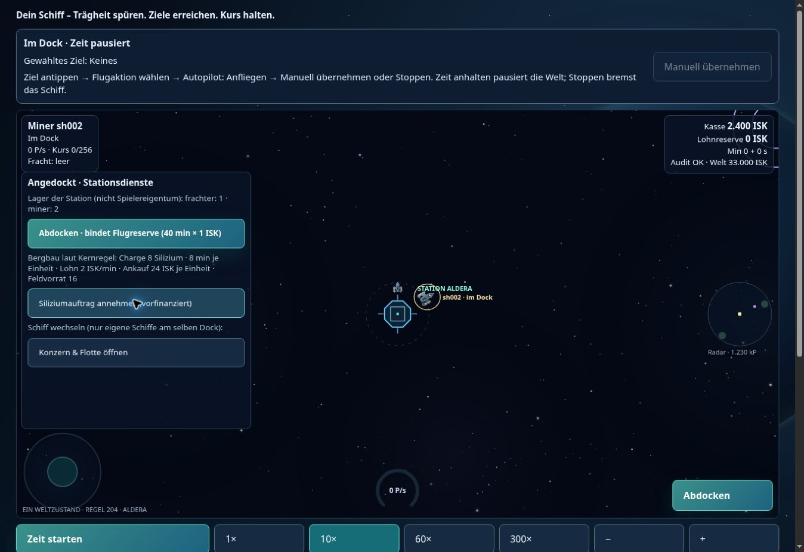
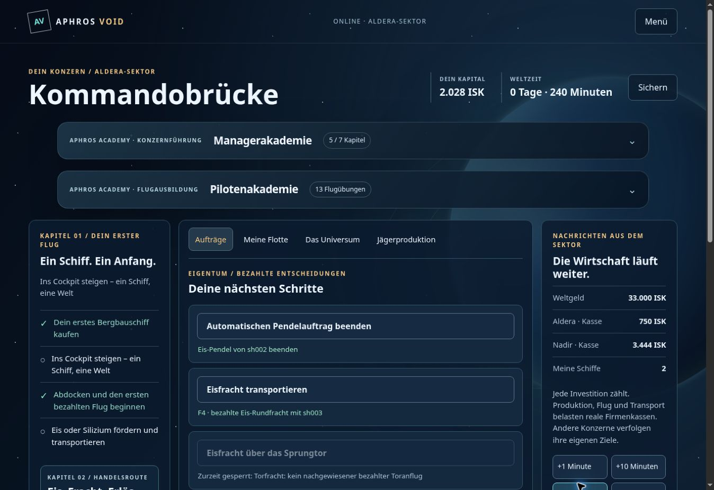
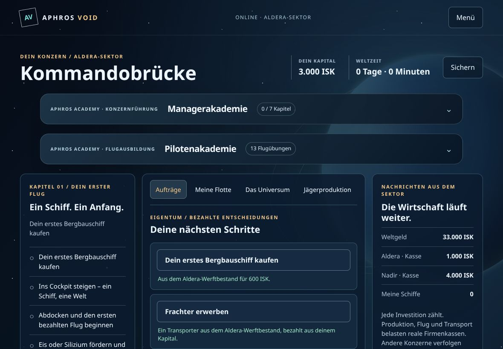
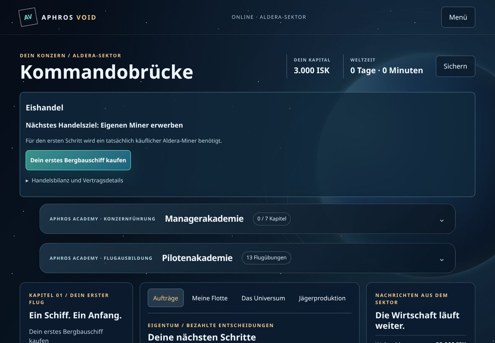
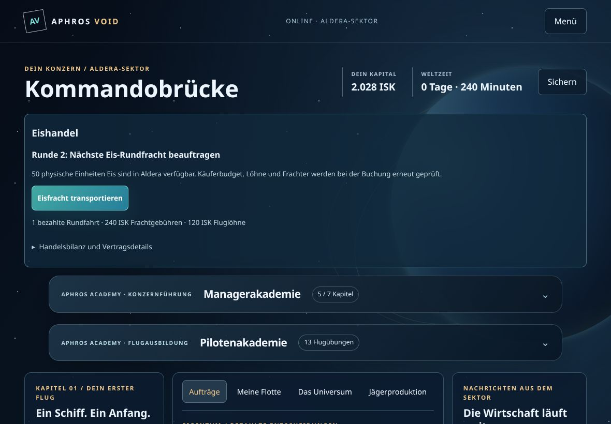

# P1 · Spielerlebnis-Audit Aphros Void

**Gesamtwertung 6/10.** Die normale Karriere ermöglicht einen bezahlten ersten Eistransport ohne externe Anleitung. Der erste Versuch endete jedoch bei einem ausverkauften Frachterangebot, nachdem das Spiel zuerst zum Cockpit und zum Flug aufgefordert hatte. Erst im zweiten Versuch, mit Frachterkauf vor dem Zeitfortschritt, wurde die Lieferung samt Rückkehr bezahlt.

## 1. Geprüfter Stand und Methode

- **Öffentliches Spiel, 19.11.2026:** [Root](https://tobiasfranziskus.github.io/Check/) und der von dort verlinkte Karriereeinstieg. GitHub meldete einen erfolgreichen [Pages-Deploy](https://github.com/tobiasfranziskus/Check/actions/runs/44348354008) für [`97214df1c8650b08f21fdb15d9421aafbe096ecc`](https://github.com/tobiasfranziskus/Check/commit/97214df1c8650b08f21fdb15d9421aafbe096ecc). Karriere-HTML, Karriere-JS und Handelsmodul stimmten bytegenau mit diesem Commit überein. Der abgefragte `main` zeigte denselben Commit.
- **Interaktiver Erstkontakt:** Chrome im Work-Cloud-Browser, Screenshotformat 1.348 × 926. Aktionen über sichtbare Spielbedienelemente, Tastatur und Spielzeitknöpfe. Beide normalen Karrieren begannen mit deaktivierten Opt-ins. Der erste Durchlauf nutzte ausschließlich Hinweise aus dem Spiel. Der zweite Durchlauf nutzte die Erkenntnisse aus dem ersten. Der erste Teststand wurde beim Neustart über das vom Spiel angebotene Verfahren als vorheriger Teststand aufbewahrt.
- **Projektabgleich:** [Entwicklungsregeln](../AGENTS.md), [Roadmap](ROADMAP.md) und [Projektstatus](PROJEKTSTATUS.md) wurden vor der Implementierung geprüft. Die P3-Entwürfe [#505–#511](https://github.com/tobiasfranziskus/Check/pull/511) betreffen unter anderem Warteschlange, Priorität und zweiten F4-Frachter. W6-Langzeitregime und Rohstofferneuerung stehen unter anderem in [#490](https://github.com/tobiasfranziskus/Check/pull/490) und [#470](https://github.com/tobiasfranziskus/Check/pull/470). Diese Forschungsbefunde fließen nicht in die Spielwertung ein. Die veröffentlichte Prologoption „Erweiterte Wirtschaftssimulation“ und die separate experimentelle Dravos-Karriere wurden im Menü identifiziert. Ihre Wirtschaftsabläufe waren nicht Teil des Erstkontakts. Der klassische Wirtschaftsbereich am Root zeigt eine eigene Regel195-Oberfläche mit separatem Spielstand. Die getestete normale Karriere zeigt Regel204.
- **Aussagegrenze:** Simulierter Erstkontakt eines einzelnen Testers. Die Spalte „Erwartung und mögliche Reaktion“ beschreibt Hypothesen. Es gab keine einstündige Beobachtung menschlicher Testpersonen.

## 2. Chronologisches Spielprotokoll

| Schritt und Aktion | Im öffentlichen Browser beobachtet | Erwartung und mögliche Reaktion |
| --- | --- | --- |
| 1. Root → „Karriere öffnen“ → „Neue Karriere“ | Hauptzugang klar. Klassische Wirtschaft und Jägertraining sind ebenfalls sichtbar. Der Prolog stellt vier Unternehmen bzw. Orte sowie zwei optionale Startprofile vor. Das erste Ziel lautet, einen Miner zu erwerben und selbst zu fliegen. | „Karriere“ ist die intuitive Wahl. Einsteiger könnten „klassisch“ auf Root und im Prolog für denselben Modus halten. |
| 2. „Karriere in Aldera beginnen“ → „Dein erstes Bergbauschiff kaufen“ unter „Aufträge“ | 3.000 → 2.400 ISK, ein eigener Miner, Fortschritt 1/7 in der Managerakademie. Das Journal nennt als Nächstes das Cockpit. Die darunterstehende Handelskarte nennt gleichzeitig den Frachterkauf. Der alte Kaufknopf bleibt mit derselben Erstkauf-Aufschrift verfügbar. | Der bezahlte Kauf überzeugt. Die konkurrierenden Ziele machen unklar, welches zuerst kommt. |
| 3. „Meine Flotte“ → „Selbst fliegen“ | Eigener Miner sh002 steht in Aldera im Dock. Das Spiel öffnet ein 2D-Cockpit mit Sternen, Radar, Dockmenü, Reserve und Objektauswahl. | Die Übernahme belohnt den Kauf visuell. Das Journal liefert keine direkte Verbindung zum Schiffsplatz. |
| 4. „Siliziumauftrag annehmen (vorfinanziert)“ | Der Knopf im Aldera-Dock ließ sich drücken. Die Annahme scheiterte mit „Kern lehnt ab: J2b: nur rechtmaessig in Nadir gekaufte K2-Miner“. Der Kontostand blieb bei 2.400 ISK. | Ein deutlich sichtbarer, vermeintlich passender Auftrag erzeugt eine falsche Erwartung. Die Rückmeldung sagt weder in einfacher Sprache, was hier angeboten wird, noch wo der Aldera-Miner sinnvoll einsetzbar ist. |
| 5. „Abdocken“ im Dockmenü → Zeit anhalten/starten → 300× → Pfeiltaste → Eisfeld → „Autopilot: Anfliegen“ | Abdocken band die angezeigte Reserve von 40 ISK und startete die Zeit bei 10×. „Legt ab“ wurde zu „Freier Flug“. Tastatureingabe wechselte die Anzeige zu „Handflug“. Der Autopilot verringerte die angezeigte Distanz von rund 1,07 Mio. auf 71.930 P. Bei Minute 99 + 41 s stand sie weiterhin dort. Ein abgeschlossener Anflug oder persönlicher Abbau wurde in dieser Folge nicht belegt. | Trägheitsflug und das eigene Schiff machen neugierig. Zwei Abdockknöpfe, getrennte Zeit- und Stoppaktionen, abstrakte Einheiten und eine langsam sichtbare Fortschrittsanzeige verlangen viel Nachlesen im Cockpit. |
| 6. „Konzern & Flotte“ → „Aufträge“ → Frachter und Eisförderung | Im fortgeschrittenen Teststand waren die Frachterangebote in Aldera und Nadir ausverkauft. Eisförderung war für den abgedockten Miner gesperrt: „K1: Pendelauftrag nur aus dem Dock“. Die erste Handelsrunde war in diesem Durchlauf nicht erreichbar. | Einsteiger folgen dem ersten Flugauftrag und erfahren zu spät, dass Zeit auch Kaufangebote verändert. Der Weg zurück zur nächsten sinnvollen Aktion fehlt. |
| 7. Akademien, Universum und Jägerproduktion | Managerlektion „Einen Frachter erwerben“ geöffnet. Ihr Kaufknopf war ebenfalls gesperrt. Pilotenakademie zeigte 13 Übungen samt dock- und schiffsabhängigen Voraussetzungen. „Das Universum“ zeigte Stationen, Lager, Firmenkassen und Angebote. „Dein erster Jäger“ zeigte 900 ISK Preis, aber 0 Silizium, 0 Bauteile und 0 fertige Hüllen in Nadir. Kauf und Jägerlektionen blieben gesperrt. Auf dem Root öffnete „Jägertraining“ eine separate Prototypansicht, deren Flugoptionen ohne Beispieljäger oder Import gesperrt waren. | Die Akademien geben dem Spiel Substanz. Leser könnten „Das Universum“ für eine interaktive Flugkarte halten. Beim Jäger erklären technische Tabellen die Produktionskette, bieten für diesen Spielstand aber keinen kurzfristigen Erfolg. Die Beispielkarriere wurde für das Audit nicht gestartet. |
| 8. „Sichern“ → Seite neu laden → „Karriere fortsetzen“ | Browser meldete lokale Sicherung. Reload stellte über „Karriere fortsetzen“ Minute 108 und 2.255 ISK wieder her. | Das Fortsetzen funktioniert über den erwarteten Weg. Eine dauerhafte Anzeige der letzten Sicherung würde den Status leichter erkennbar machen. |
| 9. Zweiter normaler Start → Miner → Frachter → „Eisförderung beginnen“ | Beide Schiffe am Start kaufbar. 600 ISK für den Miner und 750 ISK für den Frachter. Kasse danach 1.650 ISK. Der finanzierte Eispendel startete vom Dock. | Die Kasse zeigt den Einsatz sofort. Der Ablauf ist gut verständlich, sobald klar ist, dass Förderung als Firmenauftrag auf der Brücke beginnt. |
| 10. Zweimal „+60 Minuten“ → „Eisfracht transportieren“ | Nach 60 Minuten 0 Eis im Lager und 1.510 ISK in der Kasse. Nach 120 Minuten 50 Eis und 1.779 ISK. Der eigene Frachter sh003 konnte die Ladung übernehmen. Bei Buchung sank die Kasse um 120 auf 1.659 ISK. | Die erste Charge ist ein echtes Erfolgserlebnis. Ein sichtbarer Zeit- oder Mengenfortschritt würde den ersten Zwischenstand mit 0 Eis verständlicher machen. |
| 11. Je einmal „+60 Minuten“ für Hin- und Rückfahrt | Minute 180: 60 ISK Fluglöhne, noch keine abgeschlossene Rundfahrt. Minute 240: eine abgeschlossene Rundfahrt, 240 ISK Frachtgebühr, 120 ISK Fracht-Arbeitskosten, 2.028 ISK freie Kasse, 50 Eis für Runde 2. Der Journalhaken „Eis oder Silizium fördern und transportieren“ war zwischenzeitlich vor der Lieferung gesetzt und nach der Rundfahrt wieder leer. | Die Auszahlung und die nächste verfügbare Ladung motivieren. Der flüchtige Journalhaken untergräbt das sichtbare Erfolgserlebnis. |
| 12. „Sichern“ → „Spielstand als JSON sichern“ | Der Browser meldete eine abgeschlossene JSON-Dateiübertragung. Der Wiederimport dieser Datei war nicht Teil des öffentlichen Ersttests. | Ein Export ist gut auffindbar. Die Wiederaufnahme wurde in Schritt 8 bereits über den lokalen Slot geprüft. |

**Wirtschaftliches Ergebnis.** Die erste Rundfahrt zahlte 240 ISK bei 120 ISK direkten Frachtlöhnen. Die Differenz von 120 ISK ist ein Teilresultat vor Verschleiß. Vom Kauf beider Schiffe bis zur ersten vollständigen Rundfahrt stieg die freie Kasse von 1.650 auf 2.028 ISK. In dieser Zeit arbeitete der Miner parallel weiter. Der Kassenanstieg von 378 ISK enthält deshalb mehr als nur das Frachtergebnis. Bei Spielstart lagen 3.000 ISK in bar vor. Zwei gekaufte Schiffe und gebundenes Kapital machen einen Vergleich allein anhand der freien Kasse unvollständig.

## 3. Bildbelege

**Öffentliches Cockpit in Aldera.** Das Angebot „Siliziumauftrag annehmen“ erscheint neben zwei Abdockaktionen. Die Ablehnung steht im Browser weiter unten als der gezeigte Ausschnitt. Reproduktion in Schritt 4. Der [Ausschnitt der Ablehnung](bilder/p1-spielerlebnis/05-vorher-siliziumsperre.jpg) stammt aus der Wiederholung mit demselben veröffentlichten Code im Chromium-Touch-Viewport.

**Öffentliche Brücke nach der bezahlten Rundfahrt.** Oben stehen Minute 240 und 2.028 ISK. Der Abschlussbeleg der Handelskarte beginnt erst unterhalb des ersten sichtbaren Ausschnitts. Der offene Journalhaken ist links sichtbar.

## 4. Wertung des veröffentlichten Stands

| Kategorie | /10 | Begründung |
| --- | ---: | --- |
| Spielidee | 8 | Der Wechsel zwischen Unternehmensführung und eigenem Cockpit gibt Besitz, Transport und Kosten einen spielerischen Zusammenhang. |
| Wirtschaftssimulation | 8 | Begrenzter Werftbestand, gebundene Löhne, tatsächlich produzierte Ladung und Bezahlung der Fracht prägen das Spielergebnis. |
| Flugsteuerung | 6 | Eigenes Cockpit, Handflug und sichtbarer Autopilot sprechen an. Zeitsteuerung, Einheiten und Zielerreichung verlangen Einarbeitung. |
| Grafik und Atmosphäre | 7 | Startseite und Sternenhimmel geben dem Spiel einen eigenen Ton. Auf der Brücke fällt die Atmosphäre gegenüber den vielen Berichtsblöcken ab. |
| Benutzeroberfläche | 5 | Vorhandene Funktionen verteilen sich über Journal, Handel, Tabs, Akademien und Cockpit. Wichtigkeit ist optisch oft schwer zu erkennen. |
| Verständlichkeit ohne Anleitung | 4 | Start und Minerkauf sind klar. Der Flugpfad kann den frühen Handelsweg versperren und bietet einen auf diesem Schiff unzulässigen Auftrag an. |
| Motivation und Karrierefortschritt | 6 | Kauf, Cockpit und erste Auszahlung sind greifbar. Widersprüchliche Haken und ein schwacher Ausblick auf das nächste größere Ziel bremsen. |
| Langzeitspielspaß | 5 | Vorläufige Einschätzung. Wirtschaftliche Folgeentscheidungen sind interessant, die frühe Wiederholung besteht aber stark aus Zeitschritten und Tabellen. |
| Technische Zuverlässigkeit | 7 | Einstieg, Flugbeginn, Buchung, Export und lokale Fortsetzung liefen. Die Wertung gilt für die getesteten Pfade. |
| Gesamtbewertung | **6** | Eigenständige Wirtschaft mit einem spielbaren frühen Kreislauf, dessen Bedienung Einsteiger unnötig lange beschäftigt. |

### Zielgruppen und qualitative Vergleichspunkte

- **Wirtschaftsstrategen** sind die stärkste Zielgruppe. Begrenztes Betriebskapital und konkurrierende Käufer erzeugen sinnvolle Entscheidungen. Die Brücke sollte Auswirkung und nächste Option im selben Blick zeigen.
- **Weltraum-Sandbox-Spieler** finden im Schiffseigentum und Wechsel ins 2D-Cockpit einen Grund zum Ausprobieren. Für längeres Erkunden braucht es sichtbare, befliegbare Ziele und erreichbare Zwischenetappen.
- **Actionspieler** finden mit der Jägerlaufbahn einen Ausblick. Im geprüften Karriereeinstieg waren Rohstoffversorgung, Produktion und Kauf die Hürden vor der Action. Das separate Training verlangt ausdrücklich einen Beispiel- oder importierten Jägerstand.
- **Gelegenheitsspieler** können über den klaren Spielstart und kurze Akademieübungen einsteigen. Viele parallel angezeigte Optionen und unklare Sperren machen die erste Sitzung anstrengend.
- **X4: Foundations** ist der naheliegende Vergleich für das Zusammenspiel aus persönlichem Fliegen und wirtschaftlicher Disposition. Aphros Void vermittelt denselben Rollenwechsel in einer 2D-Ansicht und in deutlich kleinerem Umfang. [Egosoft zu Handel und NPC-Wirtschaft](https://www.youtube.com/watch?v=K0hCP1yuNe8)
- **EVE Online** ist ein Vergleich für die Bedeutung von Kapital, Handel und Schiffswahl. Die im Test erlebten Konkurrenten in Aphros Void sind simulierte Firmen. EVE baut seine Sandbox um andere Menschen, deren Märkte und Konflikte auf. [EVE Online](https://www.eveonline.com/)
- **Klassische Wirtschaftssimulationen** teilen mit Aphros Void die Freude an einer eingerichteten Route, die nachvollziehbar Ware und Erlöse bewegt. Eine leicht lesbare Abfolge von Bestand, Fahrt und Ergebnis wäre hier wertvoller als weitere Kennzahlen auf der Startbrücke.

## 5. Fünf priorisierte Verbesserungen

| Priorität | Hindernis | Änderung und Abnahmekriterium |
| --- | --- | --- |
| 1 | Der erste Flug konkurriert mit dem zeitkritischen Frachterkauf. | Den vorhandenen Handelsweg nach oben ziehen, Aktionen beschriften und früh auf den Frachterbestand hinweisen. Der Spieler sieht den Kaufknopf und weiß nach dem Minerkauf, warum die Reihenfolge wichtig ist. **In diesem Branch umgesetzt.** |
| 2 | Der Flugpfad trennt unzureichend zwischen Erkunden, Flugübung und wirtschaftlichem Auftrag. | Beim Schiffskauf einen direkten Weg zum Cockpit und beim Aldera-Dock eine passende Orientierung zum Eispendel anbieten. Die Flugakademie soll die vorhandene Rückkehrübung als freiwilliges Ziel sichtbar machen. |
| 3 | Sichtbare Aufträge können für das benutzte Schiff unerreichbar sein. Sperrtexte nennen interne Kürzel. | Siliziumangebot bereits anhand der vorhandenen Freigabe prüfen. „Benötigt einen in Nadir gekauften Bergbau-Miner“ am relevanten Knopf anzeigen. Den für das aktuelle Schiff passenden Auftrag unmittelbar daneben nennen, sofern vorhanden. |
| 4 | Die Brücke zeigt mehrere gleichrangige Ziele und Zahlenblöcke. | Je ein nächstes Handels- und Flugziel eindeutig platzieren. Wirtschaftsaudit und Vertragstiefe in aufklappbaren Bereichen zugänglich halten. |
| 5 | Der Missionserfolg fällt nach Entladung aus der Anzeige. | Gelieferte und bezahlte Runden anhand vorhandener Abschlussbelege dauerhaft markieren. Im selben Blick Frachtgebühr, direkte Kosten, Verschleiß und einen erreichbaren nächsten Investitionsschritt ausweisen. |

## 6. Umgesetzte Änderung

Der vorhandene Eishandel steht unter der Brückenüberschrift und vor den Akademien. Die Schaltfläche nennt den nächsten Kauf, Förderauftrag, Transport oder Zeitschritt. Nach dem Minerkauf erklärt der Text den begrenzten Frachterbestand. Bei fehlendem Schiff erscheint ein Hinweis auf die Angebote in „Das Universum“. Nach der Rückkehr zeigt die Karte die Rundfahrten sowie Frachtgebühren und Fluglöhne. Weitere Zahlen und die genaue Sperrursache bleiben unter „Handelsbilanz und Vertragsdetails“ zugänglich. Beim Wechsel auf die Brücke beginnt die Ansicht oben. Die Karte verwendet für Kauf, Förderung und Fracht die bereits geprüften Angebote und für Zeitfortschritt dieselbe bestehende Zeitfunktion. Spielregeln und Speicherformat wurden für diese Änderung nicht angefasst.

## 7. Prüfung des Branches

**Vorher und nachher bei 1.180 × 820 CSS-Pixeln mit Touch-Emulation.** Bei horizontal unveränderter Ansicht und Scrollposition 0 lag der alte Knopf bei y = 1.283 px und hieß „Originalauftrag ausführen“. Im Branch liegt der Minerkaufknopf bei y = 359 px und ist ohne Scrollen sichtbar.

Die Wiederholung im Branch begann aus der lokalen Root-Seite mit leerem Browserkontext. Die Karte führte vom Minerkauf über Frachter, Förderung und Zeitfortschritt zu einer bezahlten Rundfahrt bei Minute 240. Aus der Karte waren die 240 ISK Gebühren, 120 ISK Fluglöhne und Runde 2 direkt ablesbar. JSON-Download und Fortsetzen nach Reload funktionierten.

- **Node 22:** [Gesamtregression für den Codecommit](https://github.com/tobiasfranziskus/Check/actions/runs/44566049934). Der [W5-Job mit vollständiger Node-22-Suite](https://github.com/tobiasfranziskus/Check/actions/runs/44566049861) war für denselben Codecommit grün. Der lokale vollständige Lauf vor der abschließenden Scrollkorrektur hatte 532/532 bestanden. Der lokale Buildcheck meldete `W5_SINGLEFILE_OK`.
- **Browser-CI:** [P1-Workflow](https://github.com/tobiasfranziskus/Check/actions/runs/44566049807) mit Chromium und WebKit. Die Handelsregression bestand in beiden Browsern auf je vier Touchgrößen (1.180 × 820, 1.024 × 768, 820 × 1.180 und 390 × 844), die sichtbare Kaufaktion, den Hinweis vor dem Flug, echte Folgerunden, Vertragsdetails, Save/Load und die bestehenden Audit- und Geldinvarianten.
- **Lokale Browserumgebung:** Der installierte Desktop-Chromium konnte wegen verweigerter lokaler Sockets nicht starten. Der Vorher-Nachher-Test lief deshalb mit Chromium Headless Shell. Lokales WebKit scheiterte an fehlenden GTK-/Systembibliotheken. Die WebKit-CI verwendet eine vollständige Testumgebung. Touch-Emulation und WebKit-CI sind Browserprüfungen. Die Abnahme auf einem physischen iPad und auf dem privaten NAS steht aus.

## 8. Revision und offene Grenzen

[Arbeitsbranch](https://github.com/tobiasfranziskus/Check/tree/ux/p1-karriere-einstieg) · [Codecommit `728d755`](https://github.com/tobiasfranziskus/Check/commit/728d755f6ca60da3a8439f22bd6e290e6ea088db) · [Draft-PR #512](https://github.com/tobiasfranziskus/Check/pull/512).

Die Cockpit-Siliziumsperre, der wechselnde Journalhaken und die Erreichbarkeit des Karrierejägers sind separate Befunde. Weitere wirtschaftliche Kreisläufe und reale iPad-Safari-/NAS-Abnahme bleiben außerhalb der beobachteten Erstspielerfahrt.

## 9. Würde ein neuer Spieler freiwillig länger als eine Stunde bleiben?

**Ein wirtschaftsaffiner Spieler könnte bleiben. Für einen durchschnittlichen Neueinsteiger ist es auf dem geprüften Pages-Stand eher unwahrscheinlich.** Die erste selbst bezahlte Fracht gibt einen konkreten Grund weiterzuspielen: Mit gekauftem Schiff, gefördertem Eis und gebuchtem Erlös hat die eigene Entscheidung etwas verändert. Der veröffentlichte Einstieg macht genau dieses Erlebnis zu leicht verpassbar. Wer zuerst dem Flugziel folgt, kann nach einem abgelehnten Auftrag und einem ausverkauften Frachter zurückbleiben. Nach dem ersten Erfolg braucht es außerdem ein sichtbares größeres Ziel, etwa die nächste Flotteninvestition oder eine erreichbare Flugprüfung. Das ist eine UX-Einschätzung aus zwei geführten Selbstversuchen, keine gemessene Ein-Stunden-Bindungsrate.
