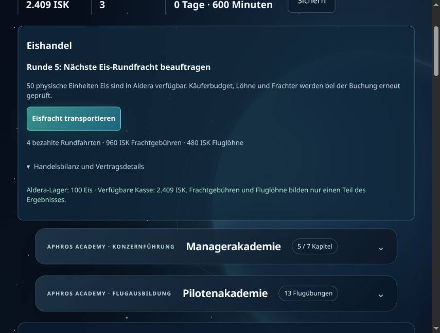

# Öffentlicher Manager-Erstspieltest · 20.11.2026

**[ANALYSE / LIVE-BROWSER / KEIN RELEASE-GATE]** Vier tatsächlich interaktiv abgeschlossene, bezahlte F4-Rundfahrten ohne eigenes Pilotencockpit; zweiter Miner rechtmäßig gekauft und beauftragt; Käuferkapital und Wasserknappheit beobachtet; Save/Load und JSON-Wiederaufnahme geprüft. Kein Spiel-/Wirtschaftscode geändert. M1–M4 werden dadurch nicht pauschal abgenommen. 600 **Spielminuten** sind keine 60 Minuten beobachtete Erstspieler-Retention.

## Ausgangsstand und Nachweisgrenzen

- Repository: [tobiasfranziskus/Check](https://github.com/tobiasfranziskus/Check), `main ca8a41960ca41033326d7b105c974d55b083fb79` (20.11.2026 06:49:32 CET), Baum `f43f5e929bd7a3401ef03b75dd1309b2679fcaad`. Der lokale Aufgabenordner enthielt anfänglich keinen Git-Checkout; öffentlicher Stand separat in einem temporären Checkout gelesen, keine vorhandenen Änderungen überschrieben.
- `AGENTS.md`, `docs/ROADMAP.md`, `docs/PROJEKTSTATUS.md`, Manageradapter, J8-Sitzung und relevante Tests auf diesem SHA gelesen. Management-first M0–M4 maßgeblich; keine neuen Piloten-, Kampf-, Preis-, Finanzierungs- oder Prioritätsregeln.
- [Pages #44683590027](https://github.com/tobiasfranziskus/Check/actions/runs/44683590027): `completed/success`, Head exakt `ca8a4196`, fertig 06:50:16 CET. Dies belegt Deployment, nicht Geräteabnahme.
- Tatsächlich geöffnet: [Root](https://tobiasfranziskus.github.io/Check/) → Link „Wirtschaftsmanager“ → [Standardkarriere](https://tobiasfranziskus.github.io/Check/prototypes/spiel/index.html). Kein Query-Prototyp, keine vorbereitete Forschungswelt, keine Console-Befehle, kein programmatisches Setzen von Geld oder Ware. Erweiterte und experimentelle Karriere blieben abgewählt.
- **Browserabweichung:** Die Werkzeug-Inventur bot nur ChatGPT-integrierten Browser und MCP-App-Oberflächen an, keinen Cloud-Chrome/Desktop. Der tatsächliche interaktive Durchlauf erfolgte im integrierten Browser. Ein ausdrücklich verlangter Cloud-Chrome-Lauf ist damit **offen**, nicht still als erledigt markiert. Browser-Engine/Touchmatrix wurden hier nicht gesondert nachgewiesen.
- Shell-Netzwerk zunächst DNS-Fehler beim Clone; autorisierter externer Lesezugriff anschließend erfolgreich. Öffentliche HTTP-Dateien zusätzlich unabhängig byteverglichen, siehe unten.

## Tatsächlich ausgeführtes Interaktionsprotokoll

Alle Kauf- und Auftragsaktionen erfolgten über sichtbare UI-Knöpfe. Angaben zu unverändertem Weltgeld beruhen zusätzlich auf den gespeicherten Zuständen und unabhängiger Summierung.

| Nr. | Weltminute | Tatsächliche Interaktion / Beobachtung |
| --- | ---: | --- |
| 1 | – | Öffentliche Root geladen; „Wirtschaftsmanager“ geklickt. Karriere fortsetzen zunächst deaktiviert. |
| 2 | – | „Neue Karriere“; Prolog gelesen. Beide optionalen Weltmodi abgewählt belassen. Warnung, beide Schiffe vor Zeitfortschritt zu kaufen, sichtbar. |
| 3 | 0 | „Karriere in Aldera beginnen“: 3.000 ISK, null eigene Schiffe, 33.000 Weltgeld. |
| 4 | 0 | Handelskarte „Dein erstes Bergbauschiff kaufen“: eigener `sh002`, 600 ISK bezahlt, Firmenkasse 2.400. |
| 5 | 0 | „Frachter erwerben“: eigener `sh003`, 750 ISK bezahlt, Kasse 1.650. Weitere Frachterangebote Aldera/Nadir: kein Komplettschiff auf Lager. |
| 6 | 0 | „Eisförderung beginnen“: Original-Pendelauftrag `sh002`. Handelsdetails aufgeklappt: noch null Eis im Aldera-Lager. |
| 7 | 60 | Einmal „60 Spielminuten weiter“: Kasse 1.510, Lager null Eis. Förderung noch unterwegs. |
| 8 | 120 | Noch einmal derselbe Zeitschritt: Kasse 1.779, Lager 50 Eis; echter Frachtknopf angeboten. |
| 9 | 120 | „Eisfracht transportieren“: 50 Eis aus Quelllager, Kasse 1.659 (120 ISK Flugfinanzierung); weiterer Frachtauftrag korrekt wegen nicht angedocktem Schiff gesperrt. |
| 10 | 180 | +60 über Handelskarte: Lieferung, aber noch kein abgeschlossener Rundfahrtzähler; Kasse 1.519. |
| 11 | 240 | +60: erste vollständige Rückkehr; 1 Rundfahrt / 240 Gebühren / 120 direkte Frachterlöhne; Kasse 2.028, nächste 50 Eis vorhanden. |
| 12 | 240 | Folgefracht gebucht: Kasse 1.908. |
| 13 | 300 | +60: 1 abgeschlossene Runde / 240 Gebühren / bereits 180 kumulierte Frachterlöhne (zweiter Auftrag unterwegs). Kasse 1.768; Aldera 5 ISK. |
| 14 | 360 | +60: zweite Rückkehr; 2 Runden / 480 Gebühren / 240 Löhne, Kasse 2.310; 50 Eis Aldera, 33 Wasser, Käuferkasse 255. Reinvestitions-/Wasser-/NPC-Karten erschienen. |
| 15 | 360 | JSON exportiert (`tick360.json`); Screenshot; „Sichern“ geklickt; Seite neu geladen. |
| 16 | 360 | „Karriere fortsetzen“ geklickt; Kasse, Zeit, Eigentum und zwei Frachtabschlüsse wieder sichtbar. Zweiter JSON-Export **bytegleich** zum ersten (SHA-256 unten). |
| 17 | 360 | Dritte Fracht über Handelskarte gebucht: Kasse 2.190. |
| 18 | 420 | +60: Aldera 8 ISK, null Wasser; privater Lohn 373. Wasserkarte rechnet 16 Wasser / 256 ISK, behauptet „wirklich vorhanden“, während Kauf korrekt gesperrt ist. Kein Wasser gekauft. |
| 19 | 480 | +60: dritte Rückkehr, 720 Gebühren / 360 Löhne; Kasse 2.594. Wasser wieder 35, Aldera 258. Der vorherige Engpass war zeitweise, kein bewiesener Dauerstillstand. |
| 20 | 480 | „Miner verbindlich kaufen (600 ISK)“: eigener `sh004`, Kasse 1.994, drei eigene Schiffe; Restbuchwert/Kassensumme vor und nach Kauf identisch 3.751 ISK. |
| 21 | 480 | „Original-Eisförderung beauftragen“ für zusätzlichen Miner: Original-Pendel `sh004`; kein kostenloser Fördererfolg behauptet. |
| 22 | 480 | Vierte Fracht gebucht: Kasse 1.874. |
| 23 | 540 | +60: Kasse 1.594; Aldera 13 ISK, null Wasser. Wieder irreführender Text: „15 wirklich vorhandene Einheiten“ für 240 ISK, aber gesperrt wegen fehlendem realen Wasser. |
| 24 | 600 | +60: vierte Rückkehr; 4 Runden / 960 Gebühren / 480 direkte Frachterlöhne; Kasse 2.409, privater Lohn 606, Aldera 3 ISK, 100 Eis / 37 Wasser. Vor Wasserentscheidung JSON exportiert. |
| 25 | 600 | „16 Wasser für 256 ISK privat kaufen“: privater Lohn 606→350, Aldera 3→259, Wasser 37→21, Firmenkasse unverändert 2.409. JSON nach Kauf exportiert. Kein Tickfortschritt. |
| 26 | 600 | „Meine Flotte“ geöffnet: `sh002` Miner, `sh003` Frachter, `sh004` Miner in Aldera; Miner mit Pendelhinweis, Frachter leer am Dock. Kein „Selbst fliegen“ geklickt. |
| 27 | 600 | „Das Universum“ geöffnet: Stationen/Lager/Kassen und echte Kaufangebote gelesen. Asterion hat trotz 2.000 ISK keine Schiffe; beide Frachtermärkte leer, Nadir ohne Material/Erz/Bauteile. |
| 28 | 600 | „Sichern“, Reload, „Spielstand importieren“, originale selbst exportierte Datei nach Wasserkauf ausgewählt. Überschreibdialog mit Vorversionssicherung erschien. |
| 29 | 600 | Beim anschließenden Versuch, den Dialog über das Werkzeug zu bestätigen, war er bereits verschwunden (`undefined`); nächste Beobachtung zeigte die wiederaufgenommene geprüfte Karriere. **Wer den Dialog abgeschlossen hat, ist nicht gesondert belegt.** Importergebnis deshalb nur als beobachtete Wiederaufnahme nach Dateiauswahl bewerten. |
| 30 | 600 | Erneuter JSON-Export ist bytegleich zum gewählten Nach-Wasser-Original; Handelsdetails aufgeklappt, Abschlussscreenshot gesichert. Endstand bleibt offen im Browser. |

Die Navigation/Dateiauswahl wurde tatsächlich ausgeführt; weder Dialogkontrolle noch ein Wechsel auf ein zweites Gerät werden aus der JSON-Gleichheit abgeleitet. Ein JSON-Import unter frischer Origin, ein defekter Import und die Wiederherstellung des separaten Vorversionsslots wurden nicht durchgeführt.

## Originalbelege und unabhängiger Abgleich

Die unveränderten Browserexporte liegen in `belege/`; sie enthalten das vollständige öffentlich erzeugte Testspiel, keine persönlichen Zugangsdaten. `unabhaengiger-audit.json` enthält die Ergebnisse des Original-Core-Audits und separate Nachrechnungen. Mit Node 22 ausführbar: `node belege/replay-audit.cjs /pfad/zum/checkout-auf-ca8a4196` (Schreibrecht im Belegordner erforderlich).

| Zustand | Firmenkasse | Privatlohn | Aldera-Kasse | Original-Core-Hash |
| --- | ---: | ---: | ---: | --- |
| Tick360 nach zwei Runden | 2.310 | 303 | 255 | `1df0f18ff779fd4c` |
| Tick600 vor Wasserkauf | 2.409 | 606 | 3 | `8bd33848deabf150` |
| Tick600 nach Wasserkauf / nach Dateiwiederaufnahme | 2.409 | 350 | 259 | `b0ff084a87dbbf89` |

SHA-256: Tick360 `bff016bb816b6da41e5e9d7a277eb1f70532feb71b5b28df73395edc0b240b28`; Tick600 vorher `023a36ffcca22c05df255aa729a88ba5b096bb0ac9bfaa45d3cb563438178672`; Tick600 nachher und Wiederaufnahme `db32264aed71ffe6060f4981c4b58e4007fd85704df71b03685012991267b4dd`. Dateihash und Core-Hash sind unterschiedliche Nachweise.

Original `kanon.spielerFrachten.auftraege` für `house/sh003`:

| Start | Lieferung | Rückkehr/Abschluss | Eis | Frachtgebühr | Direkte Fluglöhne |
| ---: | ---: | ---: | ---: | ---: | ---: |
| 120 | 180 | 240 | 50 | 240 | 120 |
| 240 | 300 | 360 | 50 | 240 | 120 |
| 360 | 420 | 480 | 50 | 240 | 120 |
| 480 | 540 | 600 | 50 | 240 | 120 |

- Alle vier Exporte vom Original-J8-Lader und Welt-Audit akzeptiert; Geld-/Güter-/Flug-/Finanzierungs-/Vollkosten-/Vertragsprüfungen `ok`, keine Core-Auditfehler. Unabhängig alle Kontenkassen summiert: jeweils **33.000 ISK**, Mint/Burn jeweils **0**. Finanzierung aus endlichem Exportkonto, keine neue Geldquelle.
- Unabhängig sämtliche `ledger`-Warensalden mit physischen Stationslagern und Schiffsladungen verglichen. Tick360: 150 Eis gefördert −80 verarbeitet =70 Bestand (50 Aldera+20 Nadir); 80 Wasser−8 Konsum=72 (33+39). Tick600 vor Wasserkauf: 300 Eis−180 Verarbeitung=120 (100+20); 180 Wasser−91 Konsum=89 (37+52); 351 Erz−350 Export=1 an Bord. Keine erfundene Lieferung.
- Original-Kaufereignisse: `sh002` 600 ISK und `sh003` 750 ISK Tick0; `sh004` 600 ISK Tick480. Eigentümer aller drei `house`, NPC-`sh001` unverändert `npc3`. Vier Miner als Startlager: drei verbrauchte Hüllen (NPC+zwei Spieler), eine verbleibende Lagerhülle; ein Starterfrachter vollständig durch Spielerkauf verbraucht. Diese Hüllen sind bezahlte **Starterlagerware**, kein hier nachgewiesener W5-Neubau.
- Frachtgebühren 960 und Frachterlöhne 480 aus Originalaufträgen nachgerechnet; Löhne an privaten Spielerpiloten über ursprünglichen Buchungstyp `spielerfracht-pilot`. Weitere Miner-/Rückfrachtbuchungen bleiben getrennt. 960−480 ist **kein vollständiger Gewinn**, und Firmenkasse−Startkasse ist keine GuV.
- Wasserkauf unabhängig als Delta geprüft: Privatkonto −256, Stationskonto +256, Wasser −16; Firmenkasse konstant. Erst diese freiwillige reale Nachfrage machte den **nächsten Förderankauf** wieder finanzierbar. Bei Tick600 lag bereits Eis für weitere Fracht vor: kein allgemeines Frachtverbot aus Alderas 3 ISK ableiten.
- Exakt die interaktiv ausgeführte Befehlsfolge anschließend **separat im Originalkern wiederholt**, mit identischen UI-Auftrags-IDs und 60-Minuten-Schritten: Tick360, Tick600 vor und nach Wasser jeweils **byteidentisch** zum Browserexport. Dies ist ein zusätzlicher Replaynachweis, kein Ersatz für die oben protokollierten UI-Interaktionen. Replay-Audit zunächst unter Node20 erfolgreich, abschließend unter Node22 wiederholt.

## Auslieferungsabgleich

Direkter unabhängiger HTTPS-Abruf: folgende fünf Dateien bytegleich zum `ca8a4196`-Checkout (Stichprobe, kein Vollmanifest aller Assets):

| Datei | Bytes | SHA-256 |
| --- | ---: | --- |
| `index.html` | 338136 | `58517355730257d55e89d60e85995a861a5e4269784033f58c24256b05f2fc55` |
| `prototypes/spiel/index.html` | 26702 | `c9080cb9e74fde38aef286f35c30c3f1d99730f575359f22f9b018315efb49d3` |
| `prototypes/spiel/spiel.js` | 63261 | `df30b0bd90f3c0b300cfc74707db7059ad0da72d5e5ed1f47fe7d02ba7bbe8c9` |
| `prototypes/spiel/p3-handelsweg.js` | 6389 | `cb3116f11c5b00b1af9aa1773d064182da8056d67aef2311f9c6dca4b34bb390` |
| `prototypes/verbund/konzern-session.js` | 19184 | `858f8170bfe06fffd79d4b51d7f176481e3d482958a08b86edacae3ad4d2b38b` |

## Belegte Blocker und Grenzen

1. **UX-Fehler, priorisiert:** Wassertext bei Tick420/540 behauptet real vorhandene Ware trotz Bestand 0. Ausführung ist korrekt gesperrt; kein Geld-/Warenfehler beobachtet. Ursache im UI-Text `prototypes/spiel/spiel.js` um Zeile 306, nicht in Core-Preis oder Angebot. Das ist der klarste neue Korrekturauftrag.
2. **Nachvollziehbarkeit:** Die hochgezogene Handelskarte zeigt kumulierte Gebühren/Löhne; bei Tick300 stehen eine abgeschlossene Runde und schon Löhne der laufenden zweiten Runde nebeneinander. Aufgeklappte „Vertragsdetails“ zeigen lediglich Lager/Kasse und Kostenhinweis, keine Einzelaufträge/Gegenkonten. Für den unabhängigen Nachweis war JSON nötig. Kein falscher kumulierter Betrag behauptet, aber Zuordnung und Zahlungsphase bleiben unklar.
3. **Betriebsübersicht:** Flotte zeigt bei Tick600 zwei angedockte Miner, Pendel-Aufträge sind nur aus dem Sperrhinweis zum persönlichen Fliegen ersichtlich. Konkreter nächster Ankauf hängt zugleich an 100 Eis Lagerpuffer und Käufermitteln. Die Flottenansicht liefert keinen lesbaren individuellen Betriebs-/Wartegrund. Ein Auftrag allein ist kein Fördererfolg.
4. **Echte endliche Markt-/Logistikgrenze:** Einziger Starterfrachter gehört uns; Asterion hat null Hüllen, beide Frachterangebote leer. In Standardkarriere keine autonome Industrie beauftragt; bis Tick600 Nadir ohne Erz/Material/Bauteile, kein W5-Neubau. Ausbau darf nicht als garantiert beschrieben werden. Dieser Lauf beweist keine dauerhaft unlösbare Industrieblockade oder Notwendigkeit einer Regeländerung.
5. **Finanzierungsgrenze konkret:** Aldera zeitweise 5/8/13, am Tick600 nur 3 ISK gegenüber 250 ISK für nächsten Eisankauf. Teilweise fehlt gleichzeitig Wasser; am Tick600 funktioniert die vorhandene freiwillige Nachfrage. Mehr Miner garantieren weder Absatz noch Rentabilität. Keine Rescue-/Mint-/NPC-Steuerung eingesetzt.

## Priorisierte Codex-Arbeitspakete (je maximal ca. 30 Minuten)

Die Reihenfolge ist ein Vorschlag auf Basis dieses Audits, keine neue Wirtschaftsentscheidung. Je Paket nach Zeitbudget stoppen und Rest als neuen kleinen Auftrag ausweisen. **Vor Implementierung aktuellen main/PRs erneut prüfen.** Für jede UI-Änderung gelten Node22, betroffene Chromium-/WebKit-Touchgrößen, Save-Identität und Original-Buchungsaudit; deren vollständige Laufzeit ist ein separates Integrationsgate und keine 30-Minuten-Mergezusage.

### 1 · Hoch · Wasserbedarf von echtem Bestand unterscheiden (15–25 min)

- **Trigger:** Originalfolge bis Tick420/540; Aldera-Wasser 0, berechneter Bedarf 16 bzw. 15. UI nennt ihn dennoch „wirklich vorhanden“.
- **Dateiscope:** ausschließlich Wasser-Rendering in `prototypes/spiel/spiel.js`, bestehender `tests/p3-wasserlohn.test.mjs`; fokussierte Textprüfung im vorhandenen Karriere-Browsertest, falls innerhalb Budget.
- **DoD:** Bedarf als benötigte Menge bezeichnen; tatsächlichen Lagerbestand separat aus bestehendem Adapterfeld anzeigen. Bei null/zu wenig Bestand keine Verfügbarkeitsbehauptung; Core-Sperrgrund und deaktivierter Button bleiben unverändert. Tick600 mit 37 Wasser und Bedarf16 bleibt ausführbar. Keine neue Formel im UI.
- **Tests:** Originalzustände „0 vorhanden“, „weniger als Bedarf“, „genau ausreichend“, „Kasse schon ausreichend“; Rendern ändert Export/Hash nicht. Betroffene Textdarstellung in schmaler und iPad-Ansicht lesbar; vollständige Browsermatrix vor Integration.
- **Grenzen/Abhängigkeit:** keine Preis-, Kaufmengen-, Nachfrage- oder Kontenänderung; kann allein auf aktuellem main beginnen. Keine P3-Kernforschung benötigt.

### 2 · Hoch · Original-Frachtbelege in vorhandenen Details zeigen (25–30 min)

- **Trigger:** Tick300: 1 Abschluss, 240 Gebühren, 180 direkte Löhne; Vertragsdetails erlauben keine Zuordnung. JSON belegt die korrekten Einzelaufträge.
- **Dateiscope:** `prototypes/spiel/p3-handelsweg.js` nur lesendes Viewmodell, zugehöriges Detail-Rendering/Markup in `spiel.js`/`index.html`, `tests/p3-handelsweg.test.mjs`. CSS nur bei zwingend nötigem Tabellenumbruch.
- **DoD:** pro Original-F4-Beleg Schiff, Menge, Start/Lieferung/Rückkehr, offen/abgeschlossen und Originalgebühr/-lohn lesbar; laufende Gesamtlöhne ausdrücklich von abgeschlossenen Rundfahrten unterscheiden. Keine künstliche Buchungs-ID oder Gegenbuchung erfinden. Gebührenminuslohn bleibt als Teilbetrag vor übrigen Kosten gekennzeichnet.
- **Tests:** vor Fracht, geliefert aber nicht zurück, zwei fertige Runden plus offene Folge; Save/Load liefert gleiche Belegliste; Rendern exportidentisch; Originalaudit weiterhin ok. Browserdetails öffnen und nach Zeitfortschritt weiter nutzbar halten.
- **Grenzen/Abhängigkeit:** keine neue Buchung, kein persistent gespeicherter UI-Fortschritt, kein Schemawechsel. Auf Paket1 sequenziell aufbauen oder Änderungen an `spiel.js` getrennt integrieren.

### 3 · Mittel · Individuellen Minerauftrag in Flotte verständlich anzeigen (25–30 min)

- **Trigger:** Tick600 zwei eigene Miner am Dock, beide mit Pendelauftrag; der Manager sieht hauptsächlich die Sperre von „Selbst fliegen“.
- **Dateiscope:** bestehender Flottenrenderer `prototypes/spiel/spiel.js`, ggf. kleiner rein lesender Adapter, `tests/p3-reinvestition.test.mjs`/vorhandener Karriere-Browsertest. Kein Cockpitcode.
- **DoD:** je bestehender eigener Miner-ID den realen Auftrag und vorhandenen Core-Status benennen (beauftragt/unterwegs/angedockt). Aktuelle Förderquote bzw. globalen Käufer-/Lagerhinweis getrennt darstellen, sofern Originaldaten ihn belegen; **keinen individuellen Wartegrund aus bloßem Dockstatus erfinden**. Bei nicht eindeutig belegbarem Grund „Auftrag vorhanden; nächste Abnahme offen“. Keine automatische Zeit-/Auftragsaktion.
- **Tests:** sh002 alleine, zusätzlicher sh004, leeres/gefülltes Lager, knappe Käuferkasse, Stop und Reload; fremdes NPC-Schiff erhält keine Spieleraktion. Gleichheit von Export und Eigentum vor/nach Anzeigen.
- **Grenzen/Abhängigkeit:** keine neue Förderung, Kapazität oder Schiffszuordnung. Nach Paket2 wegen gemeinsamem Renderer bearbeiten; P3-Forschung unverändert lassen.

### 4 · Mittel · Standardkarriere und reale Ausbaugrenze erklären (20–30 min)

- **Trigger:** Standardlauf Tick600: kein Frachterlager in Aldera/Nadir, Asterion ohne Schiff, keine Nadir-Industriewaren; Oberfläche enthält bereits Werft-/Industrieversprechen und weitere Spielmodi.
- **Dateiscope:** bestehender Markt-/Sektorbericht in `prototypes/spiel/spiel.js`, zugehörige UI-Tests. Keine Startoption oder Migration neu implementieren.
- **DoD:** vorhandenes Karriereprofil verständlich anzeigen; fehlende Hülle als aktuellen Lagerzustand ausweisen, keinen künftigen Kauf garantieren. Bestehende Aufträge beobachten/mit aktuellem Frachter weiterarbeiten als belegte Optionen nennen. Erweiterte Simulation nur als bereits vorhandene **separate neue Karriereoption** erklären, bestehende Karriere nicht still umstellen.
- **Tests:** Standardexport Tick600 und vorhandene erweiterte Fixture; keine Aktion/Saveänderung beim Lesen; Originalangebote mit Sperrgrund unverändert, keine behauptete Nadir→Aldera-Verfügbarkeit.
- **Grenzen/Abhängigkeit:** kein Aktivieren der Industriepolitik, kein neues Schiffsangebot, keine NPC-Signatur, keine Ausweitung zur Industrieimplementierung. Mit M1 #522/#524 abgleichen, deren Marktadapter nicht duplizieren. Nach Paket3 oder separatem abgegrenztem Rendererabschnitt.

## Konfliktprüfung und Integrationsgrenzen

Offene PRs vollständig als Liste abgefragt (35 PRs): insbesondere [#496](https://github.com/tobiasfranziskus/Check/pull/496), [#501](https://github.com/tobiasfranziskus/Check/pull/501), [#505–#511](https://github.com/tobiasfranziskus/Check/pull/511) behandeln Werftfrachter, W5ac-Überführungsfenster, NPC-Fairness und J8-Guards. Sie bleiben isoliert. Keine ihrer Regeln, Tests oder Referenzhashes übernommen. [#490](https://github.com/tobiasfranziskus/Check/pull/490), #470/#469 und #423 betreffen W6/Dravos; kein Ausbau daraus abgeleitet. Offene [#514](https://github.com/tobiasfranziskus/Check/issues/514) betrifft Cockpit-Silizium und wurde hier nicht bearbeitet. Ältere Piloten-/Kampf-/Legacy-PRs bleiben unverändert. Keine PR geschlossen, kein Branch gelöscht, kein Merge ausgeführt.

Dieser Draft besitzt einen neuen eigenen Dokumentations-/Belegpfad. Die Arbeitspakete 1–4 berühren teilweise dieselbe UI-Datei und sollen **nacheinander** umgesetzt werden, nicht als konkurrierende Großänderungen. J8-/Weltkern, Regeldateien, Produktions-/Überführungspolitik, Save-Slots, `index.html` im Root und NAS-Einzeldatei sind außerhalb ihres Scopes. Vor einem späteren Merge vollständiges AGENTS-Integrationsgate mit Backup, Branchbasis, Node22/Geld/Waren/Eigentum/Save/Determinismus, betroffenen Browserprüfungen und eigenständigem Pages-Nachweis; aus diesem Analyse-Draft folgt kein Mergeauftrag.

## Prüfmatrix dieses Auftrags

| Ebene | Tatsächlicher Status |
| --- | --- |
| Öffentliche Root / interaktive Standardkarriere | tatsächlich gespielt, vier F4-Abschlüsse bis Tick600, kein Handflug |
| HTTP vs main | fünf benannte Dateien bytegleich; kein Vollassetmanifest |
| Original-Core-Audit und unabhängige Geld-/Waren-/Eigentumsrechnung | vier originale Exportdateien erfolgreich geprüft |
| Determinismus | identische nachgespielte Befehlsfolge bytegleich zu drei Browser-Checkpoints |
| Save/Load | manueller Save, Reload, Fortsetzen, Tick360-Exporte bytegleich |
| JSON | Export und Dateiauswahl/Wiederaufnahme, Nachher-JSON bytegleich; Dialogabschluss nicht separat kontrolliert |
| Node22-Gesamtregression | Ergebnis siehe `belege/teststatus.txt`; eingeschränkte Vorläufe abgebrochen, unter anderem `spawnSync git EPERM` in Archivprüfungen; nötige Prozessrechte für unveränderten Wiederholungslauf freigegeben |
| Neue Chromium-/WebKit-Touchmatrix | nicht ausgeführt; fremde CI nicht als eigener Lauf gezählt |
| Cloud-Chrome | nicht verfügbar, integrierter Browser als explizite Ersatzebene |
| Echtes iPad Safari / privates NAS | nicht getestet, kein NAS-Zugriff/Push |
| 60-Minuten-M4-Erstspiel-/Retentionsabnahme | nicht durchgeführt; kein vollständiges Management-Abnahmesiegel |
| W3→W4→W5-Neubau, zweite Frachterüberführung, Dravos, Langzeitkrisen | nicht gespielt, keine Nachhaltigkeits-/Profitabilitätsbehauptung |
| Defekter/alter/fremder Save, frisches Gerät, Vorversionsslot-Recovery | nicht getestet; Original-JSON erhalten |

